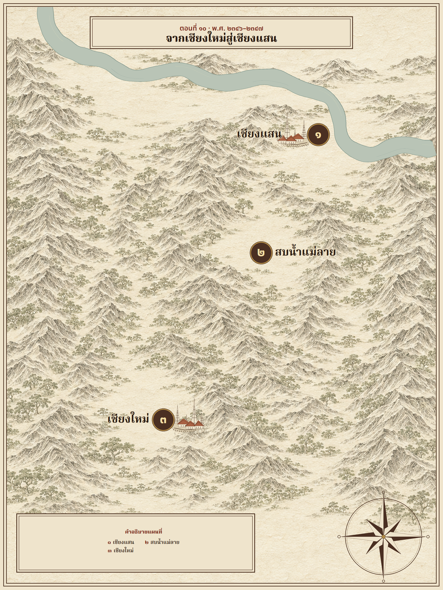

# ภาคที่ 4: เมืองหนึ่งฟื้น อีกเมืองเสียผู้คน
## ตอนที่ 10: เชียงแสน

> **หมายเหตุถึงผู้อ่านตอนที่ 10:** เนื้อหาตอนนี้เรียบเรียงจาก *ตำนานพื้นเมืองเชียงใหม่* (ฉบับพิมพ์ พ.ศ. 2514 ผูก 7 หน้า 111–114) อ่านจากภาพสแกนที่ตัดขยายครึ่งหน้าโดยไม่อาศัย OCR ถ้อยคำที่คัดมาทั้งหมดเป็นมุมมองและสำนวนของผู้บันทึกฝ่ายเชียงใหม่ ยังไม่มีเอกสารฝ่ายเชียงแสนหรือฝ่ายพม่ามาเทียบเคียงในตอนนี้ ศักราชในตัวบทใช้จุลศักราช (จ.ศ.) ซึ่งเมื่อบวก 1181 จะได้ปี พ.ศ. ตามการนับแบบไทยเก่าที่เริ่มปีใหม่ในเดือนเมษายน (เช่น จ.ศ. 1165 ตรงกับ พ.ศ. 2346 และ จ.ศ. 1166 ตรงกับ พ.ศ. 2347) และคงการระบุวันเดือนปีตามตัวบทโดยไม่แปลงเป็นวันที่สากล ตัวเลขกำลังพลและระยะเวลาเป็นตัวเลขตามตัวบท ส่วนชื่อราชสำนักสยามที่กรุงเทพฯ ตัวบทเรียกสลับกันระหว่าง "กรุงศรีอยุทธยา" กับ "กรุงเทพพระมหานคร" หรือ "กรุงเทพมหานคร" จึงคงตามตัวบทพร้อมอธิบายในวงเล็บ ผู้ที่จะนำไปอ้างอิงต่อควรตรวจทานกับต้นฉบับโดยตรงก่อน

---

### ฉากเปิด: ยามตูดเช้าที่เวียงเชียงแสนแตก

ใน **จ.ศ. 1166 (พ.ศ. 2347 ตามปีนับเก่า)** เดือน 10 ปฐมออก 5 ค่ำ วัน 3 ยามตูดเช้า ท้าวพระยาเชียงแสนไม่อาจต้านทานต่อไปได้จึง **"แตกออกเวียง"**

ผู้บันทึกฝ่ายเชียงใหม่ใน *ตำนานพื้นเมืองเชียงใหม่* หน้า 112 ไม่ได้หยุดบันทึกไว้เพียงชัยชนะของกองทัพ แต่ยังบันทึกภาพความโกลาหลที่เกิดกับผู้คนในเมืองด้วยถ้อยคำสั้น ๆ ว่า **"ข้าพัดเจ้า ลูกเต้าพัดพ่อพัดแม่ ผัวพัดเมีย"** ต่างพลัดพรากจากกันเป็นทุกขเวทนา ส่วน **นาขวา** ผู้เป็นเจ้าเมืองเชียงแสน พาลูกเมียข้ามแม่น้ำของหนีไปทางเมืองเกิ๋งและเมืองลี

ชัยชนะของเมืองหนึ่งจึงเริ่มต้นในเช้าวันเดียวกับที่อีกเมืองหนึ่งแตกสลาย และเปิดคำถามสำคัญของภาคนี้ว่า เมื่อเวียงเชียงแสนแตกแล้ว ชะตาของผู้คนในเมืองนั้นเป็นอย่างไรต่อไป

---

### แผนที่สถานที่ในหลักฐาน: เชียงแสน เชียงใหม่ สบน้ำแม่ลาย และแม่น้ำของ

แผนที่ของตอนนี้แสดงเฉพาะสถานที่หลัก 3 แห่งที่ปรากฏในตัวบท ได้แก่ **เชียงแสน**, **เชียงใหม่**, และ **สบน้ำแม่ลาย** (จุดที่ทัพเชียงใหม่ถอยมาตั้งในศึกครั้งแรก) พร้อมแนวลำน้ำ **แม่น้ำของ** โดยไม่ได้ลากเส้นทางเดินทัพเชื่อมระหว่างจุด

---

### คำถามของตอน

**เมื่อเชียงแสนแตก ผู้คนในเมืองนั้นไปอยู่ที่ใด**

คำถามข้อนี้วางอยู่บนความจริงที่หลักฐานให้คำตอบได้เพียงครึ่งเดียว ตัวบท *ตำนานพื้นเมืองเชียงใหม่* บอกได้ชัดเจนว่าผู้คนในเชียงแสนต้องพลัดพรากจากกัน บางส่วนหนีออกไป (เช่น นาขวาที่พาลูกเมียข้ามแม่น้ำของ) และต่อมา **"คนครัวชาวเชียงแสน"** ถูกนำออกจากเมืองไปพร้อมกองทัพเชียงใหม่ แต่ตัวบทไม่ได้ระบุว่ามีผู้คนจำนวนเท่าใดที่ถูกนำตัวไป และไม่ได้ระบุว่าคนครัวเหล่านั้นถูกพาไปตั้งถิ่นฐานใหม่ ณ ที่ใดบ้าง รายละเอียดส่วนหลังจึงยังคงเป็นสิ่งที่หลักฐานในตอนนี้ยังไม่ตอบ

---

### หลักฐานจากตำนานพื้นเมืองเชียงใหม่ (หน้า 111–114)

สิ่งแรกที่ต้องแยกให้ชัดเจนก่อนอ่านเหตุการณ์ศึกเชียงแสนคือ **มีศึกสองครั้ง และมีผู้นำสองคน** ซึ่งต่างกันทั้งปี ผลลัพธ์ และผู้บังคับบัญชา

#### 1. ครั้งแรก (จ.ศ. 1165 / พ.ศ. 2346): กาวิละนำทัพ — ไม่สำเร็จและถอยกลับ (หน้า 111)

ในศึกครั้งแรก ผู้นำทัพคือ **"สมเด็จพระเป็นเจ้า"** ซึ่งในบริบทของตำนานคือ **เจ้ากาวิละ** ตัวบทหน้า 111 บันทึกว่าในเดือน 5 แรม 11 ค่ำ วัน 5 เจ้ากาวิละยกพลตามตัวบทประมาณ **3,000 คน** เดินทาง 17 วันถึง **"เมืองชัยเสนรักขบุรีเชียงแสน"** ในเดือน 6 แรม 13 ค่ำ วัน 7

กองทัพเชียงใหม่ตั้งทัพล้อมและรบกันอย่างหนัก โดยมี **เจ้าอินทร์เวียงจันทน์** ร่วมรบอยู่ในศึกครั้งนี้ด้วย แต่รบอยู่ 2 เดือนปลาย 8 วัน ก็ **"บ่ได้เวียงเชียงแสน"**

เมื่อยึดเวียงไม่สำเร็จ จึงถอยทัพใน **จ.ศ. 1165 ปีก่าไก้ เดือน 8 แรม 8 ค่ำ วัน 6** ลงมาตั้งอยู่ที่ **สบน้ำแม่ลาย** แล้วภายหลังจึงเข้าเวียงเชียงใหม่ในเดือน 9 แรม 2 ค่ำ วัน 2 ทั้งนี้ เมื่อคราวถอยทัพ **พระยาพะยาก** ได้พาลูกเมียและไพร่ฟ้าลงมาเป็นข้าราชการด้วย

#### 2. ครั้งที่สอง (จ.ศ. 1166 / พ.ศ. 2347): พระเป็นเจ้ามหาอุปราชนำทัพ — ยึดเชียงแสนได้ (หน้า 112)

ศึกครั้งที่สองที่ยึดเชียงแสนได้สำเร็จนั้น **ไม่ได้มีกาวิละเป็นแม่ทัพ** แต่ผู้นำทัพคือ **"พระเป็นเจ้ามหาอุปราช"** (ตัวบทเรียกด้วยตำแหน่งเท่านั้น จึงไม่ระบุชื่อตัวเกินที่เอกสารเรียก)

ตัวบทหน้า 112 บันทึกว่า หลังพระเป็นเจ้ามหาอุปราชกลับจากกรุงเทพฯ ได้ราว 2 เดือนปลาย 26 วัน จึงยกพลโยธาตามตัวบท **1,500 คนเศษ** ออกไปในเดือน 7 แรม 3 ค่ำ ระหว่างนั้นคืนหนึ่งใกล้รุ่ง ตัวบทเล่าว่าพระเป็นเจ้ามหาอุปราชฝันว่าพระยาอินทร์ผาย **แก้ว 7 ประการ** ลงมา และตนหยิบได้ลูกหนึ่งวรรณะขาว ซึ่งผู้บันทึกตำนานเล่าไว้ว่าเป็นนิมิตว่าจะชนะเชียงแสน (เรื่องนิมิตนี้เป็นถ้อยคำตามตัวบท ไม่มีการตีความความหมายเพิ่มเติม)

กองทัพเดินทาง 14 วัน ไปถึงและตั้งทัพที่ **ท่าเข้าเปลือก** ทิศตะวันตกของเชียงแสนใน **จ.ศ. 1166 ปีกาบไจ้ เดือน 8 ขึ้น 13 ค่ำ วัน 1 (อาทิตย์)** ฝ่ายหัวเมืองที่เข้ากับเชียงแสน ได้แก่ เมืองยอง เชียงแขง บ้านยู้ เมืองหลวย เมืองวะ และเชียงขาง ออกรบที่ดินดอยครั้งหนึ่ง และที่บ้านหัวชาวครั้งหนึ่ง แต่ไม่ชนะ ผู้บันทึกตำนานอธิบายความพ่ายแพ้ของฝ่ายเชียงแสนไว้ตามมุมมองของตัวบทว่า **"ชาตาเมืองไชยแสนครบุรีก็ขาดในศักราช 1166"** (เป็นคำอธิบายของผู้บันทึกฝ่ายเชียงใหม่ ไม่ใช่เหตุผลเชิงวิเคราะห์ของผู้เรียบเรียง)

#### 3. ผลต่อผู้คนเมื่อเชียงแสนแตก (หน้า 112–114)

- **ความพลัดพรากและการหลบหนี (หน้า 112):** เมื่อถึงเดือน 10 ปฐมออก 5 ค่ำ วัน 3 ยามตูดเช้า ท้าวพระยาเชียงแสนอยู่ไม่ได้จึง "แตกออกเวียง" ฝ่ายพม่าคือม่านโป่โมยหวานและเช็กกายตายในเวียง ผู้บันทึกฝ่ายเชียงใหม่บรรยายชะตาของชาวเมืองด้วยถ้อยคำว่า **"ข้าพัดเจ้า ลูกเต้าพัดพ่อพัดแม่ ผัวพัดเมีย"** ต่างพลัดพรากจากกันเป็นทุกขเวทนา ส่วนนาขวาเจ้าเมืองเชียงแสนพาลูกเมียข้ามแม่น้ำของหนีไปทางเมืองเกิ๋งและเมืองลี ไปอยู่ที่ดอยจอมเผ้าและจอมแซว
- **ในเวียงหลังทัพเข้าเมือง (หน้า 112–113):** พระเป็นเจ้ามหาอุปราชขึ้นช้างเข้าเวียงและประกาศต่อชาวเชียงแสนใจความว่าไม่อาจสู้ได้แล้ว ชาวเชียงแสนพร้อมท้าวพระยาเข้ามากราบขอชีวิต พระเป็นเจ้า **"ให้อภัยแก่ชีวิต"** ภายในเวียงจึงมีเสียงคนโห่ร้องและร้องไห้ก้องไปทั่ว ทั้งหมดนี้เป็นภาพที่ถ่ายทอดผ่านสายตาของผู้บันทึกฝ่ายเชียงใหม่
- **การนำคนครัวออกจากเมือง (หน้า 113):** กองทัพเชียงใหม่ตั้งอยู่ที่ท่าเข้าเปลือก 1 เดือนปลาย 21 วัน และเข้าอยู่ในเวียงเชียงแสน 10 วัน รวม 2 เดือนปลาย 1 วัน ระหว่างนั้นให้เสนาออกไปตามจับนาขวา แล้วตัวบทบันทึกการเคลื่อนย้ายผู้คนด้วยถ้อยคำว่า **"เอา ... คนครัวชาวเชียงแสนออกจากเมือง"** (โดยยกออกจากเมืองเชียงแสนพร้อมรี้พลเสนาโยธา) ในเดือน 10 แรม 1 ค่ำ วัน 7 (เสาร์) ใช้เวลาเดินทาง 17 วัน ถึงเวียงเชียงใหม่ในเดือน 10 ทุติยะออก 2 ค่ำ วัน 2
- **ถ้อยคำของตัวบทกับคำของงานชั้นหลัง:** ตัวบทตำนานใช้ถ้อยคำว่า "เอา ... คนครัวชาวเชียงแสนออกจากเมือง" ขณะที่งานประวัติศาสตร์ชั้นหลังเรียกการเคลื่อนย้ายผู้คนลักษณะนี้ว่า **"กวาดต้อน"** หรือ **"เทครัว"** ในที่นี้จึงคงถ้อยคำเดิมของตัวบทควบคู่กับคำอธิบายของงานชั้นหลัง โดยไม่ตัดสินแทนผู้อ่าน และไม่ระบุจำนวนผู้คนหรือที่ตั้งถิ่นฐานใหม่เพราะตัวบทไม่ได้กล่าวไว้
- **ชะตากรรมของนาขวา (หน้า 113–114):** เสนาตามจับนาขวาและลูกเมียได้ นำตัวมาถึงเชียงใหม่ในเดือน 11 ออก 4 ค่ำ วัน 4 ต่อมาพระเป็นเจ้ามหาอุปราชพานาขวาพร้อมกับเจ้าหอคำเชียงตุงลงไปเฝ้าที่กรุงเทพฯ ออกเดินทางในเดือน 11 แรม 8 ค่ำ วัน 5 นาขวาป่วยหนักและถึงแก่อนิจกรรมที่ **"กรุงเทพมหานคร"** (ราชสำนักสยาม)
- **ข้อควรระวังเรื่องเชียงตุง (หน้า 113):** ในหน้าเดียวกันของตัวบทมีถ้อยคำว่า **"เป็นเมืองห่างเปล่าจากผู้คน"** แต่ถ้อยคำนี้ตัวบทใช้กับ **เมืองเชียงตุง** (อีกเมืองหนึ่งที่พี่น้องสองพระองค์ขึ้นไปปราบ และภายหลังเจ้าหอคำเชียงตุงลงมาสวามิภักดิ์ที่เชียงใหม่ใน จ.ศ. 1166) ไม่ได้ใช้กับเมืองเชียงแสน จึงไม่อาจนำคำนี้ไปอธิบายสภาพของเชียงแสนได้

---

### สิ่งที่ยังไม่รู้

เมื่อยึดตามข้อเท็จจริงในตัวบทตำนานอย่างเคร่งครัด ยังมีคำถามสำคัญหลายข้อที่หลักฐานในตอนนี้ยังไม่ตอบ ได้แก่

- **จำนวนผู้คนที่ถูกนำออกจากเชียงแสน:** ตัวบทระบุเพียงว่านำ "คนครัวชาวเชียงแสนออกจากเมือง" แต่ไม่ได้ระบุตัวเลขว่ามีกี่คนหรือกี่ครัวเรือน
- **ที่ตั้งถิ่นฐานใหม่ของชาวเชียงแสน:** ตัวบทบันทึกเพียงว่ากองทัพและคนครัวเดินทางถึงเวียงเชียงใหม่ในเดือน 10 ทุติยะออก 2 ค่ำ วัน 2 แต่ไม่ได้ระบุว่าชาวเชียงแสนเหล่านั้นถูกจัดให้ไปตั้งชุมชนหรืออาศัยอยู่ที่ใดต่อจากนั้น
- **ชะตาของชาวเชียงแสนส่วนที่หนีออกไป:** นอกเหนือจากนาขวาและลูกเมียที่ถูกตามจับได้ เรายังไม่ทราบว่าชาวบ้านและท้าวพระยาส่วนอื่นที่แตกออกเวียงและพลัดพรากกันไปลงเอยที่ใด
- **เสียงของฝ่ายเชียงแสนและฝ่ายพม่า:** บันทึกทั้งหมดในตอนนี้มาจากผู้บันทึกฝ่ายเชียงใหม่เพียงฝ่ายเดียว เรายังไม่เห็นคำบอกเล่าจากฝั่งผู้ถูกตีเมืองหรือชาวเชียงแสนเอง
- **เหตุผลทางการทหารของความสำเร็จในครั้งที่สอง:** ตัวบทระบุว่าศึกครั้งแรกใช้กำลังพลตามตัวบทประมาณ 3,000 คนแต่ไม่สำเร็จ ขณะที่ครั้งที่สองใช้กำลังพลตามตัวบท 1,500 คนเศษแต่ยึดเวียงได้ โดยผู้บันทึกอธิบายผ่านนิมิตและ "ชาตาเมืองขาด" เท่านั้น จึงยังไม่ทราบปัจจัยทางการทหารที่ทำให้ผลลัพธ์ต่างกัน

---

### ตะขอไปตอนถัดไป

การยึดเชียงแสนใน จ.ศ. 1166 ไม่ใช่จุดสิ้นสุดของการเคลื่อนทัพขึ้นทางเหนือ ในปีถัดมา (**จ.ศ. 1167 หรือ พ.ศ. 2348**) กองทัพเชียงใหม่ยกขึ้นไปไกลถึง **เมืองยอง**

**จบตอนที่ 10**

*(ติดตามต่อใน ตอนที่ 11: เมืองยองสู่ลำพูน)*

---

## ตารางที่มาของข้อเท็จจริง (ไม่พิมพ์ในหนังสือ ใช้ตรวจ)

| ข้อความในบท | ข้อในใบข้อเท็จจริง | หน้า | ระดับ |
|---|---|---|---|
| วิธีอ่าน ข้อจำกัด และการนับปี: ตำนานพื้นเมืองเชียงใหม่ ฉบับ พ.ศ. 2514 อ่านจากภาพสแกนตัดขยายครึ่งหน้า จ.ศ. + 1181 = พ.ศ. แบบเริ่มเมษายน ตัวบทเรียกกรุงเทพฯ ว่า "กรุงศรีอยุทธยา" หรือ "กรุงเทพพระมหานคร" / "กรุงเทพมหานคร" | ตำนานภาค 1–2 (วิธีอ่านและข้อจำกัด, หมายเหตุเรื่องการนับปี) + ใบหน้า 104–125 ("อ่านซ้ำแล้ว") | 111–114 | ตามใบข้อเท็จจริง |
| ศึกครั้งแรก: "สมเด็จพระเป็นเจ้า" (กาวิละ) เดือน 5 แรม 11 ค่ำ วัน 5 ยกพลตามตัวบทประมาณ 3,000 คน เดิน 17 วันถึง "เมืองชัยเสนรักขบุรีเชียงแสน" เดือน 6 แรม 13 ค่ำ วัน 7 ตั้งทัพล้อมรบร่วมกับเจ้าอินทร์เวียงจันทน์ อยู่ 2 เดือนปลาย 8 วัน "บ่ได้เวียงเชียงแสน" | ตำนาน H1 | 111 | ชัด |
| ถอยทัพครั้งแรก: จ.ศ. 1165 ปีก่าไก้ เดือน 8 แรม 8 ค่ำ วัน 6 ถอยจากเชียงแสนมาตั้งที่สบน้ำแม่ลาย ภายหลังเข้าเวียงเชียงใหม่เดือน 9 แรม 2 ค่ำ วัน 2 พระยาพะยากพาลูกเมียไพร่ฟ้าลงมาเป็นข้าราชการพร้อมกับเมื่อถอยทัพ | ตำนาน H2 | 111 | ชัด |
| ศึกครั้งที่สอง: ผู้นำคือ "พระเป็นเจ้ามหาอุปราช" (ไม่ใช่กาวิละ ไม่ระบุชื่อตัว) หลังกลับจากกรุงเทพฯ ราว 2 เดือนปลาย 26 วัน เดือน 7 แรม 3 ค่ำ ยกพลโยธาตามตัวบท 1,500 คนเศษ ฝันว่าพระยาอินทร์ผายแก้ว 7 ประการลงมา หยิบได้ลูกหนึ่งวรรณะขาว ถือเป็นนิมิตว่าจักชนะเชียงแสน | ตำนาน H3 + แก้จากฉบับแรก ข้อ 2–3 | 112 | ชัด |
| เดินทาง 14 วัน ถึงและตั้งทัพที่ท่าเข้าเปลือกทิศตะวันตกของเชียงแสนใน จ.ศ. 1166 ปีกาบไจ้ เดือน 8 ขึ้น 13 ค่ำ วัน 1 (อาทิตย์) เมืองยอง เชียงแขง บ้านยู้ เมืองหลวย เมืองวะ เชียงขาง ออกรบที่ดินดอยและบ้านหัวชาวไม่ชนะ ตัวบทให้เหตุว่า "ชาตาเมืองไชยแสนครบุรีก็ขาดในศักราช 1166" | ตำนาน H4 + แก้จากฉบับแรก ข้อ 3 | 112 | ชัด |
| เดือน 10 ปฐมออก 5 ค่ำ วัน 3 ยามตูดเช้า ท้าวพระยาเชียงแสน "แตกออกเวียง" ม่านโป่โมยหวานและเช็กกายตายในเวียง ตัวบทบรรยายว่า "ข้าพัดเจ้า ลูกเต้าพัดพ่อพัดแม่ ผัวพัดเมีย" พลัดพรากจากกันเป็นทุกขเวทนา นาขวาเจ้าเมืองพาลูกเมียข้ามแม่น้ำของหนีไปทางเมืองเกิ๋ง เมืองลี อยู่ดอยจอมเผ้า จอมแซว | ตำนาน H5 | 112 | ชัด |
| พระเป็นเจ้ามหาอุปราชขึ้นช้างเข้าเวียง ประกาศต่อชาวเชียงแสนใจความว่าสู้ไม่ได้แล้ว ชาวเชียงแสนพร้อมท้าวพระยาเข้ามากราบขอชีวิต พระเป็นเจ้า "ให้อภัยแก่ชีวิต" ในเวียงมีเสียงคนโห่ร้องและร้องไห้ก้องไปทั่ว | ตำนาน H6 | 112–113 | ชัด |
| ตั้งอยู่ท่าเข้าเปลือก 1 เดือนปลาย 21 วัน อยู่ในเวียงเชียงแสน 10 วัน รวม 2 เดือนปลาย 1 วัน ให้เสนาไปตามจับนาขวา แล้ว "เอา ... คนครัวชาวเชียงแสนออกจากเมือง" เดือน 10 แรม 1 ค่ำ วัน 7 (เสาร์) เดินทาง 17 วันถึงเวียงเชียงใหม่ เดือน 10 ทุติยะออก 2 ค่ำ วัน 2 ตามจับนาขวาและลูกเมียได้ถึงเชียงใหม่เดือน 11 ออก 4 ค่ำ วัน 4; อธิบายคำของงานชั้นหลังว่า "กวาดต้อน" / "เทครัว" | ตำนาน H7 + ย่อหน้า "คำของตัวบทที่ใช้กับผู้คน" | 113 | ชัด |
| ถ้อยคำ "เป็นเมืองห่างเปล่าจากผู้คน" ในหน้า 113 ใช้กับเมืองเชียงตุง (หลังพี่น้องสองพระองค์ขึ้นไปปราบ และภายหลังเจ้าหอคำเชียงตุงลงมาสวามิภักดิ์ใน จ.ศ. 1166) ไม่ใช่เชียงแสน | ตำนาน H8–H9 + แก้จากฉบับแรก ข้อ 4 | 113 | ชัด |
| พระเป็นเจ้ามหาอุปราชพาเจ้าหอคำเชียงตุงและนาขวาลงไปเฝ้าที่กรุงเทพฯ ออกเดินทางเดือน 11 แรม 8 ค่ำ วัน 5 นาขวาป่วยหนักถึงแก่อนิจกรรมใน "กรุงเทพมหานคร" | ตำนาน H10 | 113–114 | ชัด |
| ตะขอไปตอนที่ 11: ปีถัดมา (จ.ศ. 1167 / พ.ศ. 2348) ทัพเชียงใหม่ขึ้นไปถึงเมืองยอง (ตามกติกาตะขอ ไม่เล่าเหตุการณ์ที่เมืองยอง) | ข้อความถึง_Gemini_เขียนตอน10.md (กติกาตะขอ) | — | ตามกติกาตะขอ |

---

## รายการภาพที่ต้องสร้าง (ไม่พิมพ์ในหนังสือ ใช้ตรวจ)

1. **ภาพฉากเปิดตอน (`images/ep10_scene.jpg` — สัดส่วน 16:9 แนวนอน)**
   - **โทนสีและวัสดุประจำเล่ม 4 ("กระดาษสาและไม้สัก"):** กูอาชบางผสมหมึกซีเปีย ลายเส้นพู่กันแห้งบนกระดาษสาเห็นเส้นใย จานสีอุ่นครีมกระดาษสา (`#EFE4CC`) น้ำตาลไม้สัก ดินแดงลูกรัง เหลืองรง–ส้มหญ้าฝรั่น เขียวมอส–มะกอก เน้นแดงรักและทองคำเปลวไม่เกิน 3% มียอดเจดีย์ล้านนาทรงระฆังปิดทองเล็ก ๆ ไกลมากอยู่ช่วงบนของภาพ และลำต้นไม้สักเก่าชิดขอบขวาของภาพ
   - **แนวคิดและองค์ประกอบ:** ภาพเชิงสัญลักษณ์ของเมืองที่ผู้คนจากไป เช่น ประตูเวียงไม้และแนวกำแพงเก่าเปิดว่าง ทอดสู่ทางดินที่มีรอยเท้าจำนวนมากเดินออกจากเมือง พื้นดินและหญ้าต่อเนื่องถึงขอบล่าง ฉากหลังเป็นทิวเขาและหมอกบางในยามเช้า
   - **กติกาบังคับ:** ห้ามภาพการรบ ห้ามภาพคนร้องไห้ ไม่มีหน้าคน ไม่มีอาวุธเด่น ไม่มีปืน วัตถุหลักอยู่ในช่วง 45–78% ของความสูงภาพและตั้งบนพื้นอย่างมั่นคง ห้ามใส่ข้อความ ตัวเลข ป้าย ธง หรือลายน้ำในภาพ ห้ามใช้โทนเขียวหยก–ครามของเล่ม 1–3
2. **แผนที่ประจำตอน (`images/ep10_map.png` — สัดส่วน 3:4 แนวตั้ง)**
   - **โทนสีและรูปแบบประจำเล่ม 4:** พื้นครีมกระดาษสา (`#EFE4CC`) เห็นเส้นใยกระดาษ ลายเส้นหมึกซีเปีย ภูเขาลายขีดแต้มสีมะกอกอ่อน แม่น้ำสีเทาอมเขียวหม่น กรอบเส้นคู่บาง กล่องหัวแผนที่เปล่าด้านบน กล่องคำอธิบายเปล่าล่างซ้าย เข็มทิศไม่มีตัวอักษรล่างขวา วงกลมพิกัดสีน้ำตาลไม้สักเข้มขอบทองบาง (ห้ามใช้พื้นเขียวเซลาดอนของเล่ม 3)
   - **เมืองและสถานที่ที่อนุญาตให้ใส่ในแผนที่ (เฉพาะ 3 จุด + 1 ลำน้ำ เท่านั้น ห้ามใส่เมืองอื่น):**
     - **เชียงแสน** (จุดวงกลม)
     - **เชียงใหม่** (จุดวงกลม)
     - **สบน้ำแม่ลาย** (จุดวงกลม — จุดที่ถอยมาตั้งในครั้งแรก)
     - **แม่น้ำของ** (แสดงเป็นแนวลำน้ำในแผนที่ ไม่ใช่วงกลม)
   - **กติกาบังคับ:** ห้ามลากเส้นทางทัพหรือลูกศรใด ๆ ระหว่างเมือง ห้ามใส่เมืองอื่นนอกเหนือจากรายการข้างต้น (ห้ามใส่เชียงตุง เมืองยอง เมืองเกิ๋ง เมืองลี ท่าเข้าเปลือก เวียงจันทน์ กรุงเทพฯ) ไม่มีหน้าคน ไม่มีอาวุธเด่น ห้ามมีตัวอักษรหรือป้ายชื่อในภาพแผนที่ฐาน
