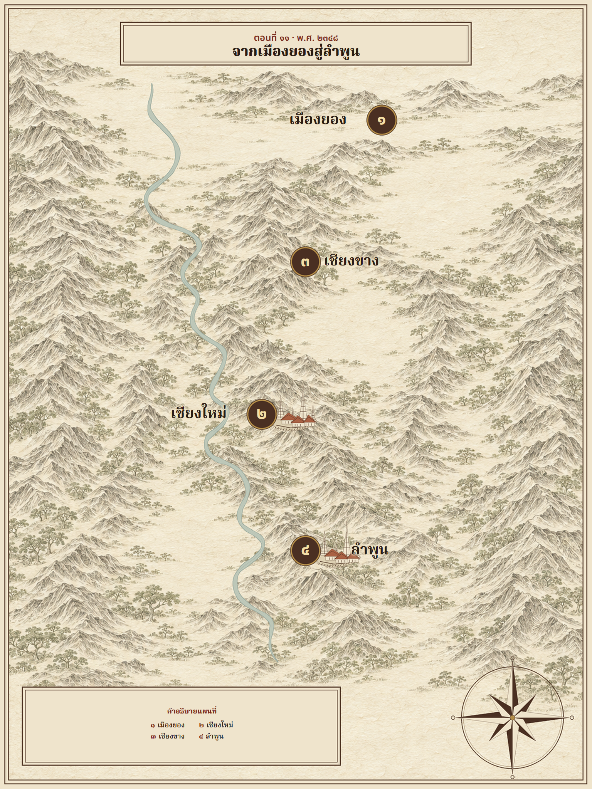

# ภาคที่ 4: เมืองหนึ่งฟื้น อีกเมืองเสียผู้คน
## ตอนที่ 11: จากเมืองยองสู่ลำพูน

> **หมายเหตุถึงผู้อ่านตอนที่ 11:** ตอนนี้แยกหลักฐานออกเป็นสองชั้นอย่างชัดเจน ได้แก่ ฝั่ง ก. ภาพสแกนตัดขยายครึ่งหน้าของ *ตำนานพื้นเมืองเชียงใหม่* (ฉบับพิมพ์ พ.ศ. 2514 ผูก 7 หน้า 114–118 โดยไม่อาศัย OCR) ซึ่งเป็นมุมมองของผู้บันทึกฝ่ายเชียงใหม่ และฝั่ง ข. งานศึกษาชั้นรองสมัยใหม่ คือ รายงานวิจัย สกว. โดย รศ.สมโชติ อ๋องสกุล และคณะ (หน้า PDF 44) ที่นำมาใช้เฉพาะเพื่ออธิบายคำว่า "เทครัว" และยุค "เก็บผักใส่ซ้า เก็บข้าใส่เมือง" ในฐานะภาษาของงานวิชาการชั้นหลัง ศักราชในตัวบทใช้จุลศักราช (จ.ศ.) ซึ่งเมื่อบวก 1181 จะได้ปี พ.ศ. ตามการนับแบบไทยเก่าที่เริ่มปีใหม่ในเดือนเมษายน (จ.ศ. 1167 ปีดับเป้า ตรงกับ พ.ศ. 2348) และคงวันเดือนปีตามตัวบทโดยไม่แปลงเป็นวันที่สากล ตัวเลขกำลังพลและบริวารเป็นตัวเลขตามตัวบท ส่วนราชสำนักสยามที่กรุงเทพฯ ตัวบทเรียกสลับกันระหว่าง "กรุงศรีอยุทธยา" กับ "กรุงเทพพระมหานคร" จึงคงตามตัวบทพร้อมอธิบายในวงเล็บ ผู้ที่จะนำไปอ้างอิงต่อควรตรวจทานกับต้นฉบับโดยตรงก่อน

---

### ฉากเปิด: เที่ยงวันเข้าตั้งเมืองหริภุญชัย

ใน **จ.ศ. 1167 ปีดับเป้า (พ.ศ. 2348 ตามปีนับเก่า)** เดือน 7 ออก 5 ค่ำ วัน 2 เจ้ากาวิละพร้อมครูบามหาเถระและคณะสงฆ์ตามตัวบท 108 รูป ได้นำเจ้ารัตน์ราชวังหลัง เจ้าศรีบุญมาเมืองละคร พร้อมด้วย **"พระยามหิตยังครัฐบุรี 4 ตนพี่น้อง และท้าวพระยาข้าเจ้าไพร่ไทยในเมืองยองทั้งมวล"** ลงไป **"เผี้ยวถาง"** เมืองหริภุญชัย (ลำพูน)

คณะสงฆ์ประกอบพิธีปริตมงคลที่สถานที่สำคัญ 4 แห่ง (เช่น ปอเต และศรีมุงเมือง) ครั้นถึง **เดือน 7 ออก 8 ค่ำ วัน 5 เวลาราวใกล้เที่ยง** จึงเข้าตั้งเมืองหริภุญชัยอย่างเป็นทางการ ตั้งเจ้ารัตน์เป็นเจ้าเมือง และตั้งเจ้าศรีบุญมาเป็นอุปราชา

ฉากการตั้งเมืองลำพูนใหม่ในเที่ยงวันนั้นเปิดคำถามสำคัญขึ้นมาทันทีว่า ผู้คนจากเมืองยองที่อยู่ไกลขึ้นไปทางเหนือ มาปรากฏตัวอยู่ในพิธีถางเมืองหริภุญชัยใน จ.ศ. 1167 ได้อย่างไร

---

### แผนที่สถานที่ในหลักฐาน: เมืองยอง เชียงขาง เชียงใหม่ และลำพูน

แผนที่ของตอนนี้วางเฉพาะเมืองหลัก 4 แห่งที่ปรากฏในลำดับเหตุการณ์ของตัวบท ได้แก่ **เมืองยอง**, **เชียงขาง**, **เชียงใหม่**, และ **ลำพูน** โดยไม่ได้ลากเส้นทางเดินทัพหรือเส้นทางเคลื่อนย้ายเชื่อมระหว่างเมือง

---

### คำถามของตอน

**ชาวเมืองยองมาอยู่ลำพูนได้อย่างไร**

ตัวบท *ตำนานพื้นเมืองเชียงใหม่* หน้า 114–118 สามารถตอบลำดับเหตุการณ์ได้ชัดเจนเป็นขั้นเป็นตอน ตั้งแต่เมืองยองออกมาน้อมหัว ผู้นำเมืองยองลงไปเฝ้าที่กรุงเทพฯ พระราชบัญชาให้ตั้งเมืองหริภุญชัย การที่ชาวเมืองยองลงไปเผี้ยวถางเมือง จนถึงวันเข้าตั้งเมืองในเดือน 7 ออก 8 ค่ำ จ.ศ. 1167 แต่ตัวบทไม่ได้ตอบคำถามอีกสามข้อสำคัญ คือ ชาวเมืองยองยินดีหรือถูกบังคับ มากันจำนวนกี่คน และชีวิตของพวกเขาในเมืองลำพูนเป็นอย่างไร

---

### หลักฐานจากตำนานพื้นเมืองเชียงใหม่ (หน้า 114–118)

สิ่งสำคัญที่ต้องแยกให้ชัดก่อนอ่านเหตุการณ์ตอนนี้คือ **ผู้นำทัพที่ยกขึ้นไปเมืองยองคือ "เจ้ามหาอุปราชวังหน้า" ไม่ใช่กาวิละ** (ตัวบทเรียกด้วยตำแหน่งเท่านั้น จึงไม่ระบุชื่อตัวเกินที่เอกสารเรียก) ส่วน **เจ้ากาวิละ** อยู่รักษาเมืองเชียงใหม่—โดยในปี จ.ศ. 1167 เดียวกัน ตัวบทหน้า 117 บันทึกเป็นฉากหลังไว้ว่ากาวิละสร้างวิหารหลวงวัดดอยสุเทพและต่างฉัตรมหาชินธาตุเจ้าสุเทพ ซึ่งมีเหตุการณ์สายฟ้าลงฟาดยอดจิกฉัตรในปีนั้นด้วย—และกาวิละเป็นผู้ลงมานำการตั้งเมืองลำพูนในขั้นสุดท้าย

#### 1. ขึ้นสู่เมืองยอง: ออกมาน้อมหัวโดยไม่มีการรบ (หน้า 114–115)

ในปีเดียวกันนั้น เริ่มจากการเคลื่อนทัพสองสาย สายแรกในเดือน 5 แรม 8 ค่ำ วัน 6 **เจ้ารัตน์หัวเมืองแก้ว "พระราชวังหลัง"** (พระราชกนิษฐา) ยกพลตามตัวบท **1,000 คน** ไปทางเชียงตุง ตีฝ่ายพม่าที่เมืองยางและเมืองแรมจนแตก ได้ทรัพย์สิน ช้างม้า และ "ครอบครัวเป็นอันมาก" แล้วกลับถึงเชียงใหม่ในเดือน 10 แรม 11 ค่ำ วัน 1

สายหลักคือ **เจ้ามหาอุปราชวังหน้า** ยกพลโยธาตามตัวบท **10,000 คน** ออกเดินทางในเดือน 5 แรม 14 ค่ำ วัน 5 คืนหนึ่งระหว่างทาง ตัวบทเล่าว่าเจ้ามหาอุปราชฝันเรื่องช้างงา (ถวายพระนอน) ซึ่งผู้บันทึกเล่าว่าถือเป็นนิมิตว่า "จักได้ปราบลานนา 57 เมือง" กองทัพเดินทาง 1 เดือนปลาย 2 วัน ก็ไปถึง **"เมืองมหิตยังครัฐบุรี" (เมืองยอง)**

เมื่อไปถึง **เมืองยองไม่ได้ถูกตีแตกและไม่มีการรบ** ตัวบทหน้า 115 บันทึกว่าท้าวพระยาเสนาและไพร่บ้านเมืองเห็นรี้พลแล้วสะดุ้งตกใจ **"บ่อาจสามารถจักต่อชนรบได้"** จึงพร้อมกันออกมาน้อมหัวปลงตัวเป็นข้า นำเครื่องท้าว 5 ประการ ช้างพลายสารตัวใหญ่ และ **นางหน่อแก้วเกี่ยงคำ** (พระธิดา) มาถวาย

ณ จุดนี้ ผู้บันทึกฝ่ายเชียงใหม่ได้ใส่ถ้อยคำสำคัญไว้ในปากของผู้นำว่า **"บ่ใช่ว่าจักมาฟันเมืองให้เป็นป่า ... จักมาฟันป่าให้เป็นเมือง"** ถ้อยคำนี้เป็นสำนวนที่ผู้บันทึกฝ่ายเชียงใหม่เขียนขึ้นไว้ในตัวบท จึงขอนำเสนอตรงตามเอกสารโดยไม่ตีความว่าเป็นการกล่าวด้วยความจริงใจหรือเป็นถ้อยคำทางการเมืองเพื่อให้ผู้อ่านพิจารณาเอง จากนั้นเจ้ามหาอุปราชจึงแต่งให้เจ้ามหาราชบุตรและเจ้าสุวรรณคำ (ราชนัดดา) ขึ้นไปเกลี้ยกล่อมเมืองยอง บ้านยู้ เมืองหลวย บ้านกาย เมืองขัน เชียงขาง เมืองวะ รวมถึงสิบสองพันนาและเชียงรุ้ง ให้เข้ามาอยู่ในเขตเมืองพิงค์เชียงใหม่

#### 2. เมืองเชียงขางและการถวายพระพุทธรูป (หน้า 115–117)

หลังอยู่ที่เมืองยองได้ 23 วัน ถึง **จ.ศ. 1167 ปีดับเป้า เดือน 7 แรม 11 ค่ำ วัน 5** กองทัพยกต่อไปยัง **เมืองเชียงขาง** (อะยะรัฐ) ใช้เวลา 3 วัน ปักกองทัพที่นั่น แล้วออกอักษรร้องเรียกไพร่ไทยที่หนีอยู่ป่าให้ออกมาทำไร่นา และให้ครูบาสังฆเจ้าออกมาทำปฏิบัติ

ตัวบทหน้า 116–117 เล่าว่าที่เชียงขาง ภิกษุสองรูปคือ ศรีมหานาม และปัญญา จากบ้านช่อแคว้น ได้นำ **พระพุทธรูปเจ้าทองทิพย์** มาถวาย โดยอ้างตามคำทำนายของครูบาที่ว่าจะมีมหาราชจากเชียงใหม่ขึ้นมา (ตัวบทเรียกพระพุทธรูปองค์นี้ว่า "พระพุทธรูปเจ้าเมืองเชียงใหม่" ทั้งหมดนี้เล่าตามถ้อยคำของตัวบทโดยไม่ตีความเพิ่มเติม) นอกจากนี้ยังมีการนำตัวพระยาลัวะ (นาคราช) ที่หนีอยู่ป่ามาถวายพร้อมช้างและพระธิดา ส่วนเมืองเชียงขาง เมืองลวง และสิบสองปันนา (เจ้าหอคำเชียงรุ้ง) ต่างส่งบรรณาการเข้ามาขอเป็นข้า

กองทัพยกออกจากเชียงขางในเดือน 8 ออก 8 ค่ำ วัน 5 ถึงเมืองยองในเดือน 8 ออก 10 ค่ำ วัน 6 พักอยู่ 7 วัน แล้วออกเดินทางกลับในเดือน 8 แรม 3 ค่ำ วัน 7 ใช้เวลา 1 เดือนปลาย 12 วัน ถึงท่าวัดเกตุ และเข้าเวียงเชียงใหม่ในเดือน 10 แรม 15 ค่ำ วัน 6

#### 3. ลงไปกรุงเทพฯ และพระราชบัญชาให้ตั้งเมืองหริภุญชัย (หน้า 117–118)

ในเดือนหนึ่ง แรม 2 ค่ำ วัน 5 เจ้ามหาอุปราชพร้อมเจ้ารัตน์ราชวังหลังและเจ้าหอคำเชียงตุง ได้นำท้าวพระยาหัวเมือง โดยมี **พระยาเมืองยองเป็นเค้า** ร่วมกับพระยาเมืองวะ เชียงขาง เมืองกาย และยางส่อง ลงไปเฝ้าที่ราชสำนักสยาม ณ กรุงเทพฯ เดินทาง 1 เดือนปลาย 6 วัน ถึงในเดือนยี่ แรม 8 ค่ำ วัน 5

คณะเจ้านายและท้าวพระยาได้รับพระราชทานเครื่องยศ และ **มีพระราชบัญชาให้เจ้ารัตน์วังหลังกับเจ้าศรีบุญมา (เมืองละคร ผู้น้องหล้า) เข้าตั้งเมืองหริภุญชัย** ระหว่างที่คณะลงไปกรุงเทพฯ เจ้ากาวิละอยู่สร้างโรงอุโบสถวัดเชียงมั่น จากนั้นเจ้ามหาอุปราชจึงเดินทางกลับถึงเวียงเชียงใหม่ในเดือน 6 ออกค่ำหนึ่ง วัน 3

#### 4. ชาวเมืองยองลงไปเผี้ยวถางและตั้งเมืองลำพูน (หน้า 118)

ใน **จ.ศ. 1167 ปีดับเป้า (พ.ศ. 2348 ตามปีนับเก่า)** เดือน 7 ออก 5 ค่ำ วัน 2 เจ้ากาวิละพร้อมครูบามหาเถระและคณะสงฆ์ 108 รูป นำ **เจ้ารัตน์ราชวังหลัง** (มีบริวารตามตัวบท **500 คน**) **เจ้าศรีบุญมาเมืองละคร** (มีบริวารตามตัวบท **500 คน**) กับ **"พระยามหิตยังครัฐบุรี 4 ตนพี่น้อง และท้าวพระยาข้าเจ้าไพร่ไทยในเมืองยองทั้งมวล"** ลงไป **"เผี้ยวถาง"** เมืองหริภุญชัย ทำพิธีปริตมงคล 4 แห่ง และใน **เดือน 7 ออก 8 ค่ำ วัน 5 ใกล้เที่ยง** จึงเข้าตั้งเมืองหริภุญชัย ตั้งเจ้ารัตน์เป็นเจ้าเมืองและเจ้าศรีบุญมาเป็นอุปราชา

จุดที่ต้องระวังอย่างยิ่งคือ **ตัวเลข 500 คนต่อฝ่ายในตัวบทเป็นบริวารของเจ้ารัตน์และเจ้าศรีบุญมาเท่านั้น** ตัวบทไม่ได้ระบุว่ามีชาวเมืองยองลงมาด้วยจำนวนกี่คน จึงไม่อาจนำตัวเลขบริวารนั้นไปนับรวมเป็นจำนวนชาวเมืองยองได้

---

### ชั้นงานชั้นรอง: คำว่า "เทครัว" และยุค "เก็บผักใส่ซ้า เก็บข้าใส่เมือง"

เมื่อขยับจากตัวบทตำนานมาดูคำอธิบายในงานศึกษาชั้นรองสมัยใหม่ รายงานวิจัย สกว. โดย **รศ.สมโชติ อ๋องสกุล และคณะ** (หน้า PDF 44) เรียกช่วงการฟื้นฟูบ้านเมืองหลัง พ.ศ. 2325 ว่ายุค **"เก็บผักใส่ซ้า เก็บข้าใส่เมือง"** เพื่อหมายถึงการรวบรวมผู้คนเข้ามาตั้งบ้านเมืองใหม่ และใช้คำว่า **"กวาดต้อน"** กับ **"เทครัว"** เพื่ออธิบายการย้ายผู้คนจากหัวเมืองต่าง ๆ ทางตอนบน (เช่น แคว้นสิบสองปันนาและสองฝั่งแม่น้ำสาละวิน) ลงมาทั้งเมือง

การวางภาษาทั้งสองชั้นเทียบกันช่วยให้เห็นความต่างของมุมมองชัดเจนขึ้น ในขณะที่ตัวบทตำนานหน้า 118 ใช้ถ้อยคำว่าชาวเมืองยอง **"ลงไปเผี้ยวถาง"** เมืองหริภุญชัย งานวิชาการชั้นหลังมองการเคลื่อนย้ายผู้คนลักษณะนี้ภายใต้คำว่า **"เทครัว"** หนังสือเล่มนี้จึงคงถ้อยคำของทั้งสองชั้นไว้เคียงคู่กันโดยไม่ตัดสินแทนผู้อ่าน และไม่สรุปว่าชาวเมืองยองเคลื่อนย้ายลงมาด้วยความสมัครใจหรือถูกบังคับ

---

### สิ่งที่ยังไม่รู้

แม้ตัวบทจะบอกลำดับเหตุการณ์จากเมืองยองสู่ลำพูนได้ค่อนข้างครบถ้วน แต่ยังมีช่องว่างสำคัญที่หลักฐานในตอนนี้ยังไม่ตอบ ได้แก่

- **เจตนาและความรู้สึกของชาวเมืองยอง:** ตัวบทบันทึกเพียงว่าชาวเมืองยองเห็นกำลังพลแล้วไม่อาจต่อรบได้จึงออกมาน้อมหัว และต่อมาลงไปเผี้ยวถางเมืองหริภุญชัย แต่ไม่ได้บันทึกว่าชาวเมืองยองยินดี เต็มใจ หรือจำยอมต่อการย้ายถิ่นฐานครั้งนี้
- **จำนวนชาวเมืองยองที่ลงมาตั้งเมืองลำพูน:** ตัวบทไม่ระบุตัวเลขชาวเมืองยอง ระบุเพียงตัวเลขบริวารของเจ้ารัตน์และเจ้าศรีบุญมาฝ่ายละ 500 คนเท่านั้น
- **ชีวิตความเป็นอยู่ของชาวเมืองยองหลังตั้งเมือง:** บันทึกของตำนานจบลงที่พิธีปริตมงคลและการแต่งตั้งเจ้าเมืองกับอุปราชาในเดือน 7 ออก 8 ค่ำ จ.ศ. 1167 ไม่ได้เล่าถึงสภาพความเป็นอยู่ การแบ่งพื้นที่ทำกิน หรือการปรับตัวของชุมชนชาวเมืองยองในลำพูน
- **การเคลื่อนย้ายระลอกหลัง (จ.ศ. 1171–1176):** ในหน้าท้าย ๆ ของตำนานยังมีบันทึกถึงการเคลื่อนย้ายผู้คนระลอกหลังในช่วง จ.ศ. 1171–1176 แต่ส่วนดังกล่าวยังอ่านได้เพียงบางส่วนและยังไม่ได้ตรวจทานครบทุกหน้า จึงยังไม่นำมาสรุปในเนื้อหาตอนนี้

---

### ตะขอไปตอนถัดไป

เมื่อเมืองลำพูนตั้งขึ้นใหม่ใน จ.ศ. 1167 เรื่องราวของการฟื้นเมืองและย้ายผู้คนก็เดินทางมาถึงบทส่งท้าย ในตอนที่ 12 เราจะออกตามหาว่าชุมชนของคนต่างถิ่นที่ย้ายลงมาตั้งบ้านใหม่นั้นเก็บอะไรไว้กับตัวบ้าง

**จบตอนที่ 11**

*(ติดตามต่อใน ตอนที่ 12: บ้านใหม่ของคนต่างถิ่น)*

---

## ตารางที่มาของข้อเท็จจริง (ไม่พิมพ์ในหนังสือ ใช้ตรวจ)

| ข้อความในบท | ข้อในใบข้อเท็จจริง / ไฟล์รายงาน | หน้า | ระดับ |
|---|---|---|---|
| วิธีอ่าน ข้อจำกัด และการนับปี: ตำนานพื้นเมืองเชียงใหม่ ฉบับ พ.ศ. 2514 อ่านจากภาพสแกนตัดขยายครึ่งหน้า จ.ศ. 1167 ปีดับเป้า = พ.ศ. 2348 ตามปีนับเก่า ตัวบทเรียกกรุงเทพฯ ว่า "กรุงศรีอยุทธยา" หรือ "กรุงเทพพระมหานคร" สลับกัน | ตำนานภาค 1–2 (วิธีอ่านและข้อจำกัด, หมายเหตุเรื่องการนับปี) + ใบหน้า 104–125 ("อ่านซ้ำแล้ว", แก้จากฉบับแรก ข้อ 5) | 114–118 | ตามใบข้อเท็จจริง |
| เดือน 5 แรม 8 ค่ำ วัน 6 เจ้ารัตน์หัวเมืองแก้ว "พระราชวังหลัง" (พระราชกนิษฐา) ยกพลตามตัวบท 1,000 คน ไปทางเชียงตุง ตีม่านที่เมืองยาง เมืองแรม ม่านแตก ได้ทรัพย์สิน ช้างม้า และ "ครอบครัวเป็นอันมาก" กลับถึงเดือน 10 แรม 11 ค่ำ วัน 1 | ตำนาน I1 | 114 | ชัด |
| เจ้ามหาอุปราชวังหน้า (ไม่ระบุชื่อตัว) ยกพลโยธาตามตัวบท 10,000 คน ออกเดือน 5 แรม 14 ค่ำ วัน 5 ฝันเรื่องช้างงา (ถวายพระนอน) ถือเป็นนิมิตว่า "จักได้ปราบลานนา 57 เมือง" เดินทาง 1 เดือนปลาย 2 วัน ถึง "เมืองมหิตยังครัฐบุรี" (เมืองยอง) | ตำนาน I2 | 114 | ชัด |
| เมืองยองไม่สู้: ท้าวพระยาเสนาไพร่บ้านเมืองเห็นรี้พลสะดุ้งตกใจ "บ่อาจสามารถจักต่อชนรบได้" พร้อมกันออกมาน้อมหัวปลงตัวเป็นข้า ถวายเครื่องท้าว 5 ประการ ช้างพลายสารตัวใหญ่ และนางหน่อแก้วเกี่ยงคำ (พระธิดา) | ตำนาน I3 | 115 | ชัด |
| ถ้อยคำที่ผู้บันทึกใส่ไว้ในปากผู้นำ: "บ่ใช่ว่าจักมาฟันเมืองให้เป็นป่า ... จักมาฟันป่าให้เป็นเมือง" แต่งให้เจ้ามหาราชบุตรและเจ้าสุวรรณคำ (ราชนัดดา) ขึ้นไปเกลี้ยกล่อมเมืองยอง บ้านยู้ เมืองหลวย บ้านกาย เมืองขัน เชียงขาง เมืองวะ สิบสองพันนา เชียงรุ้ง ให้เข้ามาในเขตเมืองพิงค์เชียงใหม่ | ตำนาน I4 | 115 | ชัด |
| อยู่เมืองยอง 23 วัน จ.ศ. 1167 ปีดับเป้า เดือน 7 แรม 11 ค่ำ วัน 5 ยกไปเมืองเชียงขาง (อะยะรัฐ) 3 วัน ปักกองทัพ ออกอักษรร้องเรียกไพร่ไทยที่หนีอยู่ป่าให้ออกมาทำไร่นา และให้ครูบาสังฆเจ้าออกมาทำปฏิบัติ | ตำนาน I5 | 115 | ชัด |
| ที่เชียงขาง ภิกษุสองรูป (ศรีมหานาม และปัญญา จากบ้านช่อแคว้น) ถวายพระพุทธรูปเจ้าทองทิพย์ ตามคำครูบาที่ว่าจะมีมหาราชจากเชียงใหม่ขึ้นมา (ตัวบทเรียก "พระพุทธรูปเจ้าเมืองเชียงใหม่") พระยาลัวะ (นาคราช) ที่หนีอยู่ป่าถูกนำตัวมาถวายพร้อมช้างและพระธิดา เมืองเชียงขาง เมืองลวง สิบสองปันนา (เจ้าหอคำเชียงรุ้ง) ส่งบรรณาการขอเป็นข้า | ตำนาน I6 | 116–117 | ชัดโดยรวม |
| ยกจากเชียงขางเดือน 8 ออก 8 ค่ำ วัน 5 ถึงเมืองยองเดือน 8 ออก 10 ค่ำ วัน 6 อยู่ 7 วัน ออกเดือน 8 แรม 3 ค่ำ วัน 7 เดินทาง 1 เดือนปลาย 12 วัน ถึงท่าวัดเกตุ เข้าเวียงเดือน 10 แรม 15 ค่ำ วัน 6 | ตำนาน I7 | 117 | ชัด |
| กาวิละอยู่รักษาเมืองเชียงใหม่ในปี จ.ศ. 1167 สร้างวิหารหลวงวัดดอยสุเทพและต่างฉัตรมหาชินธาตุเจ้าสุเทพ มีบันทึกว่าสายฟ้าลงฟาดยอดจิกฉัตร (ใช้เป็นฉากหลัง 1 ประโยค) | ตำนาน I8 | 117 | ชัด |
| เดือนหนึ่ง แรม 2 ค่ำ วัน 5 มหาอุปราช เจ้ารัตน์ราชวังหลัง และเจ้าหอคำเชียงตุง นำท้าวพระยาหัวเมือง (มีพระยาเมืองยองเป็นเค้า พระยาเมืองวะ เชียงขาง เมืองกาย ยางส่อง) ลงไปเฝ้าที่กรุงเทพฯ เดินทาง 1 เดือนปลาย 6 วัน ถึงเดือนยี่ แรม 8 ค่ำ วัน 5 ได้รับพระราชทานเครื่องยศ มีพระราชบัญชาให้เจ้ารัตน์วังหลังและเจ้าศรีบุญมา (เมืองละคร ผู้น้องหล้า) เข้าตั้งเมืองหริภุญชัย | ตำนาน I9 | 117–118 | ชัด |
| ระหว่างนั้นกาวิละสร้างโรงอุโบสถวัดเชียงมั่น มหาอุปราชกลับจากกรุงเทพฯ ถึงเวียงเดือน 6 ออกค่ำหนึ่ง วัน 3 | ตำนาน I10 | 118 | ชัด |
| เดือน 7 ออก 5 ค่ำ วัน 2 กาวิละกับครูบามหาเถระและคณะสงฆ์ 108 รูป นำเจ้ารัตน์ราชวังหลัง (บริวาร 500) เจ้าศรีบุญมาเมืองละคร (บริวาร 500) กับ "พระยามหิตยังครัฐบุรี 4 ตนพี่น้อง และท้าวพระยาข้าเจ้าไพร่ไทยในเมืองยองทั้งมวล" ลงไป "เผี้ยวถาง" เมืองหริภุญชัย ทำพิธีปริตมงคล 4 แห่ง (ปอเต ศรีมุงเมือง ฯลฯ) เดือน 7 ออก 8 ค่ำ วัน 5 ใกล้เที่ยง เข้าตั้งเมืองหริภุญชัย ตั้งเจ้ารัตน์เป็นเจ้าเมือง เจ้าศรีบุญมาเป็นอุปราชา ใน จ.ศ. 1167 ปีดับเป้า (พ.ศ. 2348) | ตำนาน I11 + แก้จากฉบับแรก ข้อ 5 | 118 | ชัด |
| งานชั้นรองสมัยใหม่: รายงานวิจัย สกว. (รศ.สมโชติ อ๋องสกุล และคณะ) เรียกช่วง พ.ศ. 2325–2339 ว่ายุค "เก็บผักใส่ซ้า เก็บข้าใส่เมือง" และใช้คำว่า "กวาดต้อน" / "เทครัว" อธิบายการย้ายผู้คนลงมาทั้งเมืองจากหัวเมืองตอนบน (เช่น แคว้นสิบสองปันนาและสองฝั่งแม่น้ำสาละวิน) | รายงาน สกว. E2 (`แหล่ง/ข้อมูลเสริมจากรายงาน_สกว_ป่าซาง.md`) | PDF 44 | งานชั้นรอง |
| การเคลื่อนย้ายระลอกหลัง (จ.ศ. 1171–1176) เอ่ยเฉพาะในส่วน "สิ่งที่ยังไม่รู้" ว่ายังอ่านได้บางส่วนและยังไม่ได้ตรวจครบ | ใบหน้า 104–125 ("เหตุการณ์ระลอกหลัง") | 124–125 | บางส่วน (ไม่ใช้ในเนื้อเรื่อง) |

---

## รายการภาพที่ต้องสร้าง (ไม่พิมพ์ในหนังสือ ใช้ตรวจ)

1. **ภาพฉากเปิดตอน (`images/ep11_scene.jpg` — สัดส่วน 16:9 แนวนอน)**
   - **โทนสีและวัสดุประจำเล่ม 4 ("กระดาษสาและไม้สัก"):** กูอาชบางผสมหมึกซีเปีย ลายเส้นพู่กันแห้งบนกระดาษสาเห็นเส้นใย จานสีอุ่นครีมกระดาษสา (`#EFE4CC`) น้ำตาลไม้สัก ดินแดงลูกรัง เหลืองรง–ส้มหญ้าฝรั่น เขียวมอส–มะกอก เน้นแดงรักและทองคำเปลวไม่เกิน 3% มียอดพระธาตุหริภุญชัยปิดทองขนาดเล็กไกลมากอยู่ช่วงบนของภาพ และลำต้นไม้สักเก่าชิดขอบขวาของภาพ
   - **แนวคิดและองค์ประกอบ:** ภาพเชิงสัญลักษณ์ของการตั้งเมืองลำพูนใหม่ แสดงพื้นที่ดินที่เพิ่งถางโล่งใหม่ ๆ มีเสาไม้หรือหลักเมืองที่เพิ่งปักตั้งมั่นอยู่บนพื้นดิน มองเห็นองค์พระธาตุหริภุญชัยอยู่ไกล ๆ ในหมอกบาง พื้นดินและหญ้าต่อเนื่องถึงขอบล่าง
   - **กติกาบังคับ:** ไม่มีคน (ห้ามมีบุคคลหรือหน้าคนในฉาก) ไม่มีอาวุธเด่น ไม่มีปืน วัตถุหลักอยู่ในช่วง 45–78% ของความสูงภาพและตั้งบนพื้นอย่างมั่นคง ห้ามใส่ข้อความ ตัวเลข ป้าย ธง หรือลายน้ำในภาพ ห้ามใช้โทนเขียวหยก–ครามของเล่ม 1–3
2. **แผนที่ประจำตอน (`images/ep11_map.png` — สัดส่วน 3:4 แนวตั้ง)**
   - **โทนสีและรูปแบบประจำเล่ม 4:** พื้นครีมกระดาษสา (`#EFE4CC`) เห็นเส้นใยกระดาษ ลายเส้นหมึกซีเปีย ภูเขาลายขีดแต้มสีมะกอกอ่อน แม่น้ำสีเทาอมเขียวหม่น กรอบเส้นคู่บาง กล่องหัวแผนที่เปล่าด้านบน กล่องคำอธิบายเปล่าล่างซ้าย เข็มทิศไม่มีตัวอักษรล่างขวา วงกลมพิกัดสีน้ำตาลไม้สักเข้มขอบทองบาง (ห้ามใช้พื้นเขียวเซลาดอนของเล่ม 3)
   - **เมืองและสถานที่ที่อนุญาตให้ใส่ในแผนที่ (เฉพาะ 4 เมืองเท่านั้น ห้ามใส่เมืองอื่น):**
     - **เมืองยอง**
     - **เชียงขาง**
     - **เชียงใหม่**
     - **ลำพูน**
   - **กติกาบังคับ:** ห้ามลากเส้นทางหรือลูกศรใด ๆ ระหว่างเมือง ห้ามใส่เมืองอื่นนอกเหนือจาก 4 ชื่อข้างต้น (ห้ามใส่เชียงตุง เมืองยาง เมืองแรม เชียงรุ้ง กรุงเทพฯ ลำปาง เชียงแสน) ไม่มีหน้าคน ไม่มีอาวุธเด่น ห้ามมีตัวอักษรหรือป้ายชื่อในภาพแผนที่ฐาน
