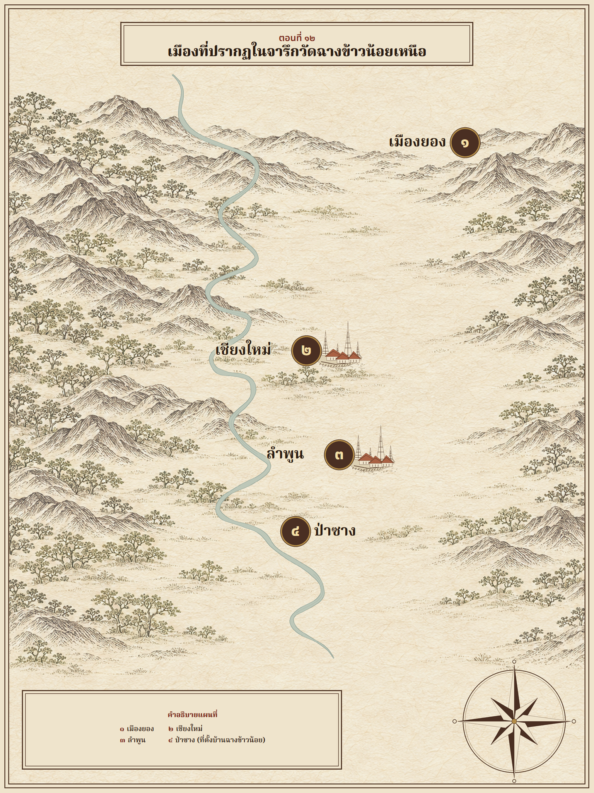

# ภาคที่ 4: เมืองหนึ่งฟื้น อีกเมืองเสียผู้คน
## ตอนที่ 12: บ้านใหม่ของคนต่างถิ่น

> **หมายเหตุถึงผู้อ่านตอนที่ 12:** คำว่า **"บ้านใหม่"** ในชื่อตอนเป็นคำตั้งชื่อของผู้เรียบเรียง ไม่ใช่ถ้อยคำของจารึก (จารึกใช้คำว่า "ตั้งอยู่ในคามสันฐาน") ผู้เรียบเรียง **ไม่เคยเห็นตัวจารึกไม้สักจริง** เห็นเฉพาะคำอ่านและคำอธิบายศัพท์ที่พิมพ์ใน **ภาคผนวก ข** ของวิทยานิพนธ์ มหาวิทยาลัยเชียงใหม่ พ.ศ. 2538 โดย แสวง มาละแซม (ท้ายคำอ่านด้านที่ 1 ลงนามผู้อ่านว่า "นายแสวง มาละแซม 2533") ตอนนี้แยกหลักฐานเป็น 3 ชั้น คือ (1) ตัวจารึกตามคำอ่าน (ด้านที่ 1 บรรทัด 1–28 และด้านที่ 2 เฉพาะบรรทัด 1–7) (2) คำอธิบายศัพท์ของผู้อ่านจารึก (ภาคผนวก ข ข้อ 1–73) และ (3) ข้อสรุปและข้อสันนิษฐานของผู้เขียนวิทยานิพนธ์ (บทที่ 4 หน้า 155–166 และบทคัดย่อ) จารึกด้านที่ 1 ให้ศักราชไว้ **สองปี** คือ จ.ศ. 1190 (พ.ศ. 2371 ตามผู้อ่านจารึก) ในบรรทัด 1 และ จ.ศ. 1191 (พ.ศ. 2372) ในบรรทัด 3 ผู้เรียบเรียงไม่ทราบความต่างของสองปีนี้จึงคงไว้ทั้งสอง และคงการสะกดตามคำอ่านที่พิมพ์ไว้

---

### ฉากเปิด: รายการสิ่งก่อสร้างและผู้ร่วมสร้างจากทุกวัย

ในคำอ่านจารึกไม้สัก **วัดฉางข้าวน้อยเหนือ** อำเภอป่าซาง จังหวัดลำพูน (ด้านที่ 1 บรรทัด 8–9, 16 และ 23–24) ส่วนที่เป็นรายการยาวที่สุดในหน้าที่อ่านแล้วคือรายการสิ่งที่ผู้ศรัทธาร่วมกันสร้างในวัดของชุมชน

ตามคำอ่านจารึก ผู้ศรัทธาร่วมกันสร้าง **พระมหาวิหารใหญ่ 2 หลัง**, **โรงอุโบสถ 1 หลัง**, **เพดาน**, **แท่นธรรมมาสน์**, **ประตูโขง**, **กำแพง**, รวมถึงการประดับโขงแท่นและการปิดทอง (คำอ่านใช้คำว่า "ติดคำ" ซึ่งผู้อ่านอธิบายว่าปิดทอง) ฝา ผนังด้านข้างวิหาร ขื่อ และแป โดยบันทึกจำนวนเงินที่ใช้ไว้ตามคำอ่านว่า **"1,000 ปลาย 330 กับ 7 แถบ"** (ผู้อ่านอธิบายว่า "แถบ" คือหน่วยเงินรูปีอังกฤษที่ใช้ในเขตพม่า)

จารึกบรรทัดที่ 16 ยังระบุถึงผู้ร่วมสร้างว่าครอบคลุมคนหลายวัย ได้แก่ พ่อขึ้นน้อย ผู้เฒ่าผู้แก่ ผู้หนุ่มปานกลาง ผู้นางทั้งหลาย และทารกาทาริกา รายการสิ่งก่อสร้างและรายชื่อผู้ร่วมศรัทธาในจารึกที่ลงปี จ.ศ. 1190–1191 (พ.ศ. 2371–2372) นี้ จึงเป็นอีกฟากหนึ่งของเรื่องราวต่อจากตอนที่ 11—คือเสียงของชุมชนปลายทางที่บันทึกถึงตนเองผ่านแผ่นไม้สัก

---

### แผนที่สถานที่ในหลักฐาน: เมืองยอง เชียงใหม่ ลำพูน และป่าซาง

แผนที่ของตอนนี้แสดงเฉพาะตำแหน่งภาพรวมของสถานที่หลัก 4 แห่งที่ปรากฏในหลักฐาน ได้แก่ **เมืองยอง** (ตำแหน่งภาพรวมทางทิศตะวันออกเฉียงเหนือไกล ซึ่งผู้อ่านจารึกอธิบายว่าปัจจุบันอยู่ในเขตรัฐฉาน), **เชียงใหม่**, **ลำพูน**, และ **ป่าซาง** (ที่ตั้งของบ้านฉางข้าวน้อย) โดยไม่ได้ลากเส้นทางหรือลูกศรเชื่อมระหว่างเมือง

---

### คำถามของตอน

**ถ้าต้นทางเป็นเมืองยองและปลายทางเป็นหมู่บ้านในลำพูน จารึกของหมู่บ้านปลายทางเล่าถึงที่มาของตนเองอย่างไร และวิทยานิพนธ์อ่านจารึกนี้ต่างจากตัวจารึกตรงไหน**

คำถามนี้ชวนให้เราวาง **ถ้อยคำของจารึกตามคำอ่าน** เคียงคู่กับ **คำอธิบายและข้อสันนิษฐานของวิทยานิพนธ์** เพื่อดูให้ชัดว่าสิ่งใดปรากฏอยู่ในแผ่นไม้สักจริงตามคำอ่าน และสิ่งใดเป็นคำตีความหรือข้อสันนิษฐานของนักวิชาการยุคหลัง

---

### หลักฐานสองฝั่ง

#### ฝั่ง ก.: จารึกไม้สัก วัดฉางข้าวน้อยเหนือ (ตามคำอ่านและคำอธิบายศัพท์ในภาคผนวก ข)

เนื้อหาในส่วนนี้แยกชัดระหว่าง **คำอ่านตัวจารึก** กับ **คำอธิบายศัพท์ของผู้อ่านจารึก (ข้อ 1–73)** ดังนี้

- **หัวจารึกและสองศักราชที่ต่างกัน 1 ปี (ด้านที่ 1 หัวจารึกและบรรทัด 1–5, หน้า 255–256, 264–265):**
  - หัวจารึกมีคำว่า "ชะตาพระเจ้าหลวง" พร้อมดวงชะตา "ลัคนา" และ "ฤกษ์ 19 ตัว"
  - บรรทัด 1–2 อ่านว่า **"จุลศักราช 1190 ตัว เดือน 8 เหนือ เพ็ญ เม็งวัน 4 ไทย กาบสัน ยามกองงาย แรก ก่อสร้าง พุทธพิมพ์ เจ้าองค์หลวงนี้ ปี เปิกไจ้แล"** — *คำอธิบายของผู้อ่านจารึก:* จ.ศ. 1190 ตรงกับ **พ.ศ. 2371** เดือนมิถุนายน ขึ้น 15 ค่ำ วันพุธ ก่อนเที่ยง "พุทธพิมพ์" หมายถึงพระพุทธรูป ปีชวด (วันที่ดังกล่าวเป็นตามคำอธิบายของผู้อ่าน ผู้เรียบเรียงไม่ได้แปลงเอง)
  - บรรทัด 3–5 อ่านว่า **"จุลศักราช 1191 ตัว"** ในปีฉลู เดือน 8 เพ็ญ วันอังคาร และลงพุทธศักราชไว้ว่า **"2372"** — *คำอธิบายของผู้อ่านจารึก:* จ.ศ. 1191 ตรงกับ **พ.ศ. 2372** ปีฉลู ฤดูร้อน เดือน 8 ขึ้น 15 ค่ำ วันอังคาร
  - **ข้อสังเกต:** จารึกด้านที่ 1 ลงศักราชไว้ทั้ง **จ.ศ. 1190 (พ.ศ. 2371)** และ **จ.ศ. 1191 (พ.ศ. 2372)** ผู้เรียบเรียงไม่ทราบว่าสองปีนี้หมายถึงเหตุการณ์ต่างกันอย่างไร จึงคงไว้ทั้งสองปีโดยไม่เลือกปีเดียว
- **ข้อความหลักว่าด้วยที่มาของชุมชน (ด้านที่ 1 บรรทัด 6–7, หน้า 256, 265):**
  - คำอ่านจารึก (คงการสะกดตามคำอ่าน): **"ผู้ข้าทั้งหลาย ทั้ง 2 คณะ อันเป็นรัฐประชาในเมือง มหิยังครัฐบุรี ทั้งมวล ย้อนแต่อิทธนุภาวะ กษัตราเมืองไทยใส่ส่องลงมาปฏิสันฐาน ตั้งอยู่ในคามสันฐานบ้าน ฉันข้าวน้อยที่นี้ อันแคว้นเมืองหริภุญชัยบุรีที่นี้"**
  - *คำอธิบายศัพท์ของผู้อ่านจารึก:* "มหิยังครัฐบุรี" คือ **เมืองยอง**, "คาม" คือหมู่บ้าน, "บ้านฉันข้าวน้อย" คือ **บ้านฉางข้าวน้อย อ.ป่าซาง จ.ลำพูน**, และ "เมืองหริภุญชัย" คือ **เมืองลำพูน**
  - **จุดที่คำอ่านไม่ได้อธิบายและไม่ตีความเพิ่ม:** คำว่า **"ใส่ส่อง"** ในบรรทัด 6–7 ไม่มีคำอธิบายความหมายโดยตรงในภาคผนวก จึงคงคำตามจารึกไว้โดยไม่แปลเป็นคำอื่น และคำว่า **"ทั้ง 2 คณะ"** (ซึ่งปรากฏอีกครั้งในบรรทัด 21) ความหมายยังไม่แน่ชัด จึงไม่ตีความว่าเป็นสองกลุ่มชาติพันธุ์
- **สิ่งก่อสร้าง พระพุทธรูป และผู้ร่วมศรัทธา (ด้านที่ 1 บรรทัด 8–24, หน้า 256–259, 265–267):**
  - จารึกรายงานการสร้างพระมหาวิหารใหญ่ 2 หลัง โรงอุโบสถ 1 หลัง (ผู้อ่านอธิบาย "เจตนาทั้ง 3" คือกายเจตนา วจีเจตนา มโนเจตนา และ "รังดา" คือตกแต่ง) และการสร้าง "พุทธพิมพ์รูป เจ้าองค์ใหญ่ องค์น้อย" พร้อมคติ **"5,000 พระวสา"** (ผู้อ่านอธิบายว่าเป็นอายุศาสนาตามคติ 5,000 ปี)
  - ฝ่ายสงฆ์ในบรรทัด 13–14 ระบุนามครูบา **ค้นธา** (ผู้อ่านเขียน "ครูบาคันธา") พรรษา 50 อยู่วัดทางทิศใต้ (*ข้อสันนิษฐานของผู้อ่านจารึก:* น่าจะคือวัดฉางข้าวน้อยใต้หรือวัดป่ายาง) และ **ปินตา** อายุ 36 (*คำอธิบายของผู้อ่านจารึก:* ครูบาปินตา เจ้าอาวาสองค์แรกของวัดฉางข้าวน้อยเหนือ)
  - ฝ่ายฆราวาสผู้เป็นเจ้าภาพในบรรทัด 15 ระบุนาม **หมื่นสิริ ท้าวคำแก่น หมื่นธุเทพ หมื่นหลวงหาญ ปู่สิริ ขนานสวร เจ้าวงศ์หัวสิบ** (*คำอธิบายคำนำหน้าของผู้อ่านจารึก:* "หมื่น" ยศข้าราชการท้องถิ่นเทียบผู้ใหญ่บ้าน, "ท้าว" คำนำหน้าชายเชื้อสายเจ้าหรือขุนนาง, "ปู่" ชายสูงอายุ, "ขนาน" ผู้บวชเรียนแล้วลาสิกขา, "หัวสิบ" ตำแหน่งทหารหรือหัวหน้าหมวดสิบ) ร่วมกับคนหลายวัยในบรรทัด 16
  - บรรทัด 18–20 มีส่วนบทภาษาบาลีอุทิศและอวยพร (ไม่คัดและไม่ถอดความในตอนนี้)
  - บรรทัด 21 เอ่ยคำว่า **"ทั้ง 2 คณะ"** อีกครั้งในบริบททั้งภายในที่มี **"ตู๋หลวงยาสมุทร"** เป็นเค้าพร้อมศิษย์โยม (*คำอธิบายของผู้อ่านจารึก:* เจ้าอาวาสองค์ที่ 3 ของวัด) และภายนอกที่มีอุบาสกอุบาสิกา (ความหมายของ "ทั้ง 2 คณะ" ยังไม่แน่ชัด)
  - บรรทัด 23–24 บันทึกรายการเพดาน แท่นธรรมมาสน์ ประตูโขง กำแพง ประดับโขงแท่น ปิดทอง ("ติดคำ") ฝา ผนังด้านข้างวิหาร ("ปางเอก") ขื่อ แป เดิกวิหาร รวมใช้เงิน "1,000 ปลาย 330 กับ 7 แถบ"
- **ข้อความเพิ่มเติมภายหลังและด้านที่ 2 เท่าที่อ่านแล้ว (ด้านที่ 1 บรรทัด 25–28 และด้านที่ 2 หัวจารึก–บรรทัด 5, หน้า 260–261, 267–268):**
  - ท้ายด้านที่ 1 มีข้อความเพิ่มเติมลง **จ.ศ. 1247** เดือน 6 เพ็ญ วัน 6 (*ผู้อ่านอธิบาย:* พ.ศ. 2428 ปีระกา วันศุกร์) เรื่องการหยาดน้ำอุทิศทาน ("ตฆิโนทก หยาดน้ำหมายทาน")
  - ด้านที่ 2 เท่าที่อ่านแล้ว (เฉพาะหัวด้านที่ 2 และบรรทัด 1–7) ลงหัวว่า "ชะตาพระเจ้าหลวงแล" พร้อมบันทึกค่าทองคำเปลวปิดพระพุทธรูป ("ค่าคำ ติดคำพระเจ้าหลวง เสี้ยง 3 หมื่น หางเสี้ยง ซาว ห่อ รักเสี้ยง หมื่น 5 แล" — *ผู้อ่านอธิบาย:* เสี้ยง = หมด, หาง = ผงสีแดงผสมรัก, ซาว = ยี่สิบ), บรรทัด 1–3 ลง **จ.ศ. 1237** ปีดับไก๊ (*ผู้อ่านอธิบาย:* พ.ศ. 2418 ปีกุน) เรื่อง "ตัดไม้วิหาร" (*ผู้อ่านอธิบาย:* เตรียมไม้และวัสดุก่อสร้างวิหาร), และบรรทัด 4–5 ลงคำว่า "ได้ปกวิหาร" กับ **จ.ศ. 1239** ปีเมิงเป้า (ส่วนด้านที่ 2 ตั้งแต่บรรทัดที่ 8 เป็นต้นไปยังไม่ได้อ่าน)

#### ฝั่ง ข.: ข้อสรุปและข้อสันนิษฐานของผู้เขียนวิทยานิพนธ์ (ชั้นนักวิชาการทั้งหมด)

เมื่อขยับจากคำอ่านจารึกมาดูเนื้อหาใน **บทคัดย่อและบทที่ 4 (หน้า 155–166)** ของวิทยานิพนธ์โดย **แสวง มาละแซม (พ.ศ. 2538)** ซึ่งผู้เขียนวิทยานิพนธ์ใช้ข้อมูลจากการสัมภาษณ์ชาวบ้านใน พ.ศ. 2535–2536 เป็นแหล่งข้อมูลประกอบหนึ่งด้วย จะเห็นข้อสรุป ข้อสันนิษฐาน และวิธีอ่านจารึกที่ต่างออกไปจากตัวจารึกหลายประการ ดังนี้

- **ภาษาเรื่องการย้ายผู้คนและการตีความ "กษัตราเมืองไทย":** ในบทคัดย่อ (หน้า ข–ค) ผู้เขียนวิทยานิพนธ์สรุปว่าผู้คนเมืองยองย้ายเข้าล้านนามาตั้งแต่สมัยพญาติโลกราช และครั้งสำคัญที่สุดคือ พ.ศ. 2348 สมัยพระเจ้ากาวิละ โดยผู้เขียนวิทยานิพนธ์ใช้คำของงานวิชาการสมัยใหม่ว่า **"การกวาดต้อนผู้คนจากเมืองยองแบบเทครัว"** และสรุปว่าทำให้ชาวยองเป็นประชากรส่วนใหญ่ของลำพูน รักษาวัฒนธรรมทางภาษาไว้ได้ และตั้งถิ่นฐานบริเวณที่ราบลุ่มแม่น้ำ (ปิง กวง ทา ลี้) เป็นเกษตรกรเป็นหลัก นอกจากนี้ ในคำอธิบายศัพท์ข้อ 30 ของภาคผนวก ข ผู้อ่านจารึกยังตีความคำว่า "กษัตราเมืองไทย" ในจารึกว่าหมายถึงอำนาจของพระเจ้ากาวิละโดยการสนับสนุนของกรุงเทพฯ (เป็นการตีความในชั้นนักวิชาการ มิใช่ข้อความโดยตรงในจารึก)
- **ข้อสันนิษฐานเรื่องจำนวนผู้คนและลักษณะการตั้งถิ่นฐาน (หน้า 157–158, 161–163):** **ผู้เขียนวิทยานิพนธ์สันนิษฐานว่า** ผู้ที่ย้ายมาจากเมืองยองและตั้งถิ่นฐานในลำพูนมีจำนวน **กว่า 10,000 คน** (ไม่มีตัวเลขนี้ในตัวจารึกหรือตัวบทตำนานที่ผู้เรียบเรียงอ่าน), สันนิษฐานว่าส่วนใหญ่น่าจะเป็นเกษตรกรตั้ง "หมู่บ้านหลัก" ตามลุ่มน้ำกวง ปิง และทา (โดยระบุชื่อบ้านป่าซางและบ้านฉางข้าวน้อยอยู่ในกลุ่มลุ่มน้ำทา), และสรุปหรือสันนิษฐานว่าเจ้าเมืองลำพูนปล่อยให้ชาวยองเลือกที่ตั้งถิ่นฐานเองตามความสมัครใจพร้อมยกย่องให้ผู้นำชาวยองปกครองชุมชนตนเอง ต่างจากกลุ่มเจ้าเมืองและขุนนางยองที่ผู้เขียนสันนิษฐานว่า "น่าจะถูกกำหนด" ให้ตั้งบ้านฝั่งตะวันออกของแม่น้ำกวงตรงข้ามกำแพงเมืองลำพูน
- **จุดที่วิทยานิพนธ์อ่านจารึกต่างจากตัวจารึกโดยตรง (หน้า 161 และ 166):**
  1. **ที่มาของผู้นำชุมชน:** ในบทที่ 4 หน้า 161 ผู้เขียนวิทยานิพนธ์สรุปว่าผู้นำชุมชนบ้านฉางข้าวน้อยที่ปรากฏชื่อในจารึกเป็นผู้นำที่เติบโตมาจากเมืองยองและน่าจะได้รับตำแหน่งตกทอดมาแต่บรรพบุรุษที่เมืองยอง **ทว่าตัวจารึกเองไม่ได้กล่าวถึงที่มาของผู้นำรายบุคคล** อีกทั้งปีของจารึก (พ.ศ. 2371–2372) ห่างจาก พ.ศ. 2348 ราว 23–24 ปี จึงไม่อาจระบุจากตัวจารึกได้ว่าผู้สร้างวัดคือชาวยองรุ่นแรกที่ย้ายมา
  2. **การเลือกใช้ปีเดียว:** ในหน้า 161 และ 166 ผู้เขียนวิทยานิพนธ์ใช้เฉพาะปี **พ.ศ. 2371** (จากบรรทัด 1 จ.ศ. 1190) เป็นปีสร้างวิหาร และสันนิษฐานว่าวัดและชุมชนวัดฉางข้าวน้อยเหนือ–ใต้น่าจะก่อตั้งขึ้นหลัง พ.ศ. 2348 เพียงไม่กี่ปี โดยในหน้าที่ผู้เรียบเรียงอ่านไม่ได้กล่าวถึงบรรทัด 3 ของจารึกที่ลง **จ.ศ. 1191 (พ.ศ. 2372)**

---

### แยก 3 ชั้น: ตัวจารึก / คำอธิบายและวิทยานิพนธ์ / สิ่งที่ยังไม่รู้

#### ชั้นที่ 1: สิ่งที่ตัวจารึกตามคำอ่าน (ภาคผนวก ข) พูด
ตัวจารึกเล่าว่าผู้ศรัทธา "ทั้ง 2 คณะ" อันเป็น "รัฐประชาในเมือง มหิยังครัฐบุรี" มาตั้งอยู่ใน "คามสันฐานบ้าน ฉันข้าวน้อย" ในแคว้นเมืองหริภุญชัย "ย้อนแต่อิทธนุภาวะ กษัตราเมืองไทยใส่ส่องลงมาปฏิสันฐาน" และร่วมกันสร้างพระมหาวิหารใหญ่ 2 หลัง โรงอุโบสถ 1 หลัง พระพุทธรูป และเครื่องประดับวัด โดยมีคนหลายวัยและผู้ศรัทธาหลายนามร่วมสร้าง ลงศักราชทั้ง จ.ศ. 1190 และ 1191 (พร้อมข้อความเพิ่มเติม จ.ศ. 1247 และด้านที่ 2 เท่าที่อ่านแล้วลง จ.ศ. 1237 และ 1239)

#### ชั้นที่ 2: คำอธิบายของผู้อ่านจารึกและข้อสันนิษฐานของวิทยานิพนธ์
ประกอบด้วยคำอธิบายศัพท์ของผู้อ่านจารึก (ข้อ 1–73) ที่เทียบชื่อเมืองและคำนำหน้านาม การตีความ "กษัตราเมืองไทย" ว่าหมายถึงอำนาจพระเจ้ากาวิละและกรุงเทพฯ การใช้คำว่า "การกวาดต้อนผู้คนจากเมืองยองแบบเทครัว" ในบทคัดย่อ ข้อสันนิษฐานเรื่องจำนวนผู้ย้ายกว่า 10,000 คน ข้อสรุปว่าผู้นำบ้านฉางข้าวน้อยเติบโตมาจากเมืองยอง และการสันนิษฐานเรื่องวัดฉางข้าวน้อยเหนือ–ใต้

#### ชั้นที่ 3: สิ่งที่ยังไม่รู้
- **บ้านต้นทางในเมืองยอง:** จารึกไม่ได้ระบุว่าชาวบ้านฉางข้าวน้อยมาจากหมู่บ้านใดในเมืองยอง
- **จำนวนคนและครัวเรือน:** จารึกไม่ได้ระบุจำนวนผู้คนที่ย้ายมา (ตัวเลขกว่า 10,000 คนเป็นข้อสันนิษฐานของผู้เขียนวิทยานิพนธ์เท่านั้น)
- **ปีที่ย้ายเข้ามาตั้งหมู่บ้านและรุ่นของผู้สร้างวัด:** จารึกไม่ได้ระบุปีที่ย้าย และปี พ.ศ. 2371–2372 ห่างจาก พ.ศ. 2348 ราว 23–24 ปี จึงไม่ทราบว่าผู้สร้างวัดคือรุ่นแรกหรือไม่
- **ความต่างของ จ.ศ. 1190 กับ จ.ศ. 1191:** ด้านที่ 1 บรรทัด 1 ลง จ.ศ. 1190 (พ.ศ. 2371) แต่บรรทัด 3 ลง จ.ศ. 1191 (พ.ศ. 2372) ผู้เรียบเรียงยังไม่ทราบความต่างของสองปีนี้
- **ความหมายของ "ทั้ง 2 คณะ":** ปรากฏทั้งในบรรทัด 6 และบรรทัด 21 (ซึ่งมีบริบทภายในและภายนอก) แต่ยังไม่ทราบแน่ชัดว่าหมายถึงสองกลุ่มใด
- **ความหมายของคำว่า "ใส่ส่อง":** ปรากฏในประโยคหลักบรรทัด 6–7 แต่คำอ่านไม่ได้อธิบายความหมายไว้โดยตรง
- **ความสัมพันธ์ของวัดฉางข้าวน้อยเหนือกับวัดฉางข้าวน้อยใต้:** การระบุว่าวัดทางทิศใต้ในจารึกคือวัดฉางข้าวน้อยใต้/ป่ายางเป็นเพียงข้อสันนิษฐานของผู้อ่านจารึก
- **ความต่างของการอ่านจารึกจากผู้อ่านท่านอื่น:** ผู้เรียบเรียงเห็นเฉพาะคำอ่านพิมพ์ในภาคผนวก ข ของนายแสวง มาละแซม ไม่ทราบว่านักอ่านจารึกท่านอื่นอ่านคำบางคำต่างออกไปหรือไม่
- **ตำแหน่งและสภาพปัจจุบันของแผ่นไม้สักจารึก:** ยังไม่ทราบว่าแผ่นไม้สักจารึกจริงเก็บรักษาอยู่ ณ จุดใดและมีสภาพเป็นอย่างไรในปัจจุบัน
- **ข้อความส่วนที่ยังไม่ได้อ่าน:** จารึกด้านที่ 2 ตั้งแต่บรรทัดที่ 8 เป็นต้นไป คำอธิบายศัพท์ด้านที่ 2 ตั้งแต่ข้อ 14 รวมถึงเนื้อหาวิทยานิพนธ์หน้า 167 เป็นต้นไป ยังไม่ได้อ่าน

---

### ปิดเล่ม

เมื่อย้อนกลับไปสู่คำถามตั้งต้นของหนังสือเล่มนี้ที่ว่า **"ได้เมืองคืนมาแล้ว ใครจะอยู่"** จารึกไม้สักวัดฉางข้าวน้อยเหนือตอบได้เพียงส่วนเดียว—คือเสียงของหมู่บ้านหนึ่งที่เล่าถึงตนเองว่าตั้งอยู่ในแคว้นเมืองลำพูนและบันทึกที่มาของตนด้วยถ้อยคำอย่างไร จารึกแผ่นนี้ไม่ได้ตอบแทนเมืองอื่นหรือผู้คนกลุ่มอื่นที่ผ่านความเปลี่ยนแปลงในยุคเดียวกัน และเปิดพื้นที่ไว้ให้ผู้อ่านพิจารณาความหมายของเรื่องราวทั้งหมดจากหลักฐานที่วางอยู่ตรงหน้าด้วยตนเอง

**จบตอนที่ 12 (จบบริบูรณ์ภาคที่ 4 และเล่ม *เชียงใหม่หลังศึก* — ได้เมืองคืนมาแล้ว ใครจะอยู่)**

---

## ตารางที่มาของข้อเท็จจริง (ไม่พิมพ์ในหนังสือ ใช้ตรวจ)

| ข้อความในบท | ข้อในใบข้อเท็จจริง | หน้าพิมพ์ | ระดับ |
|---|---|---|---|
| แหล่งและวิธีอ่าน: คำอ่านและคำอธิบายศัพท์ในภาคผนวก ข วิทยานิพนธ์ มช. 2538 โดย แสวง มาละแซม (ลงนามผู้อ่าน "นายแสวง มาละแซม 2533") ผู้เรียบเรียงไม่เคยเห็นตัวจารึกจริง เห็นเฉพาะคำอ่านพิมพ์ในภาคผนวก | ใบตอน 12 (ส่วนหัว, ข้อควรระวังก่อนใช้, สิ่งที่ใบนี้ไม่บอก) | 255–261, 264–268 | ตามใบข้อเท็จจริง |
| หัวจารึกด้านที่ 1: "ชะตาพระเจ้าหลวง" ดวงชะตา "ลัคนา" และ "ฤกษ์ 19 ตัว" | ใบตอน 12 K1 | 255 | ชัด |
| บรรทัด 1–2: จ.ศ. 1190 เดือน 8 เหนือ เพ็ญ เม็งวัน 4 ไทย กาบสัน ยามกองงาย แรกก่อสร้างพุทธพิมพ์เจ้าองค์หลวง ปีเปิกไจ้ (ผู้อ่านอธิบาย พ.ศ. 2371 เดือนมิถุนายน ขึ้น 15 ค่ำ วันพุธ ก่อนเที่ยง ปีชวด) | ใบตอน 12 K2 | 255, 264 | ชัด (วันที่ตามคำอธิบายของผู้อ่าน) |
| บรรทัด 3–5: จ.ศ. 1191 ปีฉลู เดือน 8 เพ็ญ วันอังคาร พุทธศักราช 2372 (ผู้อ่านอธิบาย พ.ศ. 2372 ปีฉลู ฤดูร้อน เดือน 8 ขึ้น 15 ค่ำ วันอังคาร) | ใบตอน 12 K3 | 256, 264–265 | ชัด |
| บรรทัด 6–7: "ผู้ข้าทั้งหลาย ทั้ง 2 คณะ อันเป็นรัฐประชาในเมือง มหิยังครัฐบุรี ทั้งมวล ย้อนแต่อิทธนุภาวะ กษัตราเมืองไทยใส่ส่องลงมาปฏิสันฐาน ตั้งอยู่ในคามสันฐานบ้าน ฉันข้าวน้อยที่นี้ อันแคว้นเมืองหริภุญชัยบุรีที่นี้" (ผู้อ่านอธิบาย มหิยังครัฐบุรี=เมืองยอง, คาม=หมู่บ้าน, บ้านฉันข้าวน้อย=บ้านฉางข้าวน้อย อ.ป่าซาง จ.ลำพูน, เมืองหริภุญชัย=ลำพูน; "ใส่ส่อง" ไม่ได้อธิบายโดยตรง; ข้อ 30 ผู้อ่านตีความ "กษัตราเมืองไทย"=อำนาจกาวิละโดยการสนับสนุนของกรุงเทพฯ) | ใบตอน 12 K4 + ข้อควรระวัง | 256, 265 | ชัด (คำอธิบายข้อ 30 เป็นชั้นนักวิชาการ) |
| บรรทัด 8–9: ร่วมกันสร้างพระมหาวิหารใหญ่ 2 หลัง โรงอุโบสถ 1 หลัง (ผู้อ่านอธิบาย เจตนาทั้ง 3, รังดา=ตกแต่ง) | ใบตอน 12 K5 | 256–257, 265 | ชัด |
| บรรทัด 10–12: สร้าง "พุทธพิมพ์รูป เจ้าองค์ใหญ่ องค์น้อย" และคติ "5,000 พระวสา" (ผู้อ่านอธิบายอายุศาสนา 5,000 ปี) | ใบตอน 12 K6 | 257, 265 | ชัด |
| บรรทัด 13–14: ครูบาค้นธา (ผู้อ่านเขียน ครูบาคันธา) พรรษา 50 อยู่วัดทางทิศใต้ (ผู้อ่านสันนิษฐาน "น่าจะ" คือวัดฉางข้าวน้อยใต้/ป่ายาง) และปินตา อายุ 36 (ผู้อ่านอธิบาย ครูบาปินตา เจ้าอาวาสองค์แรกวัดฉางข้าวน้อยเหนือ) | ใบตอน 12 K7 | 257–258, 266 | ชัด (ข้อสันนิษฐานวัดใต้เป็นชั้นนักวิชาการ) |
| บรรทัด 15: นามเจ้าภาพ หมื่นสิริ ท้าวคำแก่น หมื่นธุเทพ หมื่นหลวงหาญ ปู่สิริ ขนานสวร เจ้าวงศ์หัวสิบ พร้อมคำอธิบายคำนำหน้าของผู้อ่าน | ใบตอน 12 K8 | 258, 266 | ชัด |
| บรรทัด 16: ผู้ร่วมสร้างหลายวัย (พ่อขึ้นน้อย ผู้เฒ่าผู้แก่ ผู้หนุ่มปานกลาง ผู้นางทั้งหลาย ทารกาทาริกา) | ใบตอน 12 K9 | 258 | ชัด |
| บรรทัด 21: "ทั้ง 2 คณะ" ในบริบทภายใน (ตู๋หลวงยาสมุทร = เจ้าอาวาสองค์ที่ 3 ตามผู้อ่าน พร้อมศิษย์โยม) และภายนอก (อุบาสกอุบาสิกา) — ความหมายของ "ทั้ง 2 คณะ" ยังไม่แน่ | ใบตอน 12 K10 | 259, 267 | ชัด / ความหมาย "2 คณะ" ไม่แน่ |
| บรรทัด 23–24: เพดาน แท่นธรรมมาสน์ ประตูโขง กำแพง ประดับโขงแท่น ปิดทอง ("ติดคำ") ฝา ผนังด้านข้างวิหาร ("ปางเอก") ขื่อ แป เดิกวิหาร เงิน "1,000 ปลาย 330 กับ 7 แถบ" (แถบ=รูปีอังกฤษ) | ใบตอน 12 K11 | 259, 267 | ชัด |
| บรรทัด 18–20: มีส่วนบทบาลีอุทิศ/อวยพร (ไม่คัดและไม่ถอดความ) | ใบตอน 12 K12 | 258–259 | ชัด |
| บรรทัด 25–28: ข้อความเพิ่มทีหลัง จ.ศ. 1247 เดือน 6 เพ็ญ วัน 6 (ผู้อ่านอธิบาย พ.ศ. 2428 ปีระกา วันศุกร์) เรื่องหยาดน้ำอุทิศทาน | ใบตอน 12 K13 | 260, 267 | ชัด |
| ด้านที่ 2 หัวจารึกและบรรทัด 1–5: "ชะตาพระเจ้าหลวงแล" ค่าคำติดคำพระเจ้าหลวง เสี้ยง 3 หมื่น หางเสี้ยง ซาว ห่อ รักเสี้ยง หมื่น 5 แล; จ.ศ. 1237 ปีดับไก๊ (พ.ศ. 2418) "ตัดไม้วิหาร"; "ได้ปกวิหาร" จ.ศ. 1239 ปีเมิงเป้า (บรรทัด 8 เป็นต้นไปยังไม่อ่าน) | ใบตอน 12 L1–L3 | 261, 268 | ชัด (เฉพาะส่วนที่อ่านแล้ว) |
| บทคัดย่อวิทยานิพนธ์: ใช้คำ "การกวาดต้อนผู้คนจากเมืองยองแบบเทครัว" พ.ศ. 2348 สมัยพระเจ้ากาวิละ (หลังการย้ายมาตั้งแต่สมัยพญาติโลกราช) ชาวยองเป็นประชากรส่วนใหญ่ของลำพูน รักษาภาษา และตั้งถิ่นฐานลุ่มน้ำปิง กวง ทา ลี้ เป็นเกษตรกร | ใบตอน 12 M1 | บทคัดย่อ หน้า ข–ค (PDF abs 2–3) | ชั้นนักวิชาการ |
| ข้อสันนิษฐานวิทยานิพนธ์: จำนวนผู้ย้ายจากเมืองยองกว่า 10,000 คน, เกษตรกรตั้งหมู่บ้านหลักลุ่มน้ำกวง ปิง ทา (รวมบ้านป่าซาง บ้านฉางข้าวน้อย), เจ้าเมืองลำพูนให้ชาวบ้านเลือกที่ตั้งเองตามความสมัครใจและให้ผู้นำชาวยองปกครองตนเอง ส่วนกลุ่มเจ้าเมืองและขุนนางยอง "น่าจะถูกกำหนด" ให้ตั้งฝั่งตะวันออกแม่น้ำกวง | ใบตอน 12 M3, M4, M5, M7 | บทที่ 4 หน้า 157–158, 161–163 | ชั้นนักวิชาการ / การสันนิษฐาน |
| ข้อสรุปวิทยานิพนธ์เรื่องบ้านฉางข้าวน้อย: ผู้นำชุมชนเติบโตมาจากเมืองยองและน่าจะรับตำแหน่งตกทอดมาแต่บรรพบุรุษ, ใช้เฉพาะปี พ.ศ. 2371 (จ.ศ. 1190) ห่างจาก พ.ศ. 2348 เป็นเวลา 23 ปี, และสันนิษฐานว่าวัดและชุมชนวัดฉางข้าวน้อยเหนือ–ใต้น่าจะก่อตั้งหลัง พ.ศ. 2348 เพียงไม่กี่ปี | ใบตอน 12 M6, M8 | บทที่ 4 หน้า 161, 166 | ชั้นนักวิชาการ |
| แหล่งสัมภาษณ์ของวิทยานิพนธ์ (พ.ศ. 2535–2536) ระบุว่าเป็นแหล่งข้อมูลประกอบหนึ่งของวิทยานิพนธ์ | ใบตอน 12 M10 | บทที่ 4 หน้า 164–166 | ชั้นนักวิชาการ |

---

## รายการภาพที่ต้องสร้าง (ไม่พิมพ์ในหนังสือ ใช้ตรวจ)

1. **ภาพฉากเปิดตอน (`images/ep12_scene.jpg` — สัดส่วน 16:9 แนวนอน)**
   - **โทนสีและวัสดุประจำเล่ม 4 ("กระดาษสาและไม้สัก"):** กูอาชบางผสมหมึกซีเปีย ลายเส้นพู่กันแห้งบนกระดาษสาเห็นเส้นใย จานสีอุ่นครีมกระดาษสา (`#EFE4CC`) น้ำตาลไม้สัก ดินแดงลูกรัง เหลืองรง–ส้มหญ้าฝรั่น เขียวมอส–มะกอก เน้นแดงรักและทองคำเปลวไม่เกิน 3% มียอดเจดีย์ล้านนาทรงระฆังปิดทองเล็ก ๆ ไกลมากอยู่ช่วงบนของภาพ และลำต้นไม้สักเก่าชิดขอบขวาของภาพ
   - **เวลาและแสงเฉพาะตอนที่ 12:** **แสงลอดใบไม้บ่ายกลาง** (ต่างจากตอนอื่นทั้งหมดในเล่ม 4)
   - **แนวคิดและองค์ประกอบ:** ภาพเชิงสัญลักษณ์ของโครงไม้สักวิหารที่ยังสร้างไม่เสร็จ มีแผ่นไม้สักเรียบวางพิงเสา (ไม่มีลายจารึกหรือตัวอักษรที่อ่านได้) พื้นดินและหญ้าต่อเนื่องถึงขอบล่าง
   - **กติกาบังคับ:** ไม่มีคน ไม่มีหน้าคน ไม่มีอาวุธ ไม่มีเครื่องมือเด่น ไม่มีตัวอักษรในภาพ ห้ามถอดหรือเขียนตัวอักษรจารึกเลียนแบบ วัตถุหลักอยู่ในช่วง 45–78% ของความสูงภาพและตั้งบนพื้นอย่างมั่นคง ห้ามใส่ข้อความ ตัวเลข ป้าย ธง หรือลายน้ำในภาพ ห้ามใช้โทนเขียวหยก–ครามของเล่ม 1–3
2. **แผนที่ประจำตอน (`images/ep12_map.png` — สัดส่วน 3:4 แนวตั้ง)**
   - **โทนสีและรูปแบบประจำเล่ม 4:** พื้นครีมกระดาษสา (`#EFE4CC`) เห็นเส้นใยกระดาษ ลายเส้นหมึกซีเปีย ภูเขาลายขีดแต้มสีมะกอกอ่อน แม่น้ำสีเทาอมเขียวหม่น กรอบเส้นคู่บาง กล่องหัวแผนที่เปล่าด้านบน กล่องคำอธิบายเปล่าล่างซ้าย เข็มทิศไม่มีตัวอักษรล่างขวา วงกลมพิกัดสีน้ำตาลไม้สักเข้มขอบทองบาง (ห้ามใช้พื้นเขียวเซลาดอนของเล่ม 3)
   - **เมืองและสถานที่ที่อนุญาตให้ใส่ในแผนที่ (เฉพาะ 4 แห่งเท่านั้น ห้ามใส่เมืองอื่น):**
     - **เมืองยอง** (ตำแหน่งภาพรวมทางทิศตะวันออกเฉียงเหนือไกล)
     - **เชียงใหม่**
     - **ลำพูน**
     - **ป่าซาง** (ที่ตั้งบ้านฉางข้าวน้อย)
   - **กติกาบังคับ:** ห้ามลากเส้นทางหรือลูกศรใด ๆ ระหว่างเมือง ห้ามเติมเมืองอื่นนอกเหนือจาก 4 ชื่อข้างต้น (ห้ามใส่เชียงแสน บ้านเวียงยอง บ้านหลวย) ไม่มีหน้าคน ไม่มีอาวุธเด่น ห้ามมีตัวอักษรหรือป้ายชื่อในภาพแผนที่ฐาน
