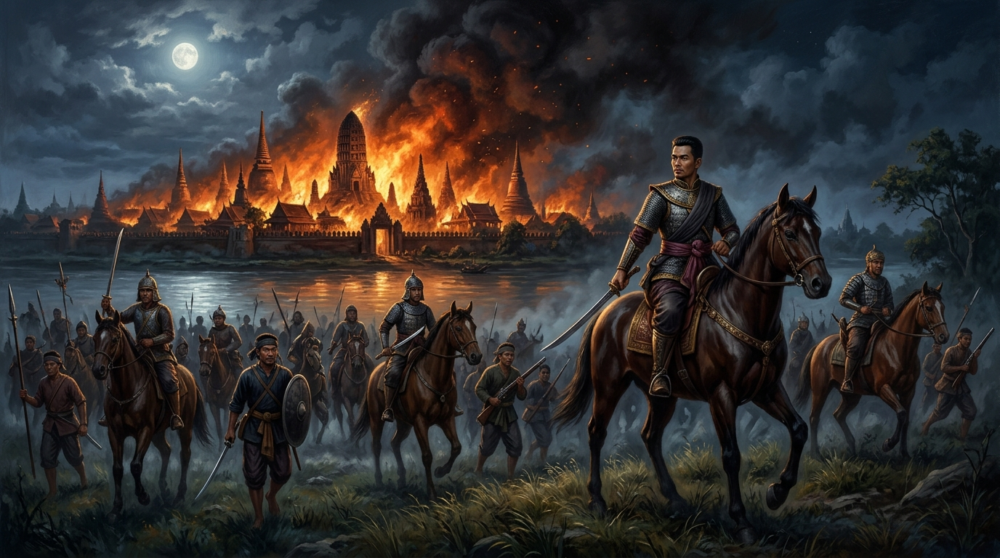
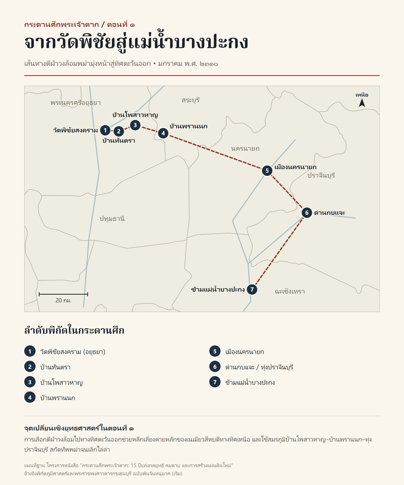
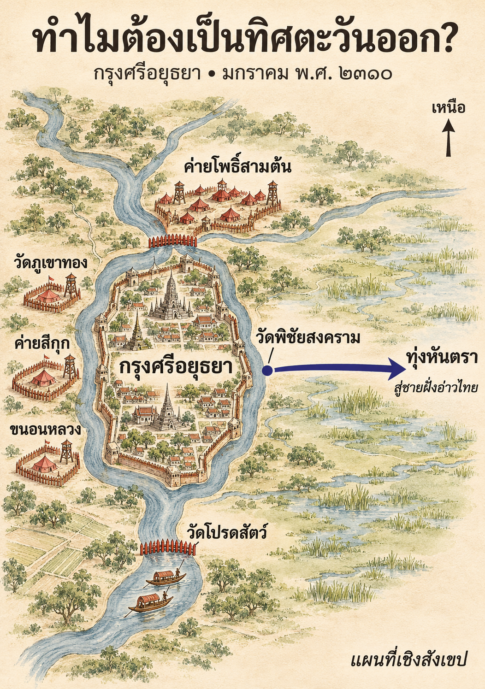
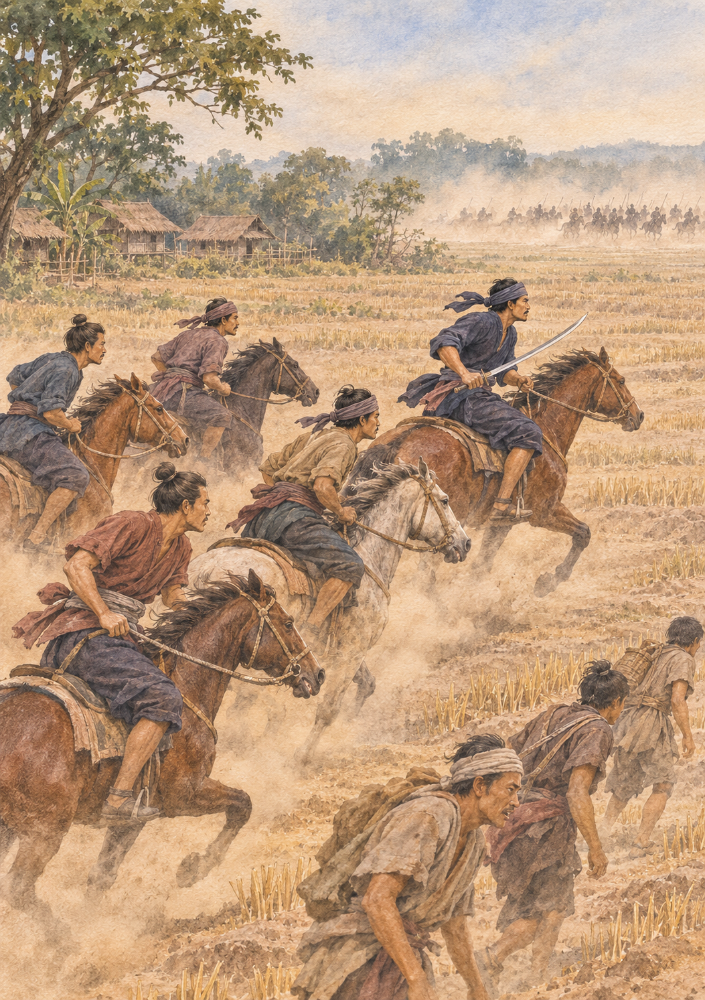

# ภาคที่ 1: ฝ่าไฟไปตั้งหลัก (พ.ศ. 2309 – 2310)
## ตอนที่ 1: คืนไฟบรรลัยกัลป์ จากวัดพิชัยสู่อ่าวไทย

---

### องก์ที่ 1: จุดชนวนและเดิมพัน (The Cold Open & The Stakes)

กลิ่นควันไฟลอยข้ามลำน้ำมาก่อนเสียงกรีดร้อง

คืนวันเสาร์ เดือนยี่ ขึ้น 4 ค่ำ ปีจอ จุลศักราช 1128 (ตรงกับคืนวันที่ 3 มกราคม พ.ศ. 2310 ตามปฏิทินสากล) ลมหนาวต้นฤดูแล้งพัดกรรโชกจากทิศตะวันออกเฉียงเหนือ หอบเอาเถ้าถ่านสีดำและกลิ่นเนื้อไม้ไหม้เกรียมจากเกาะเมืองกรุงศรีอยุธยา ข้ามคูขื่อหน้ามาตกโปรยปรายลงบนลานดินหน้าพระอุโบสถวัดพิชัยสงคราม

ในความมืดของคืนข้างขึ้นอ่อนๆ ที่พระจันทร์เพิ่งลับขอบฟ้า ทหารยามหนุ่มบนหอรบไม้ไผ่ริมคลองข้าวเม่ากำด้ามหอกในมือแน่นจนข้อนิ้วขาวซีด เบื้องหน้าของเขา—ห่างออกไปเพียงชั่วลำน้ำกั้น—มหานครที่เคยรุ่งเรืองที่สุดแห่งลุ่มน้ำเจ้าพระยากำลังลุกโชนเป็นทะเลเพลิง

แสงสีส้มแดงฉานจากบ้านเรือนราษฎรและศาลาวัดกว่าหมื่นหลังที่เกิดเพลิงไหม้ลุกลามพร้อมกัน พุ่งทะยานขึ้นจับท้องฟ้ายามวิกาลจนสว่างวาบราวกับกลางวัน เงาของยอดพระปรางค์และเจดีย์หลวงทอดตัวดำทะมึนตัดกับม่านไฟ เสียงกระบอกไม้ไผ่ระเบิดปะทุดังรัวราวกับเสียงปืนไฟ ผสมปนเปไปกับเสียงโห่ร้องตีเกราะเคาะไม้ของทหารพม่าจากค่ายล้อมกรุงที่ฉวยโอกาสขยับแนวประชิดกำแพงเมือง

ทว่าภายในค่ายวัดพิชัยสงคราม กลับเงียบสงัดอย่างน่าขนลุก

ไม่มีคำสั่งให้ตีม้าล่อระดมพลไปช่วยดับไฟในพระนคร ไม่มีเสียงเกือกม้าที่มุ่งหน้ากลับเข้าสู่ประตูเมือง มีเพียงเสียงฝีเท้าหนักๆ ของชายฉกรรจ์ราวห้าร้อยคน ทั้งไทยและจีน ที่กำลังตระเตรียมอาวุธสั้นยาว ผูกอานม้า และมัดห่อเสบียงเท่าที่หาได้เข้ากับแผ่นหลังอย่างเร่งรีบ

ที่หน้าพระอุโบสถ แสงคบเพลิงดวงเล็กส่องกระทบใบหน้าคมเข้มกร้านแดดของชายวัยสามสิบสองปีในชุดรัดกุมทะมัดทะแมง **พระยาวชิรปราการ**—หรือที่ทหารในกองคุ้นปากว่า *“พระยาตาก”*—ยืนทอดสายตามองเปลวไฟที่กำลังกลืนกินราชธานีด้วยแววตานิ่งลึกไร้อารมณ์หวั่นไหว

มือข้างหนึ่งของเขาวางทาบอยู่บนด้ามดาบข้างเอว อีกข้างหนึ่งกำบังเหียนม้าศึกที่กำลังพ่นลมหายใจเป็นไอขาวในอากาศหนาวเหน็บ

สำหรับขุนนางในศาลาลูกขุน ไฟที่ลุกไหม้คืนนี้คือสัญญาณของความโกลาหลอีกคืนหนึ่งภายใต้การปิดล้อมของกองทัพพระเจ้ามังระ แต่สำหรับแม่ทัพผู้ผ่านศึกหน้าแนวรบมาตลอดหลายเดือน เปลวเพลิงเบื้องหน้าคือ **"คำพิพากษา"** ที่ชัดเจนที่สุด

กรุงศรีอยุธยาไม่อาจรักษาไว้ได้อีกต่อไปแล้ว

และนี่คือเส้นตายสุดท้าย—หากไม่ฉวยจังหวะที่ควันไฟกำลังพรางตาและลมหนาวพัดตลบหลังพม่า ตีฝ่าวงล้อมออกไปในคืนนี้ รุ่งเช้าวันพรุ่งหรืออีกไม่กี่เดือนข้างหน้า ทหารทั้งห้าร้อยคนตรงหน้าก็จะกลายเป็นเพียงซากศพไร้ชื่อที่ทับถมอยู่ใต้ซากอิฐกำแพงเมือง

---

### องก์ที่ 2: อ่านกระดานศึกและปมที่ซ่อนอยู่ (The Map & The Hidden Truth)

เหตุใดแม่ทัพที่เพิ่งได้รับการเลื่อนยศขึ้นเป็นถึง **พระยาวชิรปราการ เจ้าเมืองกำแพงเพชร** จึงตัดสินใจหันหลังให้ราชธานีในยามวิกฤตที่สุด?

ตำราเรียนยุคหลังมักสรุปเหตุการณ์นี้อย่างรวบรัดเพียงว่า *“เห็นว่ากรุงศรีอยุธยาจะต้องเสียแก่พม่าแน่แล้ว จึงรวบรวมผู้คนตีฝ่าวงล้อมออกไปกู้ชาติ”* แต่หากเรากางแผนที่ยุทธการและเปิดอ่านบันทึกหลักฐานชั้นต้นอย่าง **พระราชพงศาวดาร ฉบับพันจันทนุมาศ (เจิม)** คู่กับ **คำให้การชาวกรุงเก่า** เราจะพบความจริงที่ขมขื่นและบีบคั้นยิ่งกว่านั้นมาก

พระยาตากไม่ได้หนีเพราะขลาดกลัวการรบ แต่เขาถอนตัวเพราะ **"ระบบบัญชาการรบของกรุงศรีอยุธยาได้ตายลงไปแล้วก่อนที่กำแพงเมืองจะพัง"**

ย้อนกลับไปไม่กี่สัปดาห์ก่อนหน้านั้น ในช่วงปลายฤดูน้ำหลาก เดือน 12 (พฤศจิกายน พ.ศ. 2309) ราชสำนักอยุธยาส่งกองทัพเรือออกไปตีค่ายพม่าที่วัดใหญ่ชัยมงคลและวัดสังข์กระจาย โดยมี **พระยาเพชรบุรี (เรือง)** ยอดขุนพลฝีมือฉกาจเป็นทัพหน้า และพระยาตากเป็นทัพหนุน

ในวันปะทะที่หน้าวัดสังข์กระจาย กองเรือพม่าของเนเมียวสีหบดีซุ่มรออยู่ในคลองแคบและไหล่ทุ่ง เมื่อพระยาเพชรบุรีนำเรือบุกทะลวงเข้าไป ท่านกลับถูกล้อมกรอบด้วยกองเรือพม่าที่เหนือกว่าหลายเท่าตัว พระยาตากซึ่งอ่านจังหวะศึกอยู่ด้านหลังเห็นท่าไม่ดีว่าเป็นการเดินเข้าสู่กับดักมรณะ จึงชะลอทัพไว้ที่วัดป่าแก้วเพื่อรักษาแนวป้องกันสุดท้ายไม่ให้ละลายไปพร้อมกัน ทว่าแม่ทัพนายกองคนอื่นๆ ที่ร่วมขบวนกลับถอยหนีแตกพ่าย ทิ้งให้พระยาเพชรบุรีสู้จนตัวตายกลางวงล้อมพม่า

ความตายของพระยาเพชรบุรีไม่ได้เพียงแต่พรากขุนพลคู่ใจไป แต่ยังจุดชนวนความหวาดระแวงในราชสำนัก ขุนนางฝ่ายในที่ไม่เคยจับดาบออกศึกพากันกล่าวโทษว่าพระยาตากทอดทิ้งเพื่อนร่วมรบ

และฟางเส้นสุดท้ายก็ขาดสะบั้นลงที่ **"คดีปืนใหญ่บนเชิงเทิน"**

ในยามที่ทัพพม่าขยับค่ายเข้ามาประชิดคูเมืองจนแทบจะเห็นใบหน้ากัน พระยาตากซึ่งรับผิดชอบรักษาหน้าที่เชิงเทินด้านทิศตะวันออก เห็นกองทหารพม่ากำลังขนไม้และดินเข้ามาตั้งค่ายประชิดในระยะหวังผล ในเสี้ยววินาทีทางยุทธวิธี หากปล่อยให้พม่าตั้งค่ายเสร็จ ปืนใหญ่พม่าจะสามารถยิงถล่มกำแพงเมืองได้โดยตรง พระยาตากจึงสั่งพลปืนจุดชนวนยิงปืนใหญ่ถล่มสกัดทัพพม่าทันที!

ทว่าแทนที่จะได้รับคำชมเชย ราชสำนักกลับส่งเจ้าหน้าที่มาชำระความผิดฐาน **"ยิงปืนใหญ่โดยไม่ได้รับอนุญาตจากศาลาลูกขุน"**

ภายใต้กฎมณเฑียรบาลอันวิปริตในยามศึกประชิดเมือง เพื่อป้องกันไม่ให้เสียงปืนใหญ่ทำให้พระสนมกำนัลในพระราชวังตกใจกลัว การจะยิงปืนใหญ่แต่ละนัดต้องทำเรื่องกราบบังคมทูลขอพระบรมราชานุญาตผ่านขั้นตอนระบบราชการเสียก่อน! แม้ครั้งนี้พระยาตากจะได้รับพระราชทานอภัยโทษเพราะความดีความชอบในศึกก่อนหน้า แต่สำหรับนักรบผู้มองเห็นความตายอยู่ตรงหน้าทุกวัน นี่คือสัญญาณเตือนที่ชัดเจนที่สุดว่า—*หากยังอยู่ในกำแพงเมืองแห่งนี้ ถ้าไม่ตายด้วยคมดาบพม่า ก็ต้องตายด้วยคมดาบการเมืองของพวกเดียวกันเอง*

พระยาตากจึงขออาสานำกองกำลังออกมารักษาด่านนอกพระนครที่ **วัดพิชัยสงคราม** ทางทิศตะวันออกของเกาะเมือง ซึ่งในมุมมองของโต๊ะยุทธการ นี่คือการขยับหมากออกจาก "กรงขัง" มาอยู่ในตำแหน่งที่พร้อมเคลื่อนไหวได้ทุกเมื่อ

#### โจทย์บนโต๊ะยุทธการ: ทำไมต้องเป็น "ทิศตะวันออก"?

หากกางแผนที่ลุ่มน้ำเจ้าพระยาในเดือนมกราคม พ.ศ. 2310 ออกดู เราจะเห็นวงล้อมของพม่าบีบรัดกรุงศรีอยุธยาไว้เหมือนคีมเหล็กยักษ์สองขา:
- **ทิศเหนือและทิศตะวันออกเฉียงเหนือ:** กองทัพฝ่ายเหนือของ **เนเมียวสีหบดี** ตั้งค่ายหลวงอยู่ที่โพธิ์สามต้น คุมเส้นทางแม่น้ำเจ้าพระยาและลพบุรี-สระบุรีไว้อย่างเบ็ดเสร็จ การหนีกลับขึ้นเหนือไปหาฐานเสียงเดิมที่เมืองตากหรือพิษณุโลก คือการเดินเข้าปากเสือ
- **ทิศตะวันตก:** กองทัพฝ่ายใต้ของ **มังมหานรธา** (ซึ่งเพิ่งป่วยหนักและเสียชีวิตที่ค่ายสีกุก แต่เนเมียวสีหบดีได้รวบอำนาจบัญชาการแทน) ตั้งค่ายเรียงรายตั้งแต่สีกุก วัดภูเขาทอง ไปจนถึงขนอนหลวง
- **ทิศใต้:** เส้นทางล่องแม่น้ำเจ้าพระยาลงสู่ธนบุรีและปากน้ำ ถูกค่ายพม่าที่วัดโปรดสัตว์และกองเรือลาดตระเวนพม่าปิดตาย

*แผนที่เชิงสังเขปแสดงแนวปิดล้อมกรุงศรีอยุธยาและทางออกด้านตะวันออกจากวัดพิชัยสงครามผ่านทุ่งหันตรา*

เหลือเพียงช่องว่างเดียวบนกระดานศึก นั่นคือ **"ทิศตะวันออก—มุ่งหน้าสู่ชายฝั่งทะเลอ่าวไทย"**

ในสายตาของแม่ทัพพม่า ทิศตะวันออกผ่านทุ่งหันตรา นครนายก และปราจีนบุรี เป็นเส้นทางทุรกันดารที่เต็มไปด้วยป่ารกชัฏและที่ลุ่มน้ำขัง ไม่มีเมืองใหญ่ที่มีคลังเสบียงหรือกำลังพลพอจะยกกลับมาตีกระหนาบพม่าได้ พม่าจึงวางกำลังสกัดกั้นไว้เบาบางที่สุด

แต่ในสายตาของพระยาตาก—อดีตพ่อค้าเกวียนผู้มีสายสัมพันธ์ลึกซึ้งกับเครือข่ายการค้าชาวจีนโพ้นทะเล—ทิศตะวันออกมีข้อได้เปรียบเชิงยุทธศาสตร์ 3 ประการที่ไม่มีใครมองเห็น:
1. **ฤดูกาลเป็นใจ:** เดือนยี่ (มกราคม) น้ำในทุ่งพระอุทัย (ทุ่งตะวันออกของอยุธยา) เริ่มลดระดับลงจนแผ่นดินโคลนเริ่มแข็งตัว ม้าศึกและทหารราบสามารถเดินตัดทุ่งได้เร็วกว่าเรือพม่าที่ติดตื้นในลำคลอง
2. **ปราการธรรมชาติ:** เมื่อพ้นเขตนครนายกและปราจีนบุรีไปแล้ว ทิวเขาและป่าดงดิบจะกลายเป็นกำแพงกั้นไม่ให้ทัพใหญ่ของพม่าส่งกำลังตามมาขยี้ได้โดยง่ายเพราะพม่าต้องทุ่มกำลังหลักไว้ที่การตีกรุงศรีอยุธยา
3. **ทางออกสู่ทะเลและเส้นเลือดการค้า:** หัวเมืองชายฝั่งตะวันออก (ชลบุรี ระยอง จันทบูร ตราด) ยังไม่บอบช้ำจากสงคราม มีข้าวปลาอาหารบริบูรณ์ และที่สำคัญที่สุด—มันคือประตูสู่เครือข่ายเรือสำเภาจีนในอ่าวไทย ที่สามารถเปลี่ยนเป็นกองทัพเรือย้อนกลับมาทางปากน้ำเจ้าพระยาได้เมื่อลมมรสุมเปลี่ยนทิศ!

ด้วยกำลังพลเพียง **500 นาย** มีปืนคาบศิลาเพียงหยิบมือ และแทบไม่มีปืนใหญ่ติดตัวไปเลย นี่คือการเดิมพันที่ต้องอาศัยความเร็ว ความเด็ดขาด และการรบแบบกองโจรที่ห้ามแพ้แม้แต่ครั้งเดียว

---

### องก์ที่ 3: คมดาบและกลศึก (The Clash & Tactical Turning Point)

*"เคลื่อนทัพ!"*

สิ้นเสียงคำสั่งสั้นห้วนของพระยาวชิรปราการ ขบวนนักรบห้าร้อยชีวิตก็เคลื่อนออกจากเงามืดของวัดพิชัยสงครามในยามดึกสงัด โดยมีขุนพลคู่ใจอย่าง **พระเชียงเงิน**, **หลวงพิชัยอาสา (จ้อย)**, **หลวงพรหมเสนา**, **หลวงราชเสน่หา** และ **ขุนอภัยภักดี** คุมปีกซ้ายขวาและกองระวังหลัง

เบื้องหลังของพวกเขา แสงไฟจากกรุงศรีอยุธยายังคงลุกโชติช่วง ทหารพม่าในค่ายรายรอบมัวแต่จับจ้องไปที่ความพินาศในเกาะเมือง กว่าจะรู้ตัวว่ามีกองกำลังขนาดย่อมแหวกแนวค่ายด้านตะวันออกพุ่งตรงไปยัง **บ้านหันตรา** ขบวนของพระยาตากก็ทะลวงผ่านแนวระวังป้องกันชั้นแรกไปแล้ว

แต่เนเมียวสีหบดีไม่ได้เป็นแม่ทัพไร้ฝีมือ

ทันทีที่ม้าเร็วรายงานว่ามีกองทหารอยุธยาตีฝ่าวงล้อมออกไปทางทิศตะวันออก คำสั่งไล่ล่าสังหารก็ถูกส่งออกจากค่ายพม่าทันที กองทหารม้าและทหารราบพม่าหลายพันนายถูกส่งออกติดตามอย่างกระชั้นชิด หวังบดขยี้กบฏกลุ่มเล็กๆ นี้ให้แหลกคามือก่อนที่ดวงอาทิตย์จะขึ้น

#### สมรภูมิที่ 1: เปลวไฟและคมดาบที่บ้านโพสาวหาญ

รุ่งเช้าของวันอาทิตย์ เดือนยี่ ขึ้น 5 ค่ำ ขบวนของพระยาตากเคลื่อนมาถึง **บ้านโพสาวหาญ** (ปัจจุบันอยู่ในเขตอำเภออุทัย จังหวัดพระนครศรีอยุธยา) ฝุ่นดินที่ตลบฟุ้งขึ้นจากขอบฟ้าทิศตะวันตกบอกให้รู้ว่ากองทัพพม่าตามมาทันแล้ว

ทหารห้าร้อยนายเดินทัพมาตลอดทั้งคืนโดยไม่ได้หลับนอน ความเหนื่อยล้าเริ่มเกาะกินสองขา แต่พระยาตากรู้ดีว่าในทุ่งโล่งเช่นนี้ หากสั่งให้วิ่งหนีต่อ ทหารที่หมดแรงจะถูกทหารม้าพม่าไล่แทงข้างหลังทีละคนจนหมดสิ้น

ทางเดียวที่จะรอด คือต้องหันกลับมาขยี้ผู้ล่าให้ชะงัก!

พระยาตากสั่งจัดขบวนรบรับมือทันที แบ่งกำลังซุ่มตามแนวพุ่มไม้และคันดินริมหมู่บ้าน ทันทีที่กองหน้าพม่ากรูกันเข้ามาด้วยความชะล่าใจเพราะคิดว่ากำลังไล่ต้อนคนหนีตาย เสียงโห่ร้องกึกก้องก็ดังสนั่นขึ้นพร้อมกันจากสองฟากทาง

พระยาตากชักดาบควบม้านำทหารทะลวงเข้าใส่กลางขบวนพม่าด้วยตัวเอง คมดาบปะทะคมหอกดังสนั่นหวั่นไหว เลือดสดๆ สาดกระเซ็นย้อมหญ้าแห้งริมทุ่ง ทหารไทย-จีนทั้งห้าร้อยคนที่รู้ว่าไม่มีแผ่นดินให้ถอยกลับ ระเบิดพละกำลังเข้าห้ำหั่นแบบแลกชีวิต จนกองหน้าพม่าที่ขาดการจัดรูปขบวนแตกฮือถอยร่นไม่เป็นท่า

เมื่อตีพม่าแตกกระจายจนได้จังหวะ พระยาตากไม่เสียเวลาไล่ตามให้เสียขบวน ท่านสั่งถอนกำลังเคลื่อนต่อไปยัง **บ้านพรานนก** ทันที

#### สมรภูมิที่ 2: ห้าทหารม้าปะทะสามสิบที่บ้านพรานนก

ที่บ้านพรานนก กองทัพเดินมาด้วยความหิวโหย พระยาตากจึงสั่งให้ทหารกองหนึ่งแยกไปหาเสบียงอาหารในหมู่บ้าน ทว่าในจังหวะที่กำลังพลกระจายตัวกันอยู่นั้น กองทัพพม่าอีกชุดหนึ่ง—ประกอบด้วยทหารม้าประมาณ 30 ม้า และทหารราบราว 200 นาย—ก็ยกตามมาปะทะเข้ากับทหารไทยที่ออกไปหาข้าวปลาอาหารจนแตกพ่ายวิ่งหนีกลับมาหาค่ายพัก

สถานการณ์เข้าขั้นวิกฤต หากปล่อยให้ทหารม้าพม่า 30 นายควบทะลวงเข้ามาถึงจุดพักแรมในขณะที่ทหารส่วนใหญ่กำลังหิวและเสียขวัญ กองทัพห้าร้อยคนจะแตกสลายในพริบตา

ในเสี้ยววินาทีแห่งความเป็นความตายนั้นเอง พระยาวชิรปราการไม่ได้สั่งตั้งค่ายรับ แต่กลับกระโดดขึ้นหลังม้าศึก พร้อมด้วยทหารม้าคู่ใจอีกเพียง **4 นาย**—รวมเป็น **5 ม้า!**

ท่ามกลางสายตาตกตะลึงของทหารทั้งสองฝ่าย ม้าศึกเพียงห้าตัวพุ่งทะยานสวนกระแสทหารที่กำลังวิ่งหนี พุ่งตรงเข้าใส่กองทหารม้าพม่า 30 ม้าอย่างบ้าบิ่นราวกับพายุคลั่ง!

*ภาพจำลองฉากบ้านพรานนก พระยาตากนำทหารม้าอีกสี่นายควบออกไปเผชิญกองทหารม้าพม่า*

ลองจินตนาการผ่านสายตาของนายกองทหารม้าพม่าในวินาทีนั้น—เบื้องหน้าของเขาคือกลุ่มคนที่ควรจะวิ่งหนีสุดชีวิต แต่แม่ทัพของคนกลุ่มนั้นกลับควบม้านำลูกน้องเพียงสี่คน พุ่งฝ่าฝุ่นตลบเข้ามาฟาดฟันระยะประชิดโดยไม่กลัวคมหอกคมดาบ ดาบในมือพระยาตากตวัดฟันทหารม้าพม่าคนแรกตกจากหลังม้าในฉับเดียว ทหารม้าคู่ใจทั้งสี่พุ่งกระแทกแนวหน้าของพม่าจนม้าเสียหลักชนกันเอง

ความดุดันเกินมนุษย์ของคนเพียงห้าคนทำลายขวัญกำลังใจของทหารม้าพม่าจนพังทลาย พวกพม่าเข้าใจผิดคิดว่ามีกองทัพใหญ่ซุ่มรออยู่ด้านหลัง จึงพากันชักม้าหันหลังควบหนีไปชนกองทหารราบอีก 200 นายที่เดินตามมาข้างหลังจนขบวนรวนเร แตกพ่ายหนีกระเจิดกระเจิงไปทั้งกองทัพ!

ชัยชนะที่บ้านพรานนกไม่ได้เป็นเพียงเรื่องเล่าขานถึงความกล้าหาญ แต่มันคือจิตวิทยาการรบขั้นสูงสุดที่หลอมรวมหัวใจของทหารทั้ง 500 นาย และชาวบ้านในละแวกนั้นอย่าง **ขุนชำนาญไพรสณฑ์** และนายกองช้างเมืองนครนายก ให้ยอมถวายชีวิตนำช้างม้าและเสบียงอาหารมาเข้าร่วมขบวนด้วยความศรัทธาอย่างหมดหัวใจ

---

### องก์ที่ 4: ผลลัพธ์และเงาของศึกถัดไป (The Aftermath & Cliffhanger)

กองกำลังของพระยาตากเคลื่อนผ่านเมืองนครนายก มุ่งหน้าเข้าสู่เขต **ด่านกบแจะ** และทุ่งเมือง **ปราจีนบุรี**

แต่พม่ายังไม่ยอมลดละ กองทัพพม่าจากค่ายปากน้ำเจ้าโล้ (บริเวณอำเภอบางคล้า-ปราจีนบุรี ซึ่งพม่าตั้งด่านคุมลำน้ำบางปะกงอยู่) ได้ส่งกำลังพลขนาดใหญ่ทั้งทัพบกและทัพเรือยกขึ้นมาสกัดกั้น พร้อมกับไล่ติดตามมาทางด้านหลังอย่างกระชั้นชิด

ครั้งนี้พระยาตากรู้ดีว่า กองทัพพม่าที่ปากน้ำเจ้าโล้มีกำลังมากเกินกว่าจะใช้ม้าห้าตัวพุ่งชนเหมือนที่บ้านพรานนก และทหารของท่านก็เดินทัพติดต่อกันมาหลายวันจนแทบหมดเรี่ยวแรง

บนกระดานศึกที่ทุ่งปราจีนบุรี พระยาตากจึงงัดกลยุทธ์ **"ล่อเสือเข้าช่องแคบ"** ออกมาใช้เป็นครั้งสุดท้ายก่อนข้ามลำน้ำ

ท่านสั่งให้กองลำเลียงและราษฎรที่ติดตามมาล่วงหน้าข้ามทุ่งไปก่อน ส่วนพระองค์นำหน่วยรบหลักถอยเข้าไปตั้งรับในแนวป่าละเมาะที่มีช่องทางเดินแคบๆ บังคับให้ทัพพม่าต้องบีบขบวนเดินเรียงแถวเข้ามา จากนั้นสั่งให้นำปืนใหญ่ขนาดเล็ก (ปืนหลักและปืนนกสับคาบศิลาที่ยึดมาได้ระหว่างทาง) ตั้งเรียงรายซุ่มไว้หลังพุ่มไม้ในระยะประชิด

เมื่อกองทัพพม่าเห็นฝ่ายไทยถอยร่นเข้าไปในชายป่า ก็สำคัญผิดว่ากองกำลังของพระยาตากหมดทางสู้แล้ว ทหารพม่าจึงโห่ร้องกรูกันวิ่งไล่ตามเข้ามาในช่องแคบอย่างไม่เป็นขบวน

*"ยิง!"*

เสียงปืนใหญ่และปืนคาบศิลาแผดคำรามขึ้นพร้อมกันในระยะเผาขน!

ลูกปรายและกระสุนเหล็กพุ่งฉีกร่างทหารพม่าแถวหน้าล้มระเนนระนาดราวกับใบไม้ร่วง ควันดินปืนสีขาวขุ่นคลุ้งตลบไปทั่วชายป่า ทหารพม่าแถวหลังที่วิ่งตามมาเบรกไม่ทัน เหยียบกันเองล้มคว่ำคะมำหงาย พระยาตากสั่งยิงซ้ำอีกสามตับติดๆ กัน จนซากศพทหารพม่ากองทับถมขวางทางเดิน

กองทัพพม่าที่สูญเสียกำลังพลไปอย่างหนักหน่วงในพริบตาเดียว เกิดความหวาดกลัวสุดขีด ไม่กล้าบุกฝ่าแนวปืนไฟเข้ามาอีก ต้องสั่งถอนทัพถอยร่นกลับไปทางปากน้ำเจ้าโล้ และนับตั้งแต่วินาทีนั้น กองทัพพม่าก็ไม่กล้าส่งกำลังออกไล่ล่ากองทัพของพระยาตากอีกเลย

ยามเย็นวันนั้น เมื่อเสียงปืนนัดสุดท้ายเงียบลง และควันดินปืนจางหายไปในสายลม พระยาวชิรปราการนำทหารที่เหลือเคลื่อนพลมาหยุดยืนอยู่ริมฝั่งแม่น้ำสายใหญ่ที่ไหลคดเคี้ยวลงสู่อ่าวไทย—**แม่น้ำบางปะกง**

เบื้องหลังของพวกเขา แผ่นดินลุ่มน้ำเจ้าพระยากำลังจมดิ่งลงสู่ยุคเข็ญที่มืดมนที่สุดในประวัติศาสตร์

แต่เบื้องหน้า ข้ามลำน้ำบางปะกงออกไป คือดินแดนหัวเมืองชายฝั่งทะเลตะวันออกที่ยังไม่มีใครรู้ชะตากรรม ดินแดนที่เจ้าเมืองกรมการเมืองต่างกำลังตั้งป้อมรักษาผลประโยชน์ของตนเอง โดยไม่รู้เลยว่า กองกำลังทหารเสื้อผ้าขาดวิ่นเพียงห้าร้อยคนริมฝั่งน้ำแห่งนี้ กำลังจะก้าวข้ามแม่น้ำมาเปลี่ยนประวัติศาสตร์ของแผ่นดินไปตลอดกาล

---
**จบตอนที่ 1**
*(ติดตามต่อใน ตอนที่ 2: ข้ามแม่น้ำบางปะกง เมื่อแผ่นดินไร้ราชธานี)*
