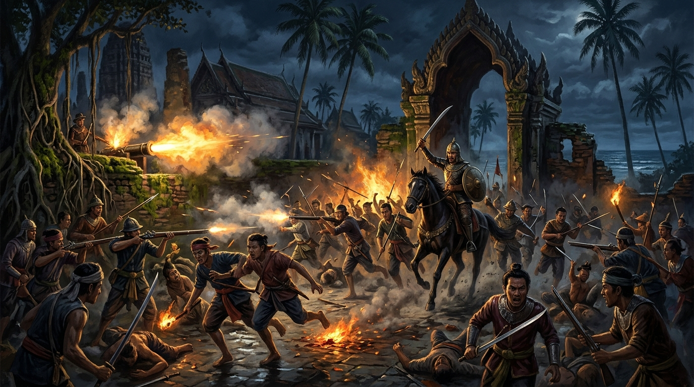
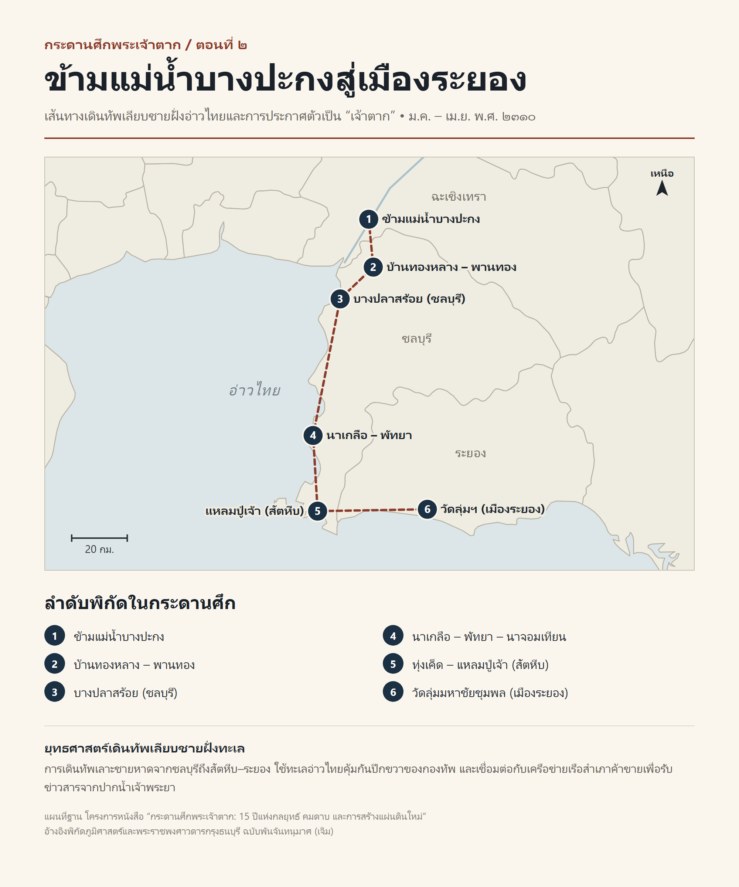
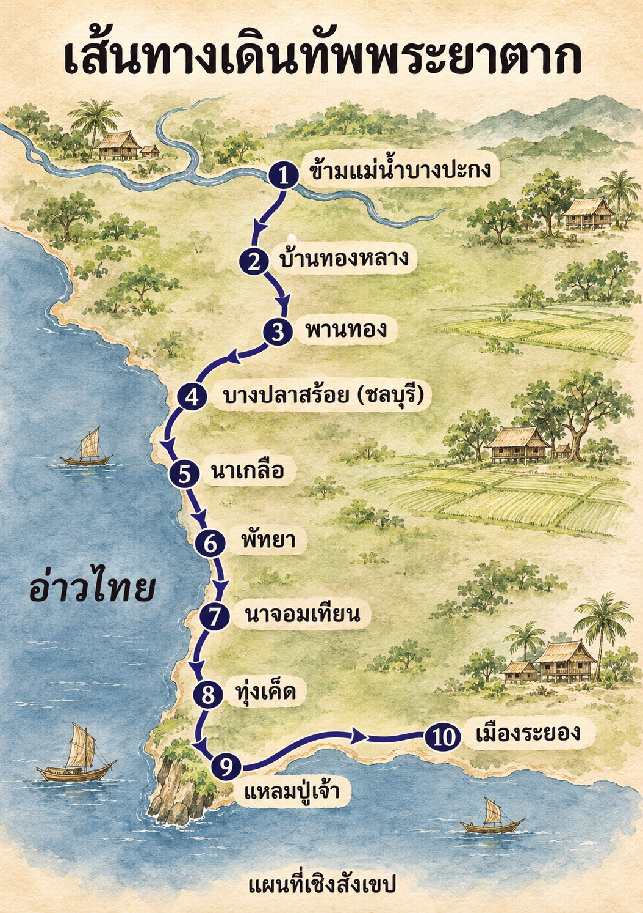
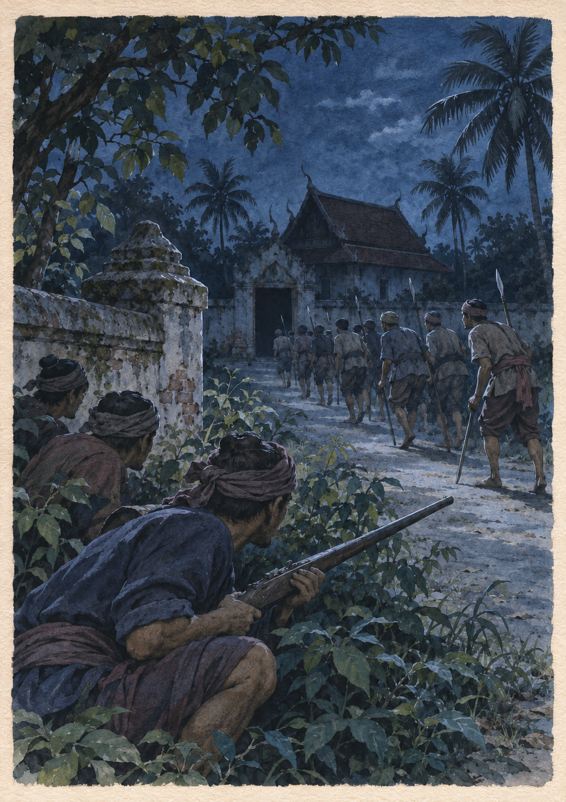

# ภาคที่ 1: ฝ่าไฟไปตั้งหลัก (พ.ศ. 2309 – 2310)
## ตอนที่ 2: ข้ามแม่น้ำบางปะกง เมื่อแผ่นดินไร้ราชธานี

---

### องก์ที่ 1: จุดชนวนและเดิมพัน (The Cold Open & The Stakes)

กลิ่นน้ำกร่อยและลมเค็มจากอ่าวไทยพัดสวนขึ้นมาตามคุ้งน้ำบางปะกง

ปลายเดือนยี่ ปีจอ (มกราคม พ.ศ. 2310) ขบวนนักรบเสื้อผ้าขาดวิ่นและเปื้อนโคลนแห้งกรังราวห้าร้อยชีวิต ค่อยๆ ลำเลียงคนม้าและช้างศึกข้ามฝั่งแม่น้ำบางปะกงมุ่งหน้าลงสู่ทิศใต้ ไม่มีเสียงฆ้องกลองนำขบวน ไม่มีธงชัยประจำตำแหน่งเจ้าเมืองกำแพงเพชรโบกสะบัดอย่างเปิดเผย มีเพียงความระแวดระวังทุกฝีก้าวราวกับฝูงหมาป่าที่เพิ่งหลุดพ้นจากบ่วงพราน

หากมองจากสายตาของชาวบ้านริมฝั่งน้ำที่แอบซุ่มดูอยู่หลังกอจาก ขบวนคนติดอาวุธกลุ่มนี้แทบไม่ต่างอะไรจาก "ซ้องโจร" หรือกองทหารหนีทัพที่แตกกระสานซ่านเซ็นมาจากศึกกรุงศรีอยุธยา

และนั่นคืออันตรายที่แท้จริงยิ่งกว่ากองทัพพม่า

บนหลังม้าศึกที่เดินนำขบวน **พระยาวชิรปราการ** ตระหนักดีถึงความจริงข้อนี้ ทันทีที่ก้าวข้ามแม่น้ำบางปะกงพ้นเขตการไล่ล่าของกองทัพพม่าที่ปากน้ำเจ้าโล้ ศัตรูของพระองค์ก็เปลี่ยนรูปไปอย่างสิ้นเชิง จากทหารพม่าที่พูดคนละภาษา กลายเป็น **"คนไทยด้วยกันเอง"**—บรรดาเจ้าเมือง กรมการเมือง และนายชุมนุมท้องถิ่นตลอดแนวชายฝั่งตะวันออก

เพราะในห้วงเวลานั้น กรุงศรีอยุธยายังไม่แตก!

ตราบใดที่พระที่นั่งสุริยาสน์อมรินทร์ยังไม่ล่มสลาย ในทางกฎหมายของแผ่นดิน ขุนนางที่นำกำลังทหารผละออกจากสมรภูมิโดยไม่มีท้องตราพระราชสีห์อนุญาต ย่อมมีสถานะเดียวคือ **"กบฏหนีทัพ"** ซึ่งเจ้าเมืองหัวเมืองใดๆ ก็มีสิทธิ์ชอบธรรมที่จะจับกุมหรือสังหารเพื่อส่งหัวไปรับบำเหน็จจากราชสำนัก หรืออย่างน้อยที่สุด ก็ใช้เป็นข้ออ้างในการกำจัดผู้บุกรุกที่จะมาแย่งชิงเสบียงอาหารและไพร่พลในเขตอิทธิพลของตน

ห้าร้อยชีวิตที่รอดตายจากคมดาบพม่า กำลังเดินเข้าสู่ดินแดนสนธยาที่ไร้กฎเกณฑ์ ดินแดนที่รอยยิ้มต้อนรับหน้าประตูเมืองอาจซ่อนคมหอกไว้ข้างหลัง และความอยู่รอดขึ้นอยู่กับการอ่านใจคนให้ออกก่อนที่อีกฝ่ายจะลงมือ

---

### องก์ที่ 2: อ่านกระดานศึกและปมที่ซ่อนอยู่ (The Map & The Hidden Truth)

หากเราเปิด **พระราชพงศาวดารกรุงธนบุรี ฉบับพันจันทนุมาศ (เจิม)** และ **พระราชพงศาวดารกรุงสยาม ฉบับบริติชมิวเซียม** ไล่เรียงรายชื่อสถานที่ที่กองทัพพระยาตากเดินผ่านหลังจากข้ามแม่น้ำบางปะกง เราจะเห็นเส้นทางเดินทัพที่แปลกประหลาดอย่างยิ่งในสายตาคนยุคปัจจุบัน:

*ข้ามแม่น้ำบางปะกง -> บ้านทองหลาง -> พานทอง -> บางปลาสร้อย (ชลบุรี) -> นาเกลือ -> พัทยา -> นาจอมเทียน -> ทุ่งเค็ด -> แหลมปู่เจ้า -> เมืองระยอง*

*แผนที่เชิงสังเขปแสดงลำดับการเดินทัพของพระยาตากจากแม่น้ำบางปะกงถึงเมืองระยอง*

คำถามสำคัญบนโต๊ะยุทธการก็คือ **ทำไมพระยาตากจึงเลือกเดินทัพเลาะเลียบชายหาดและโขดหินริมทะเลอ่าวไทย แทนที่จะเดินลึกเข้าไปในแผ่นดินดอนที่มีหมู่บ้านและไร่นาอุดมสมบูรณ์กว่า?**

หากวิเคราะห์ผ่านเลนส์ภูมิรัฐศาสตร์และหลักฐานทางประวัติศาสตร์ยุคต้นรัตนโกสินทร์ (รวมถึงงานศึกษาของ ศาสตราจารย์ ดร.นิธิ เอียวศรีวงศ์) เราจะพบคำตอบที่สะท้อนถึงความรอบคอบระดับอัจฉริยะของพระยาตาก 3 ประการ:

1. **การหลีกเลี่ยงการปะทะที่ไม่จำเป็นในขณะที่กำลังพลยังบอบช้ำ:**
   เส้นทางลึกเข้าไปในแผ่นดินเต็มไปด้วยป่าทึบและชุมชนเกษตรกรรมที่มีเจ้าถิ่นตั้งซ้องสุมกำลังพลป้องกันตัวจากโจรผู้ร้าย การเดินทัพเลียบชายฝั่งทะเล (ผ่านหาดนาเกลือ พัทยา นาจอมเทียน และแหลมปู่เจ้าหรือบริเวณสัตหีบในปัจจุบัน) แม้จะทุรกันดารและขาดแคลนน้ำจืดในบางช่วง แต่เป็นพื้นที่เปิดโล่งที่ยากต่อการถูกดักซุ่มโจมตีทั้งสองขนาบ และมีทะเลอ่าวไทยคอยคุ้มกันปีกขวาของกองทัพไว้ตลอดเวลา
2. **การเชื่อมต่อกับเครือข่ายชุมชนชาวจีนและชาวประมงชายฝั่ง:**
   เมืองท่าเล็กๆ อย่าง **บางปลาสร้อย (ชลบุรี)** และ **ระยอง** เป็นจุดแวะพักของเรือสำเภาค้าขายและชุมชนชาวจีนแต้จิ๋ว-ฮกเกี้ยน พระยาตากไม่ได้ต้องการแค่ "ข้าวสาร" แต่ต้องการ **"ข่าวสาร"** และ **"ฐานกำลังทางเรือ"** การยึดกุมเมืองท่าชายทะเลคือการเปิดหูเปิดตารับข่าวจากปากน้ำเจ้าพระยาได้เร็วที่สุดผ่านเรือประมงและเรือค้าขายที่หนีภัยสงครามออกมา
3. **กลยุทธ์ "ไม้อ่อนนำไม้แข็ง" (ขอกำลังและเสบียงในนามผู้รักษาราชการ):**
   ในระยะแรกที่ยังไม่รู้ชะตากรรมแน่ชัดของกรุงศรีอยุธยา พระยาตากเลือกใช้วิธีเจรจาอย่างนุ่มนวล ท่านไม่ได้ยกทัพเข้าปล้นเมือง แต่ใช้วิธีส่งคนไปเจรจากับผู้มีอิทธิพลในท้องถิ่น ขอความร่วมมือเรื่องเสบียงอาหารโดยอ้างภารกิจรวบรวมกำลังพลกลับไปช่วยราชธานี

ตัวอย่างแรกเกิดขึ้นที่เขตเมืองชลบุรี เมื่อขบวนทัพเดินมาถึงบ้านทองหลางและพานทอง ได้เผชิญหน้ากับชุมนุมของ **นายกลม** ผู้นำท้องถิ่นที่รวบรวมผู้คนตั้งตัวเป็นใหญ่และเตรียมยกกำลังออกมาสกัดกั้น

แทนที่จะสั่งทหารเข้าห้ำหั่นให้เสียเลือดเนื้อทั้งสองฝ่าย พระยาตากกลับแสดงแสนยานุภาพทางทหารควบคู่ไปกับการทูตที่เด็ดขาด กดดันจนนายกลมเห็นว่าสู้ไปก็รังแต่จะพินาศ จึงยอมวางอาวุธเข้าสวามิภักดิ์ และนำพรรคพวกมาร่วมขบวนทัพ เดินทางต่อไปยังบางปลาสร้อยและมุ่งหน้าสู่เป้าหมายสำคัญแห่งแรก—**เมืองระยอง**

---

### องก์ที่ 3: คมดาบและกลศึก (The Clash & Tactical Turning Point)

ปลายเดือนยี่ แรม 7 ค่ำ (ปลายเดือนมกราคม พ.ศ. 2310) กองทัพของพระยาตากเดินทางมาถึงเขตเมืองระยอง และหยุดตั้งค่ายพักแรมอยู่ที่ด่านนอกเมือง

ในจังหวะนี้เอง มุมมองของเรื่องราวตัดสลับเข้าไปสู่ **"ห้องประชุมลับของกรมการเมืองระยอง"**

ภายในจวนผู้รั้งเมืองระยอง **พระระยอง (บุญเมือง)** ผู้ว่าราชการเมือง กำลังตกอยู่ในภาวะกลืนไม่เข้าคายไม่ออก ข้างกายของเขาคือกลุ่มขุนนางกรมการเมืองผู้กุมอำนาจทหารตัวจริงของระยอง นำโดย **ขุนรามหมื่นซ่อง**, **ขุนจ่าเมือง**, **หมื่นโคราช** และ **หลวงพล**

ในสายตาของขุนรามหมื่นซ่องและพวก กองกำลังของพระยาวชิรปราการที่ยกมาถึงหน้าประตูเมืองมีทหารหลักเพียงห้าร้อยเศษ แม้จะมีคนของนายกลมสมทบมาบ้าง แต่สภาพอิดโรยจากการเดินทัพไกลหลายร้อยกิโลเมตร ในขณะที่ฝ่ายเมืองระยองสามารถระดมไพร่พลในพื้นที่ได้นับพันคน

*"กรุงศรีอยุธยายังไม่เสียแก่พม่า..."* ขุนรามหมื่นซ่องกระซิบเสียงเครียดในวงล้อมกรมการเมือง *"พระยาตากผู้นี้ทิ้งหน้าที่ราชการหนีทัพออกมา หากเรายอมให้เขายึดเมืองระยอง วันหน้าถ้าทัพหลวงหรือทัพพม่ายกมา เราจะเอาหัวไปไว้ที่ไหน? สู้แสร้งทำเป็นต้อนรับให้ตายใจ ล่อให้เข้ามาตั้งค่ายในเมือง แล้วระดมคนเข้าล้อมฆ่าเสียในยามดึกไม่ดีกว่าหรือ!"*

แผนสังหารภายใต้รอยยิ้มถูกวางขึ้นอย่างแยบยล

วันรุ่งขึ้น พระระยองและกรมการเมืองพากันแต่งกายเต็มยศ นำข้าวปลาอาหารและผลไม้ออกมาต้อนรับพระยาวชิรปราการอย่างนอบน้อม เชื้อเชิญให้กองทัพเคลื่อนเข้าสู่ตัวเมืองระยอง และจัดให้เข้าพักที่ **วัดลุ่มมหาชัยชุมพล** ซึ่งตั้งอยู่ใจกลางพื้นที่ลุ่มที่มีลำน้ำและป่าล้อมรอบ—สถานที่ซึ่งดูเหมือนที่พักอันร่มรื่น แต่ในทางยุทธวิธี มันคือ **"ก้นถุง"** ที่เหมาะแก่การปิดล้อมสังหารที่สุด!

ทว่าพวกกรมการเมืองระยองประเมินสัญชาตญาณของคนที่รอดตายจากสมรภูมิวัดสังข์กระจายและบ้านโพสาวหาญต่ำเกินไป

ทันทีที่พระยาตากก้าวเท้าเข้าสู่วัดลุ่มมหาชัยชุมพล สายตาของแม่ทัพผู้เจนศึกก็กวาดมองชัยภูมิรอบด้าน และสังเกตเห็นความผิดปกติในแววตาที่หลุกหลิกของเหล่ากรมการเมือง รวมถึงความเคลื่อนไหวแปลกๆ ของไพร่พลในเมืองที่แอบขนอาวุธออกจากคลัง

พระยาตากยังคงยิ้มรับไมตรีอย่างสงบนิ่ง แต่ทันทีที่ขบวนของพระระยองกลับออกไป สายลับและทหารลาดตระเวนของพระองค์ก็ถูกส่งออกไปกระจายตัวในความมืดทันที

และแล้ว ความจริงก็ปรากฏชัดในอีกสองวันถัดมา

ขุนรามหมื่นซ่อง หลวงพล และขุนจ่าเมือง แอบตั้งค่ายชุมนุมพลกว่า **1,500 นาย** อยู่ที่ **สะพานทอง** นอกเมืองระยอง พร้อมทั้งส่งคนไปกักตัวพระระยองไว้ไม่ให้ส่งข่าวเตือนพระยาตาก โดยวางแผนจะแบ่งกำลังออกเป็นสองสาย บุกเข้าตีกระหนาบค่ายวัดลุ่มมหาชัยชุมพลในยามดึกคืนนั้น!

แต่ก่อนที่ทัพกบฏเมืองระยองจะทันได้เคลื่อนพล ทหารลาดตระเวนของพระยาตากก็จับตัวคนเดินสารของฝ่ายขุนรามหมื่นซ่องได้เสียก่อน เมื่อเค้นสอบจนรู้แผนการทั้งหมด แทนที่พระยาตากจะสั่งถอนทัพหนีออกจากเมืองระยองที่มีกำลังน้อยกว่าถึงสามเท่า พระองค์กลับสั่งเดินหมาก **"ซ้อนกลลวง"** ที่เฉียบขาดที่สุดครั้งหนึ่ง

#### คืนสังหารที่วัดลุ่มมหาชัยชุมพล

ค่ำคืนนั้น พระยาตากสั่งการด้วยเสียงเรียบเย็น:
1. ให้เรียกตัว **พระระยอง (บุญเมือง)** มาไว้ในค่ายเพื่อตัดตอนการบังคับบัญชาของฝ่ายตรงข้าม
2. สั่งให้ทหารทุกนายในค่ายวัดลุ่มฯ **ดับคบเพลิงและกองไฟทั้งหมด** งดส่งเสียงพูดคุย จนทั้งวัดมืดสนิทและเงียบเชียบราวกับทหารทั้งหมดกำลังหลับใหลไม่รู้ชะตากรรม (หรือหนีไปแล้ว)
3. แบ่งกองทหารฝีมือดีพร้อมปืนคาบศิลาและปืนใหญ่เข็น ออกไปซุ่มซ่อนตามแนวรั้ววัด พุ่มไม้ และสองฟากทางเดินที่จะมุ่งหน้าเข้าสู่ประตูค่าย โดยแบ่งหน้าที่รับผิดชอบอย่างรัดกุม—พระเชียงเงินและหลวงพรหมเสนาคุมปีกหนึ่ง หลวงพิชัยอาสาและขุนอภัยภักดีคุมอีกปีกหนึ่ง

ดึกสงัดคืนนั้น ลมทะเลพัดยอดมะพร้าวไหวเสียดสีกันท่ามกลางความมืด ขุนรามหมื่นซ่องและขุนจ่าเมืองนำกำลังไพร่พลกว่าพันคนย่องเข้ามาตามเส้นทางจากสะพานทอง มุ่งตรงมายังวัดลุ่มมหาชัยชุมพล

*ภาพจำลองฉากก่อนปะทะที่วัดลุ่มมหาชัยชุมพล ขณะกองกำลังระยองเคลื่อนเข้าหาประตูวัดและทหารพระยาตากซุ่มอยู่ข้างทาง*

เมื่อเห็นภายในวัดมืดสนิทไร้แสงไฟและไม่มีทหารยามยืนเฝ้าหน้าประตู ขุนรามหมื่นซ่องก็กระหยิ่มยิ้มย่อง คิดว่าพระยาตากคงชะล่าใจนอนหลับกันหมดทั้งค่าย จึงชักดาบสั่งให้ไพร่พลโห่ร้องกรูกันวิ่งทะลวงผ่านซุ้มประตูวัดและแนวกำแพงเข้ามาพร้อมกัน!

ฝีเท้านับพันวิ่งกรูเข้ามาในพื้นที่สังหารโดยไร้การจัดแถว... ห้าสิบเมตร... สามสิบเมตร... สิบเมตร!

*"จุดชนวน!"*

เสียงคำสั่งของพระยาวชิรปราการดังกัมปนาทผ่าความมืด ตามด้วยแสงไฟสว่างวาบจากปากกระบอกปืนใหญ่และปืนคาบศิลานับร้อยกระบอกที่แผดเสียงคำรามขึ้นพร้อมกันจากทุกทิศทุกทาง!

เปรี้ยง! เปรี้ยง! ตูม!

กระสุนลูกปรายสาดเข้าใส่ร่างของไพร่พลเมืองระยองที่อัดแน่นกันอยู่หน้าประตูวัดในระยะเผาขน เสียงกรีดร้องโหยหวนดังระงมขึ้นแทนเสียงโห่ร้อง ร่างของคนแถวหน้าล้มคว่ำทับกันเป็นกองเลือด ท่ามกลางความมืดและควันดินปืนที่ทำให้ไม่รู้ว่าศัตรูมีจำนวนเท่าใด ทหารของพระยาตากที่ซุ่มอยู่สองข้างทางก็ชักดาบสองมือกระโจนออกจากเงามืด ไล่ฟาดฟันทะลวงเข้าใส่กลางขบวนที่กำลังขวัญหนีดีฝ่อ!

หลวงพิชัยอาสา (จ้อย) และพระเชียงเงินนำหน่วยทะลวงฟันบุกฝ่าวงล้อมออกไปถึงแนวหลังในพริบตา ไพร่พลเมืองระยองกว่า 1,500 คนที่ถูกจู่โจมกลับอย่างไม่คาดฝัน ต่างพากันทิ้งหอกทิ้งดาบ วิ่งหนีตายเหยียบกันเองแตกพ่ายกระเจิดกระเจิงไปในความมืด ขุนรามหมื่นซ่องและพรรคพวกต้องหนีเตลิดออกจากเมืองระยอง มุ่งหน้าไปขอพึ่งใบบุญของ **พระยาจันทบูร** ที่เมืองจันทบุรี

ภายในเวลาไม่ถึงหนึ่งชั่วยาม เมืองระยองทั้งเมืองก็ตกอยู่ใต้การควบคุมของพระยาวชิรปราการอย่างเบ็ดเสร็จ!

---

### องก์ที่ 4: ผลลัพธ์และเงาของศึกถัดไป (The Aftermath & Cliffhanger)

ชัยชนะที่วัดลุ่มมหาชัยชุมพลเปลี่ยนสถานะของพระยาตากจาก "ผู้พลัดถิ่น" ให้กลายเป็น "ผู้กุมอำนาจเหนือเมืองระยอง" คลังเสบียง อาวุธ ช้างม้า และไพร่พลของเมืองระยองถูกนำมาเสริมทัพจนแข็งแกร่งขึ้นผิดหูผิดตา

แต่จุดเปลี่ยนที่แท้จริงของประวัติศาสตร์ ไม่ได้เกิดจากคมดาบในคืนนั้น หากแต่เดินทางมากับเรือสำเภาและผู้รอดชีวิตที่หนีตายมาจากปากน้ำเจ้าพระยาในเดือนเมษายน พ.ศ. 2310

**วันอังคาร เดือน 5 ขึ้น 9 ค่ำ ปีกุน (7 เมษายน พ.ศ. 2310)**

ข่าวร้ายที่สุดที่คนไทยทุกคนหวาดกลัวเดินทางมาถึงเมืองระยอง—**กรุงศรีอยุธยาแตกแล้ว!**

กำแพงเมืองที่ยืนหยัดมานานกว่า 417 ปี พังทลายลงด้วยไฟและระเบิดใต้ดินของทัพพม่า ปราสาทราชมณเฑียร วัดวาอาราม และพระพุทธรูปทองคำถูกเผาทำลายหลอมลอกเอาทอง ราษฎรและเชื้อพระวงศ์ถูกกวาดต้อนเป็นเชลยศึกนับแสนคน ส่วนสมเด็จพระที่นั่งสุริยาสน์อมรินทร์ (พระเจ้าเอกทัศ) เสด็จสวรรคตท่ามกลางความพินาศของพระนคร

ภายในค่ายหลวงเมืองระยอง ความเงียบงันเข้าปกคลุมเหล่าแม่ทัพนายกองและไพร่พล น้ำตาของลูกผู้ชายไหลอาบแก้มที่กร้านศึก แผ่นดินสยามในวินาทีนั้น ไม่มีพระมหากษัตริย์ ไม่มีราชธานี และไม่มีศูนย์กลางอำนาจหลงเหลืออยู่อีกต่อไป

ทว่าในห้วงเวลาแห่งความสิ้นหวังนั้นเอง บนโต๊ะยุทธการของพระยาวชิรปราการ วิกฤตการณ์ระดับชาติได้ปลดล็อก **"พันธนาการทางการเมือง"** ข้อสุดท้ายออกไปจนหมดสิ้น

เมื่อกรุงศรีอยุธยาล่มสลายและไร้พระเจ้าแผ่นดิน สถานะ "ขุนนางหนีทัพ" ก็สูญสลายไปตามสายลม นับจากวินาทีนี้ ใครก็ตามที่สามารถรวบรวมผู้คน กอบกู้แผ่นดิน และฟื้นฟูพระพุทธศาสนาขึ้นมาใหม่ได้ ผู้นั้นคือผู้มีความชอบธรรมสูงสุดเหนือแผ่นดิน!

ท่ามกลางที่ประชุมนายทัพนายกองและราษฎรเมืองระยอง ณ วัดลุ่มมหาชัยชุมพล พระยาวชิรปราการก้าวขึ้นยืนประกาศเจตนารมณ์ด้วยน้ำเสียงกังวานเด็ดขาด ว่าพระองค์จะรวบรวมกำลังพลกลับไปตีทัพพม่า กอบกู้กรุงศรีอยุธยากลับคืนมาให้จงได้ เพื่อมิให้แผ่นดินต้องไร้ขื่อแปและพระพุทธศาสนาต้องเสื่อมสูญ

นับตั้งแต่วันนั้น ผู้คนและไพร่พลทั้งปวงจึงพร้อมใจกันยกย่องและขานพระนามของพระองค์ใหม่ว่า **"เจ้าตาก"**—เทียบเท่าฐานะเจ้านายผู้เป็นจอมทัพปกครองแผ่นดิน!

แต่ "เจ้าตาก" รู้ดีว่า ลำพังกำลังพลและเสบียงอาหารของเมืองระยองและชลบุรี ยังไม่เพียงพอที่จะต่อเรือรบร้อยลำเพื่อยกกลับไปรบกับพม่าที่อยุธยา

สายตาของจอมทัพหนุ่มจึงทอดมองไปทางทิศตะวันออก—มุ่งตรงไปยังป้อมปราการที่มั่งคั่ง แข็งแกร่ง และมีกำแพงเมืองสูงตระหง่านที่สุดในภูมิภาคนี้

**เมืองจันทบูร (จันทบุรี)**

ที่นั่น **พระยาจันทบูร** เจ้าเมืองผู้มั่งคั่งซึ่งให้ที่พักพิงแก่ขุนรามหมื่นซ่องศัตรูของเจ้าตาก กำลังส่งทูตถือจดหมายไมตรีมาเชิญเจ้าตากด้วยถ้อยคำหวานหู ขณะที่เบื้องหลังกำแพงเมืองจันทบูร ปืนใหญ่ทุกกระบอกกำลังถูกเข็นขึ้นประจำป้อม รอคอยให้กองทัพของเจ้าตากเดินเข้าสู่หลุมพรางมรณะ!

---
**จบตอนที่ 2**
*(ติดตามต่อใน ตอนที่ 3: ทุบหม้อข้าวที่จันทบูร เดิมพันสุดท้ายหน้ากำแพงเมือง)*
