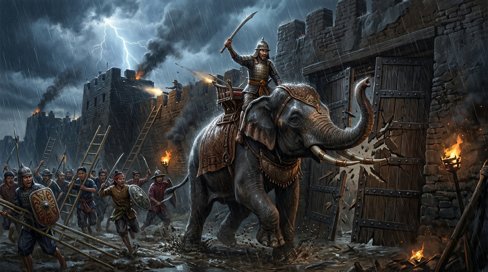
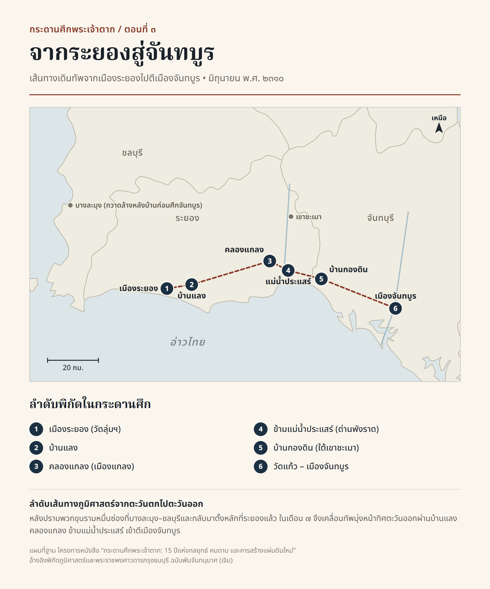
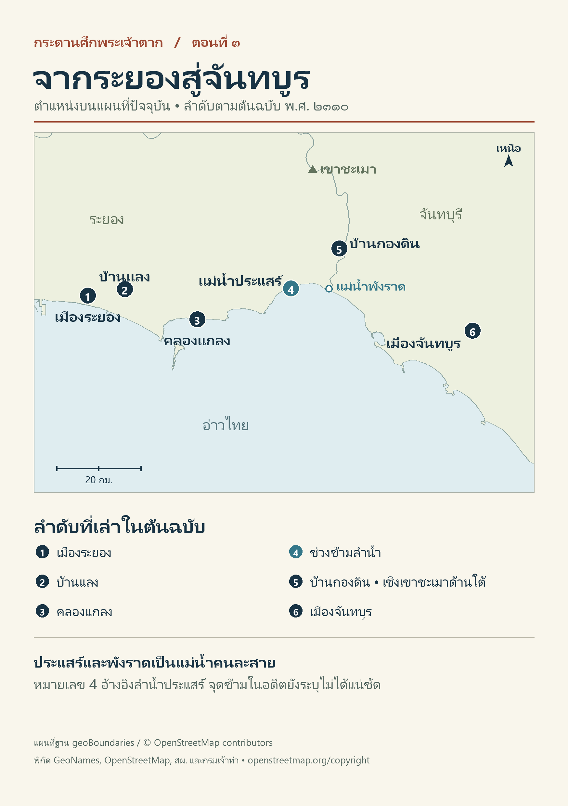

# ภาคที่ 1: ฝ่าไฟไปตั้งหลัก (พ.ศ. 2309 – 2310)
## ตอนที่ 3: ทุบหม้อข้าวที่จันทบูร เดิมพันสุดท้ายหน้ากำแพงเมือง

---

### องก์ที่ 1: จุดชนวนและเดิมพัน (The Cold Open & The Stakes)

เสียงดินเผาแตกกระจายดังกราวแข่งกับเสียงฟ้าร้องคำรามเหนือยอดไม้เมืองจันทบูร

เย็นวันอาทิตย์ เดือน 7 แรม 3 ค่ำ ปีกุน (ตรงกับวันที่ 14 มิถุนายน พ.ศ. 2310) เมฆพายุฤดูมรสุมตะวันตกเฉียงใต้ตั้งเค้าดำทะมึนปกคลุมท้องฟ้าเหนือ **วัดแก้ว** นอกกำแพงเมืองจันทบูร ลมชื้นหอบกลิ่นดินและกลิ่นน้ำฝนแรกของค่ำคืนพัดกรรโชกแรงจนยอดธงศึกสะบัดพึ่บพั่บ

บนเชิงเทินกำแพงเมืองจันทบูรที่ก่อด้วยศิลาแลงและดินอัดแน่นสูงตระหง่าน ทหารยามสองนายในชุดเสื้อเกราะหวายเพ่งสายตามองฝ่าแสงสลัวของยามพลบค่ำลงไปยังค่ายของ **เจ้าตาก** ที่ตั้งประชิดอยู่ห่างออกไปไม่กี่เส้น

แทนที่จะเห็นควันไฟหุงหาอาหารลอยอ้อยอิ่งเหมือนทุกเย็น หรือเห็นการขุดสนามเพลาะเตรียมตั้งค่ายล้อมเมืองระยะยาว ทหารยามบนกำแพงกลับเห็นภาพที่ชวนให้ขนลุกชันไปทั้งแผ่นหลัง

เบื้องล่างนั้น ทหารไทยและจีนนับพันคนเพิ่งกินข้าวเย็นมื้อสุดท้ายเสร็จสิ้น และในวินาทีถัดมา ตามคำสั่งเดียวของจอมทัพหนุ่มผู้ประทับอยู่บนหลังช้างศึก **พังคีรีบัญชร** ทหารทุกคนก็คว้าท่อนไม้และด้ามหอกทุบหม้อดินหุงข้าว หม้อแกง และเทกระจาดเสบียงอาหารที่เหลือทิ้งลงกับพื้นดินจนแตกกระจายไม่เหลือชิ้นดี!

*"พวกมันบ้าไปแล้วหรือ..."* ทหารยามนายหนึ่งพึมพำเสียงสั่น มือที่จับด้ามปืนคาบศิลาชื้นไปด้วยเหงื่อ *"ทุบหม้อข้าวทิ้งหมดแบบนั้น ถ้าคืนนี้ตีเมืองเราไม่ได้ พรุ่งนี้เช้าพวกมันจะเอาอะไรกิน?"*

ไม่มีใครบนกำแพงเมืองตอบคำถามนั้นได้ เพราะคำตอบอยู่ในดวงตาอันคมกริบของเจ้าตากที่จ้องเขม็งขึ้นมาบนยอดกำแพงเมืองจันทบูรแล้ว

*“เราจะตีเมืองจันทบูรในค่ำวันนี้ เมื่อกองทัพหุงข้าวเย็นกินเสร็จแล้ว ทั้งนายไพร่ให้เทอาหารที่เหลือและทุบหม้อข้าวหม้อแกงเสียให้หมด ไปกินข้าวเช้าด้วยกันในเมืองพรุ่งนี้ ถ้าตีเอาเมืองไม่ได้ในค่ำวันนี้ ก็ให้ตายเสียด้วยกันให้หมดเถิด!”*

นั่นไม่ใช่เพียงคำปลุกใจที่จำมาจากนิยายสามก๊กหรือพงศาวดารจีน แต่มันคือ **"คำสั่งประหารความลังเล"** ของกองทัพที่กำลังหลังพิงฝา เพราะหากคืนนี้กำแพงเมืองจันทบูรไม่แตก กองทัพกู้แผ่นดินก็จะจบสิ้นลงที่นี่—ก่อนที่จะได้ต่อเรือรบแม้แต่ลำเดียว!

---

### องก์ที่ 2: อ่านกระดานศึกและปมที่ซ่อนอยู่ (The Map & The Hidden Truth)

ก่อนจะไปถึงวินาทีที่ช้างพังคีรีบัญชรพุ่งชนประตูเมือง เราต้องย้อนกลับมากางแผนที่บนโต๊ะยุทธการเพื่อตอบคำถามสำคัญเสียก่อนว่า **ทำไมเจ้าตากจึงยอมเสียเวลาเจรจากับพระยาจันทบูรอยู่นานเกือบสองเดือน ทั้งที่รู้ว่าอีกฝ่ายไม่น่าไว้ใจ และทำไมในที่สุดจึงต้องตัดสินใจหักเอาเมืองด้วยชีวิตในคืนเดือนเจ็ด?**

หากวิเคราะห์จากหลักฐานชั้นต้นทั้ง **พระราชพงศาวดาร ฉบับพันจันทนุมาศ (เจิม)**, **จดหมายเหตุคณะบาทหลวงฝรั่งเศส** และสภาพภูมิศาสตร์ของหัวเมืองชายฝั่งตะวันออก เราจะเห็นแรงบีบคั้นของเวลาและทรัพยากร (Ticking Clock) ที่กำลังนับถอยหลังอย่างโหดร้าย:

#### 1. ทำไม "ระยอง" จึงไม่พอ และทำไมต้องเป็น "จันทบูร"?
แม้เจ้าตากจะยึดเมืองระยองและปราบปรามซ้องโจรที่เมืองชลบุรี (เช่น นายทองอยู่นกเล็ก ที่เจ้าตากเกลี้ยกล่อมและตั้งให้ดูแลเมืองชลบุรีชั่วคราว) ได้แล้ว แต่ระยองเป็นเพียงเมืองขนาดเล็กที่มีพื้นที่ราบลุ่มจำกัด ข้าวสารในยุ้งฉางของระยองแทบไม่พอเลี้ยงกองทัพและผู้ลี้ภัยสงครามที่หลั่งไหลมาสมทบจนเพิ่มจำนวนขึ้นเป็นหลักพันคน

ยิ่งไปกว่านั้น เป้าหมายสูงสุดของเจ้าตากคือการ **"ยกทัพเรือย้อนกลับไปตีพม่าที่กรุงศรีอยุธยาในฤดูน้ำหลาก (เดือน 11–12 หรือตุลาคม–พฤศจิกายน)"** ซึ่งเหลือเวลาเตรียมการอีกเพียง **4 เดือนเศษ!**

การจะต่อเรือรบขนาดใหญ่จำนวน 100 ลำภายในเวลา 4 เดือน จำเป็นต้องมีทรัพยากร 3 สิ่งที่เมืองระยองไม่มี แต่ **เมืองจันทบูร** มีครบถ้วน:
- **แหล่งไม้ซุงขนาดใหญ่และเหล็ก:** ป่าดงดิบเชิงเขาสระบาปและลุ่มน้ำจันทบุรีอุดมไปด้วยไม้ตะเคียนและไม้เคี่ยมขนาดใหญ่สำหรับทำกระดูกงูเรือรบ
- **อู่ต่อเรือที่ปลอดภัยจากพายุฤดูมรสุม:** ปากแม่น้ำจันทบุรีและอ่าวคุ้งกระเบน–แหลมสิงห์ มีภูเขากำบังลมมรสุมตะวันตกเฉียงใต้ ทำให้สามารถตั้งโรงต่อเรือได้ตลอดฤดูฝนโดยไม่ถูกคลื่นทะเลซัดพัง
- **คลังเสบียงและชุมชนชาวจีน-ญวน-เข้ารีตที่มั่งคั่ง:** จันทบูรเป็นเมืองท่าการค้านานาชาติที่ไม่เคยถูกพม่าแตะต้อง มีข้าวเปลือก อาวุธปืนใหญ่ และช่างต่อเรือฝีมือดีอาศัยอยู่เป็นจำนวนมาก

#### 2. เกมการเมืองสองหน้าของ "พระยาจันทบูร"
ในตอนแรกที่เจ้าตากยังตั้งมั่นอยู่ที่ระยอง พระองค์พยายามใช้ไม้อ่อนส่งทูตไปเจรจาขอเป็นพันธมิตรและขอซื้อเสบียงจากพระยาจันทบูร เพราะไม่ต้องการเสียกำลังพลในการตีเมืองที่มีกำแพงแข็งแกร่ง

ฝ่าย **พระยาจันทบูร** นั้น ทีแรกแสร้งทำเป็นยอมอ่อนน้อม ส่งทูตนำสิ่งของมาต้อนรับถึงเมืองระยอง เมื่อขุนรามหมื่นซ่อง (อดีตกรมการเมืองระยองที่พ่ายแพ้เจ้าตากจากศึกวัดลุ่มมหาชัยชุมพล) หนีไปซ่องสุมกำลังปล้นชิงช้างม้าอยู่ที่แถบ **บางละมุงและเมืองชลบุรี** เจ้าตากจึงต้องยกกำลังย้อนกลับขึ้นไปทางทิศตะวันตกเพื่อปราบปรามขุนรามหมื่นซ่องและเกลี้ยกล่อมนายทองอยู่นกเล็กที่ชลบุรีเสียก่อน เพื่อมิให้มีศึกขนาบหลัง จากนั้นจึงเสด็จกลับลงมาตั้งมั่นที่ **เมืองระยอง** ส่วนขุนรามหมื่นซ่องที่แตกพ่ายอีกครั้งได้หนีเตลิดข้ามเขตไปพึ่ง **พระยาจันทบูร** และยุยงเป่าหูว่า กองทัพเจ้าตากมีคนน้อยและเป็นเพียงพวกเร่ร่อนไร้ฐานอำนาจ พระยาจันทบูรจึงเปลี่ยนใจ คิดจะกำจัดเจ้าตากเสียเองเพื่อฮุบกำลังพลและทรัพย์สินทั้งหมด!

เดือน 7 (มิถุนายน พ.ศ. 2310) เมื่อการระวังหลังทางฝั่งบางละมุง–ชลบุรีเรียบร้อยแล้ว และเห็นว่าพระยาจันทบูรบ่ายเบี่ยงไม่ยอมส่งเสบียงทั้งยังให้ที่พักพิงแก่ขุนรามหมื่นซ่อง เจ้าตากจึงตัดสินใจเคลื่อนทัพทั้งหมดออกจาก **เมืองระยอง** มุ่งหน้าไปทางทิศตะวันออก เดินทัพผ่าน **บ้านแลง–คลองแกลง–ข้ามแม่น้ำประแสร์ (พังราด)–เลียบแนวป่าเชิงเขาชะเมาด้านใต้ผ่านบ้านกองดิน** เข้าสู่เขต **เมืองจันทบูร**

เมื่อกองทัพเจ้าตากมาถึงชานเมือง พระยาจันทบูรก็งัด **"กลศึกสับขาหลอก"** ออกมาใช้ทันที

พระยาจันทบูรส่งขุนนางและนิมนต์พระสงฆ์ 4 รูป ออกมาเชิญเสด็จเจ้าตากให้ยกทัพเข้าไปตั้งพักในตัวเมืองจันทบูร โดยอ้างว่าได้จัดเตรียมที่พักและเสบียงอาหารไว้ต้อนรับเรียบร้อยแล้ว ทว่าสายตาของเจ้าตากและหน่วยลาดตระเวนมองเห็นความผิดปกติอย่างชัดเจน—เส้นทางที่พระยาจันทบูรเชิญให้เดินทัพเข้าไปนั้น ต้องเดินข้ามลำน้ำลึกเข้าไปในช่องแคบหน้าประตูเมือง ซึ่งบนเชิงเทินสองฟากมีปืนใหญ่และพลธนูซุ่มรออยู่เต็มอัตรา!

หากเจ้าตากหลงกลเดินทัพข้ามน้ำเข้าไป กองทัพทั้งขบวนจะตกอยู่ในสภาพเป้านิ่งกลางลำน้ำ ให้ทหารจันทบูรบนกำแพงเมืองระดมยิงกดหัวจนจมน้ำตายทั้งหมดโดยไม่มีโอกาสได้ชักดาบขึ้นสู้ด้วยซ้ำ!

เจ้าตากรู้เท่าทันกลลวง จึงสั่งปฏิเสธคำเชิญและเลี้ยวทัพไปตั้งค่ายมั่นอยู่ที่ **วัดแก้ว** (บริเวณตำบลวัดใหม่ อำเภอเมืองจันทบุรีในปัจจุบัน) ซึ่งเป็นพื้นที่ดอนนอกกำแพงเมือง พร้อมส่งคำขาดให้พระยาจันทบูรนำตัวขุนรามหมื่นซ่องออกมาส่งมอบและออกมาถวายสัตย์ปฏิญาณแต่โดยดี

เมื่อรู้ว่ากลลวงไม่สำเร็จ พระยาจันทบูรก็ฉีกหน้ากากทิ้ง สั่งปิดประตูเมืองทุกด้าน และสั่งให้ทหารบนเชิงเทินจุดชนวนปืนใหญ่ยิงถล่มใส่ค่ายวัดแก้วของเจ้าตากทันที!

*หมายเลขเรียงตามเนื้อเรื่อง จุดบนแผนที่อิงตำแหน่งปัจจุบัน แม่น้ำประแสร์และแม่น้ำพังราดเป็นคนละสาย หมายเลข 4 ใช้พิกัดอ้างอิงบริเวณปากแม่น้ำประแสร์ โดยจุดข้ามในอดีตยังระบุไม่ได้แน่ชัด* [ข้อมูลแผนที่ฐาน](https://www.geoboundaries.org/api/current/gbOpen/THA/ADM1/) · [ข้อมูลลุ่มน้ำชายฝั่งตะวันออก](https://www.opsmoac.go.th/chachoengsao-dwl-files-461991791138)

---

### องก์ที่ 3: คมดาบและกลศึก (The Clash & Tactical Turning Point)

ลูกกระสุนปืนใหญ่จากกำแพงเมืองจันทบูรพุ่งแหวกอากาศตกกระแทกพื้นดินรอบค่ายวัดแก้วสนั่นหวั่นไหว

บนโต๊ะยุทธการในค่ายวัดแก้ว สถานการณ์ของเจ้าตากกำลังเดินเข้าสู่มุมอับ:
1. **ล้อมให้อดไม่ได้:** ในเมืองจันทบูรมีเสบียงอาหารสะสมไว้กินได้เป็นปี ในขณะที่กองทัพของเจ้าตากข้างนอกกำแพงมีเสบียงเหลือติดตัวเพียงไม่กี่วัน
2. **ถอยกลับไม่ได้:** ฤดูมรสุมมาถึงแล้ว ฝนที่ตกลงมาอย่างหนักทำให้ลำห้วยและแม่น้ำด้านหลังเอ่อล้น หากสั่งถอยทัพกลับระยองตอนนี้ ทหารจะเสียขวัญและแตกสานซ่านเซ็นไปคนละทิศละทาง

ทางรอดมีเพียงทางเดียว—**ต้องบุกทะลวงกำแพงเมืองเข้าไปให้สำเร็จภายในคืนเดียว!**

แต่การบุกตีเมืองที่มีป้อมปราการแข็งแกร่งและมีปืนใหญ่ตั้งเรียงรายบนกำแพง ในตำราพิชัยสงครามถือเป็นข้อห้ามร้ายแรงหากฝ่ายบุกไม่มีปืนใหญ่ที่เหนือกว่า แล้วเหตุใดเจ้าตากจึงเลือกบุกในคืนวันอาทิตย์ เดือน 7 แรม 3 ค่ำ ท่ามกลางพายุฝน?

นี่คือการอ่านจังหวะธรรมชาติและจิตวิทยาการรบที่เฉียบคมที่สุดของจอมทัพวัยสามสิบสองปี:
- **ประการแรก ใช้ "สายฝน" ปิดตาและทำลายอำนาจปืนไฟบนกำแพง:** ในยุคปืนคาบศิลาและปืนใหญ่ชนวนไฟ พายุฝนยามค่ำคืนคือศัตรูตัวฉกาจของฝ่ายตั้งรับบนกำแพงเมือง เพราะความชื้นจะทำให้ดินหูและสายชนวนเปียกชื้น จุดติดยาก อัตราการยิงซ้ำจะช้าลงกว่าปกติหลายเท่าตัว ในขณะที่ฝ่ายบุกซึ่งเน้นการใช้ดาบสองมือ หอก และบันไดพาดกำแพง จะสามารถเข้าประชิดตัวได้โดยสูญเสียน้อยที่สุด!
- **ประการที่สอง กลยุทธ์ "ทุบหม้อข้าว" เพื่อเปลี่ยนความกลัวเป็นความบ้าคลั่ง:** เมื่อไพร่พลเห็นกับตาว่าหม้อข้าวทุกใบถูกทุบแตกสลาย และข้าวปลาอาหารที่เหลือถูกเททิ้งลงดิน สมองของทหารทุกคนจะถูกตัดทางเลือกในการ "ถอย" ออกไปโดยสมบูรณ์ ความหิวโหยในวันพรุ่งนี้จะถูกเปลี่ยนเป็นแรงผลักดันดิบเถื่อนที่จะต้องบุกเข้าไปหาข้าวเช้ากินในกำแพงเมืองจันทบูรให้ได้สถานเดียว!

#### ยามสาม: เสียงแตรสังข์และช้างศึกพังประตู

เจ้าตากสั่งจัดกำลังแบ่งออกเป็น **2 กองหนุนเนื่องกัน**—กองหน้าเป็นทหารไทยและกองหลังเป็นทหารจีน กำชับเด็ดขาดว่าให้ทุกคนซุ่มหมอบอยู่ในความมืดหน้าแนวกำแพงเมือง ห้ามส่งเสียงร้องและห้ามบุกขึ้นไปก่อนสัญญาณโดยเด็ดขาด ให้รอจนกว่าจะได้ยินเสียง **"ปืนสัญญาณและเสียงแตรสังข์"** จึงค่อยโห่ร้องกรูกันเข้าปีนกำแพงพร้อมกันทุกด้าน!

เวลาล่วงเข้าสู่ **ยามสาม (ประมาณ 24.00 – 03.00 น.)** ซึ่งเป็นช่วงเวลาที่ร่างกายมนุษย์อ่อนล้าและง่วงซึมที่สุด ทหารยามเมืองจันทบูรบนเชิงเทินที่ตากฝนหนาวเหน็บมาตลอดคืนเริ่มลดความระแวดระวังลง

ปัง! แปร๋น—!

เสียงปืนสัญญาณนัดเดียวดังกึกก้อง ตามด้วยเสียงแตรสังข์ที่กรีดแหลมผ่าสายฝนยามดึก!

สิ้นเสียงสัญญาณ ทหารไทยและจีนนับพันคนที่อัดอั้นความฮึกเหิมไว้ตั้งแต่หัวค่ำ ก็ผุดลุกขึ้นจากเงามืดริมคูเมือง โห่ร้องกึกก้องสะท้านแผ่นดิน แบกบันไดไม้ไผ่และชักดาบสองมือวิ่งกรูเข้าประชิดเชิงกำแพงเมืองจันทบูรพร้อมกันราวกับคลื่นยักษ์ซัดฝั่ง!

บนเชิงเทินเมืองจันทบูรเกิดความโกลาหลอลหม่าน ทหารรักษาเมืองรีบจุดชนวนปืนใหญ่และปืนคาบศิลาระดมยิงลงมาในความมืด แสงไฟจากปากกระบอกปืนสว่างวาบเป็นระยะ เสียงกระสุนปืนและลูกธนูพุ่งตัดสายฝนลงมาปักร่างทหารฝ่ายบุกล้มลง แต่ไม่มีใครหยุดฝีเท้า คนหน้าล้ม คนหลังเหยียบข้ามศพพุ่งต่อไปข้างหน้า เพราะทุกคนรู้ดีว่าข้างหลังไม่มีหม้อข้าวให้กลับไปกินอีกแล้ว!

ที่หน้าประตูเมืองด้านวัดแก้ว การปะทะดุเดือดถึงขีดสุด ทหารจันทบูรระดมยิงปืนไฟลงมาสกัดที่หน้าประตูเมืองอย่างหนาแน่นจนทหารราบเข้าไปพังประตูไม่ได้

ในวินาทีวิกฤตนั้นเอง เจ้าตากซึ่งประทับอยู่บนคอช้างศึก **พังคีรีบัญชร** ไม่รอช้า ทรงไสช้างหลวงพุ่งทะยานฝ่าห่ากระสุนปืนไฟตรงเข้าหาประตูเมืองจันทบูรด้วยพระองค์เอง!

กระสุนปืนคาบศิลาและลูกปรายจากบนกำแพงเมืองพุ่งเฉียดพระวรกายและตกกระทบพื้นดินรอบเท้าช้างจนโคลนสาดกระเซ็น ความรุนแรงของห่ากระสุนทำให้ **นายท้ายช้าง** เกิดความหวาดกลัวว่าเจ้าตากจะถูกปืนข้าศึกสวรรคต จึงตัดสินใจเอาขอเกี่ยวช้างพังคีรีบัญชรให้ถอยหลังกลับ!

เพียงเสี้ยววินาทีที่ช้างศึกชะงักฝีเท้าจะถอย เจ้าตากทรงเหลียวพระพักตร์กลับไป ดวงเนตรลุกโชนดั่งเปลวเพลิง ทรงเงื้อพระแสงดาบขึ้นสุดแขน เตรียมจะฟันคอนายท้ายช้างให้ขาดสะบั้นคาคอช้าง!

*"มึงจะถอยไปไหน! ถ้าถอยกูจะฟันมึงเสียเดี๋ยวนี้!"*

นายท้ายช้างตกใจสุดขีด รีบกราบวิงวอนขอชีวิตและปลดขอเกี่ยวออกทันที เจ้าตากจึงทรงไสช้างพังคีรีบัญชรพุ่งเข้ากระแทกบานประตูเมืองจันทบูรอย่างเต็มแรง!

**โครม! ครืนนน—!**

งาและหน้าผากอันทรงพลังของพังคีรีบัญชรกระแทกเข้ากับบานประตูไม้สักหุ้มเหล็กจนสลักดาลประตูหักสะบั้น บานประตูเมืองจันทบูรพังโครมเปิดอ้าออกกว้าง!

ทหารไทยและจีนที่เห็นจอมทัพของตนขี่ช้างพังประตูเมืองเปิดทางให้ต่อหน้าต่อตา ต่างระเบิดเสียงโห่ร้องด้วยขวัญกำลังใจที่พุ่งทะลุขีดจำกัด กรูกันวิ่งทะลวงผ่านช่องประตูเมืองและปีนข้ามใบเสมากำแพงเมืองเข้าไปไล่ฟาดฟันทหารจันทบูรแบบตะลุมบอนกลางสายฝน!

เมื่อประตูเมืองแตกและทหารเจ้าตากบุกทะลวงเข้ามาในเมืองได้ทุกทิศทาง ขวัญกำลังใจของทหารเมืองจันทบูรก็พังทลายลงอย่างสิ้นเชิง พวกไพร่พลพากันทิ้งปืนทิ้งดาบกระโดดลงจากกำแพงเมืองหนีตายอลหม่าน ส่วน **พระยาจันทบูร** เมื่อเห็นว่าเสียเมืองแน่แล้ว ก็รีบพาครอบครัวและทรัพย์สินลงเรือที่เตรียมไว้ด้านหลังเมือง หลบหนีล่องออกปากน้ำมุ่งหน้าไปยังเมือง **พุทไธมาศ (ฮาเตียน)** ในเขตอิทธิพลของหมากเทียนตื้อทันที!

---

### องก์ที่ 4: ผลลัพธ์และเงาของศึกถัดไป (The Aftermath & Cliffhanger)

รุ่งอรุณของวันจันทร์ เดือน 7 แรม 4 ค่ำ สายฝนหยุดตกแล้ว ทิ้งไว้เพียงกลิ่นควันดินปืนที่ปะปนกับกลิ่นหอมของข้าวสุกใหม่

คำประกาศิตของเจ้าตากเป็นจริงทุกประการ—เช้าวันนั้น ทหารไทยและจีนทุกนายได้นั่งล้อมวงกินข้าวเช้าด้วยกันภายในกำแพงเมืองจันทบูร!

การยึดเมืองจันทบูรได้ในคืนเดียว คือจุดเปลี่ยนทางยุทธศาสตร์ที่สำคัญที่สุดของภาคตะวันออก เพราะในเช้าวันนั้นเอง กองทัพของเจ้าตากไม่ได้เป็นเพียง "กองกำลังจรยุทธ์" อีกต่อไป แต่ได้ครอบครองฐานที่มั่นที่มีกำแพงเมืองแข็งแกร่ง มีคลังแสงอาวุธปืนใหญ่ ปืนคาบศิลา ดินดำ และมีข้าวเปลือกในยุ้งฉางมหาศาล

ทันทีที่ควบคุมความสงบเรียบร้อยในเมืองได้ เจ้าตากทรงแสดงพระปรีชาสามารถทางการเมืองด้วยการประกาศ **"นิรโทษกรรมและคุ้มครองราษฎร"** ห้ามมิให้ทหารปล้นสะดมหรือทำร้ายชาวเมืองจันทบูรโดยเด็ดขาด ทำให้ชาวเมืองที่หนีไปซ่อนตัวตามป่าเขาพากันเดินทางกลับเข้ามาสวามิภักดิ์ด้วยความเลื่อมใส จนกำลังพลของเจ้าตากเพิ่มขึ้นจากหลักพันเป็น **หลายพันนาย** ในเวลาอันรวดเร็ว (ส่วนขุนรามหมื่นซ่องที่ถูกจับตัวได้ ถูกสั่งประหารชีวิตเพื่อปิดบัญชีแค้นตั้งแต่ศึกเมืองระยอง)

แต่บนโต๊ะยุทธการของเจ้าตาก เวลายังคงเดินหน้าอย่างไม่หยุดยั้ง

ฤดูมรสุมตะวันตกเฉียงใต้กำลังพัดกระหน่ำอ่าวไทย เหลือเวลาอีกเพียง **3 เดือน** ก่อนที่ลมมรสุมตะวันออกเฉียงเหนือและฤดูน้ำหลากในเดือน 11 จะมาถึง—ช่วงเวลาเดียวของปีที่ทัพเรือจะสามารถแล่นทวนน้ำเจ้าพระยาบุกขึ้นไปถึงค่ายโพธิ์สามต้นของสุกี้พระนายกองได้โดยตรง!

ทว่าเมื่อเจ้าตากทอดพระเนตรออกไปที่ปากน้ำจันทบูรและชายฝั่งทะเลเมืองตราด พระองค์กลับพบปัญหาใหญ่ขวางกั้นอยู่เบื้องหน้า:
1. กองทัพยังต้องการเรือรบถึง **100 ลำ** ซึ่งต้องระดมตัดไม้และต่อเรือแข่งกับเวลาทั้งกลางวันและกลางคืน
2. ที่ปากน้ำเมืองตราด มีกองเรือสำเภาจีนติดอาวุธขนาดใหญ่ของ **จีนเจียม (ตั้วเจียม)** ตั้งซ่องสุมกำลังปิดกั้นเส้นทางทะเลอยู่!

หากปราบกองเรือจีนที่เมืองตราดไม่ได้ และต่อเรือรบร้อยลำไม่ทันก่อนลมมรสุมเปลี่ยนทิศ ความฝันที่จะกอบกู้แผ่นดินอยุธยาก็จะเป็นเพียงสายลมที่พัดผ่านกำแพงเมืองจันทบูรไปเท่านั้น

---
**จบตอนที่ 3**
*(ติดตามต่อใน ตอนที่ 4: ลมมรสุมเปลี่ยนทิศ ทัพเรือร้อยลำย้อนกลับเจ้าพระยา)*
