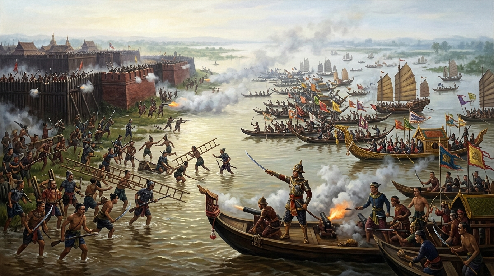
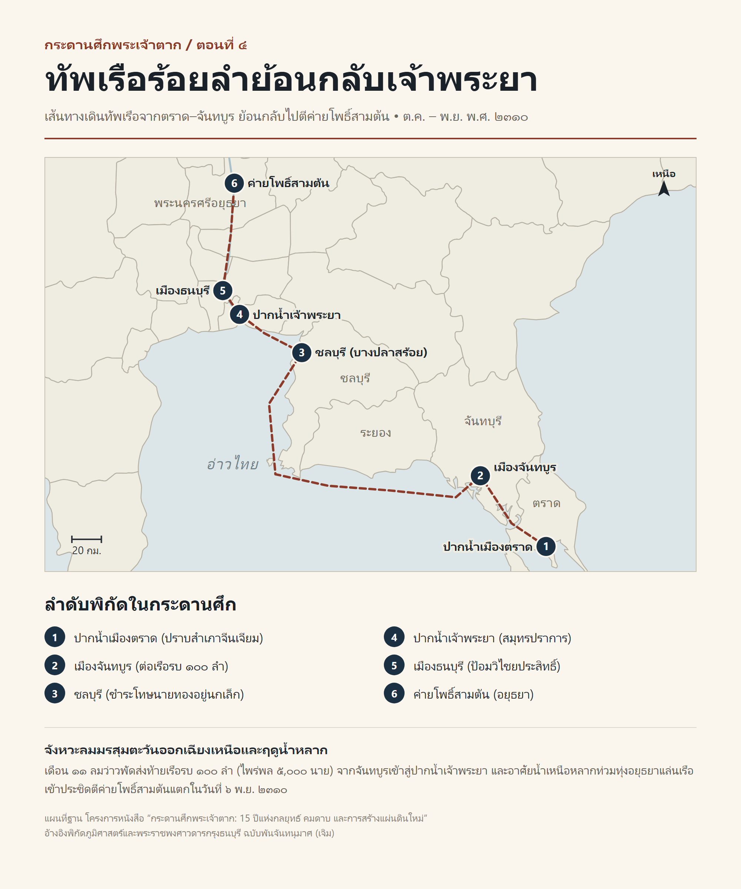

# ภาคที่ 1: ฝ่าไฟไปตั้งหลัก (พ.ศ. 2309 – 2310)
## ตอนที่ 4: ลมมรสุมเปลี่ยนทิศ ทัพเรือร้อยลำย้อนกลับเจ้าพระยา

---

### องก์ที่ 1: จุดชนวนและเดิมพัน (The Cold Open & The Stakes)

เสียงขวานนับร้อยเล่มจามลงบนเนื้อไม้ตะเคียนดังกังวานสะท้อนคุ้งน้ำจันทบูรตั้งแต่เช้ามืดจรดเที่ยงคืน

ตลอดสามเดือนของฤดูฝนปีกุน (กรกฎาคม – กันยายน พ.ศ. 2310) ในขณะที่แผ่นดินลุ่มน้ำเจ้าพระยากำลังเงียบเชียบราวกับป่าช้าหลังการล่มสลายของกรุงศรีอยุธยา ชายฝั่งแม่น้ำจันทบุรีและอ่าวคุ้งกระเบนกลับกลายเป็นโรงงานอุตสาหกรรมสงครามขนาดมหึมาที่ไม่เคยหลับใหล

ท่ามกลางสายฝนที่ตกพรำและควันไฟจากเตาหลอมเหล็ก ช่างไม้ชาวไทยและชาวจีนหลายพันคนกำลังเร่งมือดัดไม้กระดาน ตอกหมันยาชัน และติดตั้งแท่นปืนใหญ่ลงบนหัวเรือรบที่เรียงรายอยู่ตามแนวตลิ่ง

บนหอสังเกตการณ์ริมปากน้ำ **เจ้าตาก** ทอดพระเนตรมองออกไปที่ผืนน้ำสีเทาหม่นของอ่าวไทย พระหัตถ์ข้างหนึ่งถือธงผ้าผืนเล็กชูขึ้นรับกระแสลม

ตลอดหลายเดือนที่ผ่านมา ธงผืนนั้นสะบัดชี้เข้าหาแผ่นดิน—เพราะเป็นฤดู **ลมมรสุมตะวันตกเฉียงใต้** ที่พัดเอาคลื่นยักษ์จากทะเลเปิดซัดเข้าหาฝั่งตะวันออก ขังกองเรือทั้งหมดไว้ในอ่าวจันทบูร

แต่เช้าวันนี้ในเดือน 11 (ตุลาคม พ.ศ. 2310) อากาศริมทะเลเริ่มเย็นเยียบลง และปลายธงผ้าในพระหัตถ์ของเจ้าตากก็เริ่มกระตุก... ก่อนจะพลิกกลับทิศ สะบัดชี้พุ่งออกสู่ปากอ่าวไทยทางทิศตะวันตกเฉียงเหนือ!

**ลมว่าว—หรือลมมรสุมตะวันออกเฉียงเหนือ—มาถึงแล้ว!**

การรอคอยสิ้นสุดลง นาฬิกาทรายแห่งการกอบกู้แผ่นดินได้พลิกกลับด้าน เบื้องล่างหอสังเกตการณ์ กองเรือรบต่อใหม่และเรือสำเภาดัดแปลงจำนวน **100 ลำ** พร้อมกำลังพลไทย-จีนที่ฝึกปรือจนชำนาญศึกจำนวน **5,000 นาย** จอดเรียงรายรอคำสั่งเคลื่อนทัพ

จากกองกำลังทหารม้าและทหารราบเพียง 500 นายที่ตีฝ่าไฟออกจากวัดพิชัยสงครามเมื่อเก้าเดือนก่อน บัดนี้เจ้าตากกำลังจะนำทัพเรือร้อยลำแล่นย้อนกลับเข้าสู่ปากน้ำเจ้าพระยา เพื่อทวงคืนแผ่นดินจากกองทัพพม่าที่ค่ายโพธิ์สามต้น!

---

### องก์ที่ 2: อ่านกระดานศึกและปมที่ซ่อนอยู่ (The Map & The Hidden Truth)

ก่อนที่ใบเรือทั้งร้อยลำจะถูกชักขึ้นสู่เสากระโดง เราต้องกางแผนที่ยุทธศาสตร์เพื่อไขปริศนาสำคัญ 2 ข้อที่ซ่อนอยู่ในหน้าประวัติศาสตร์:
1. **เจ้าตากหาวัตถุดิบ ปืนใหญ่ และกะลาสีเรือที่เชี่ยวชาญการรบทางทะเลมาจากไหนภายในเวลาเพียง 3 เดือน?**
2. **ทำไมกองทัพพม่าที่เพิ่งพิชิตกรุงศรีอยุธยา จึงปล่อยให้ค่ายโพธิ์สามต้นเหลือกำลังพลเพียงไม่กี่พันนาย?**

คำตอบข้อแรก ซ่อนอยู่ที่สมรภูมิทางทะเลปลายสุดแดนตะวันออก—**ปากน้ำเมืองตราด**

หลังจากยึดเมืองจันทบูรได้ในเดือน 7 เจ้าตากไม่ได้หยุดทัพอยู่แค่จันทบุรี พระองค์ทรงตระหนักดีว่าลำพังการตัดไม้จากป่าเขาสระบาปมาต่อเรือรบใหม่ทั้งหมด ต้องใช้เวลานานเกินไป และที่สำคัญ ทหารส่วนใหญ่ที่ติดตามมาจากอยุธยาและระยองเป็น "ทหารบก" ที่ไม่คุ้นเคยกับการเดินเรือทะเลลึก

เจ้าตากจึงเคลื่อนทัพมุ่งหน้าต่อไปทางทิศตะวันออกเฉียงใต้ เข้าสู่เขต **เมืองตราด (บ้านบางพระ)**

ที่เมืองตราด กรมการเมืองและราษฎรพากันออกมาถวายบังคมยอมสวามิภักดิ์โดยไม่คิดต่อสู้ แต่ที่บริเวณ **ปากน้ำเมืองตราด** กลับมีกองเรือสำเภาจีนติดอาวุธปืนใหญ่หลายลำทอดสมอปิดปากอ่าวอยู่ ผู้นำกองเรือสำเภาคือพ่อค้าและนักเลงทะเลชาวจีนผู้ทรงอิทธิพลชื่อ **จีนเจียม (ตั้วเจียม)** ซึ่งตั้งตัวเป็นอิสระไม่ยอมขึ้นต่อผู้ใด

เจ้าตากทรงส่งคนไปเจรจาเกลี้ยกล่อมให้จีนเจียมเข้ามาสวามิภักดิ์ดีๆ แต่จีนเจียมซึ่งมั่นใจในอานุภาพของเรือสำเภาทะเลขนาดใหญ่และปืนใหญ่ประจำเรือ กลับสั่งให้ลูกเรือเปิดฉากยิงปืนใส่กองทหารของเจ้าตาก!

ศึกทางน้ำครั้งแรกของเจ้าตากจึงระเบิดขึ้นที่ปากน้ำเมืองตราด

แม้เรือของฝ่ายเจ้าตากจะมีขนาดเล็กกว่า แต่ด้วยยุทธวิธีการรบประชิดตัว เจ้าตากทรงนำเรือเร็วฝ่าห่ากระสุนปืนใหญ่เข้าโอบล้อมเรือสำเภาของจีนเจียมจากทุกทิศทาง ปะทะกันดุเดือดอยู่ครึ่งวัน ทหารของเจ้าตากก็บุกขึ้นยึดเรือสำเภาได้หลายลำ จนจีนเจียมเห็นว่าสู้ต่อไปต้องตายทั้งตระกูลแน่ จึงยอมคุกเข่าจำนน ถวายทรัพย์สิน เรือสำเภาทั้งหมด และยกบุตรสาวชื่อ **"หง"** ถวายตัวเป็นบาทบริจาริกาเพื่อผูกสัมพันธไมตรี

ชัยชนะเหนือจีนเจียมที่ปากน้ำเมืองตราด คือจิ๊กซอว์ชิ้นสำคัญที่สุดในการสร้างกองทัพเรือธนบุรี! เพราะนอกจากจะได้เรือสำเภาทะเลขนาดใหญ่มาเป็นเรือธงและเรือลำเลียงเสบียงแล้ว เจ้าตากยังได้ **"ปืนใหญ่ประจำสำเภา"**, **"ช่างต่อเรือชาวจีน"** และ **"กะลาสีเรือผู้เชี่ยวชาญร่องน้ำอ่าวไทย"** เข้ามาเป็นแกนหลักในการฝึกทหารเรือทั้ง 5,000 นาย

#### จุดเปลี่ยนระดับโลก: มังกรต้าชิงขยับทัพ พยัคฆ์อังวะถอนกำลัง

ในเวลาเดียวกับที่เจ้าตากกำลังเร่งต่อเรือรบอยู่ที่จันทบูรและตราด บนกระดานภูมิรัฐศาสตร์ระดับเอเชียกำลังเกิดแผ่นดินไหวครั้งใหญ่ที่ส่งผลโดยตรงต่อชะตากรรมของกรุงศรีอยุธยา

หากเราเปิดอ่าน **มหาราชวงษ์ พงษาวดารพม่า** คู่กับ **บันทึกประวัติศาสตร์ราชวงศ์ชิง (Ch'ing Shih-lu)** เราจะพบว่า สาเหตุที่ทัพหลวงของ **เนเมียวสีหบดี** ต้องรีบเผากรุงศรีอยุธยาและถอนกำลังส่วนใหญ่กลับพม่าอย่างเร่งด่วนในเดือนมิถุนายน พ.ศ. 2310 นั้น ไม่ใช่เพราะพม่าไม่คิดจะยึดครองสยามระยะยาว แต่เป็นเพราะ **"จักรพรรดิเฉียนหลงแห่งราชวงศ์ชิง"** ได้ส่งกองทัพธงแปดกองของแมนจู นำโดยแม่ทัพ **หมิงรุ่ย (Mingrui)** บุกทะลวงจากมณฑลยูนนานเข้าโจมตีดินแดนรัฐฉานและมุ่งหน้าประชิดกรุงอังวะ ราชธานีของพม่า!

**พระเจ้ามังระ** กษัตริย์พม่าจึงมีพระราชโองการด่วนให้เนเมียวสีหบดีถอนทัพหลักพร้อมเชลยศึกและทรัพย์สินกลับไปช่วยรับศึกจีนที่กรุงอังวะทันที

ก่อนถอนทัพกลับ เนเมียวสีหบดีได้วางโครงสร้างการปกครองอยุธยาไว้เป็น 2 ชั้นเพื่อคุมลุ่มน้ำเจ้าพระยา:
1. **ค่ายโพธิ์สามต้น (ศูนย์บัญชาการหลักทางเหนือของเกาะเมืองอยุธยา):** แต่งตั้งให้ **สุกี้พระนายกอง (นายทองสุก)** ขุนพลชาวมอญผู้ภักดีและเชี่ยวชาญพื้นที่สยาม คุมกำลังทหารพม่าและมอญราว **3,000 นาย** ตั้งมั่นอยู่ในค่ายโพธิ์สามต้นทั้งสองฝั่งแม่น้ำ พร้อมทั้งตั้งขุนนางไทยที่ยอมสวามิภักดิ์เป็นกรมการเมืองคอยกวาดต้อนผู้คนและทรัพย์สินที่หลงเหลือ
2. **เมืองธนบุรีและป้อมวิไชยประสิทธิ์ (ด่านหน้าคุมปากน้ำเจ้าพระยา):** แต่งตั้งให้ **นายทองอิน** คนไทยที่ยอมเข้ากับพม่า คุมกำลังพลรักษาเมืองธนบุรีเพื่อคอยระวังป้องกันทางทะเลและส่งข่าวขึ้นไปยังค่ายโพธิ์สามต้น

สุกี้พระนายกองมั่นใจว่า หลังการเผาทำลายกรุงศรีอยุธยาจนราบคาบ ขุนนางและไพร่พลไทยที่หนีเข้าป่าไปคงหมดปัญญาจะรวมตัวกันติดอย่างน้อยก็อีกหลายปี

แต่สุกี้ไม่เคยคาดคิดเลยว่า ในเดือน 11 ที่น้ำเหนือกำลังไหลหลากท่วมทุ่งอยุธยาและลมมรสุมกำลังพัดเข้าหาปากอ่าวไทย กองทัพเรือร้อยลำจากชายฝั่งตะวันออกกำลังพุ่งตรงมาที่คอหอยของเขาแล้ว!

---

### องก์ที่ 3: คมดาบและกลศึก (The Clash & Tactical Turning Point)

เดือน 11 ปีกุน (ตุลาคม พ.ศ. 2310) กองทัพเรือ 100 ลำของเจ้าตากเคลื่อนออกจากปากน้ำจันทบูร แล่นตัดคลื่นลมมรสุมตะวันออกเฉียงเหนือเลียบชายฝั่งตะวันออกย้อนกลับมายังปากอ่าวไทย

เส้นทางเดินทัพเรือย้อนกลับครั้งนี้ เจ้าตากทรงใช้กลยุทธ์ **"สายฟ้าแลบและกวาดล้างไส้ศึก"** ไปพร้อมกัน:

1. **ชำระหนี้แค้นที่เมืองชลบุรี (บางปลาสร้อย):**
   เมื่อกองเรือแล่นมาถึง **เกาะสีชัง** และเข้าเทียบฝั่งเมือง **ชลบุรี** เจ้าตากทรงได้รับรายงานว่า **นายทองอยู่นกเล็ก** (ซึ่งเจ้าตากเคยเมตตาตั้งให้เป็น *หลวงพล* ดูแลเมืองชลบุรีตั้งแต่ขามา) ได้ทรยศหันไปตั้งตนเป็นสลัดคอยดักปล้นเรือสำเภาค้าขายและขัดขวางการส่งเสบียงให้กองทัพ
   เจ้าตากไม่ทรงปล่อยให้มีหนามยอกอกไว้เบื้องหลัง ทรงนำกำลังเข้าล้อมจับตัวนายทองอยู่นกเล็กและพรรคพวกที่กระทำผิด สั่งประหารชีวิตนายทองอยู่นกเล็กด้วยการ **"ถ่วงน้ำ"** เพื่อประกาศให้เห็นถึงกฎอัยการศึกอันเด็ดขาด จากนั้นจึงเคลื่อนทัพเรือมุ่งหน้าเข้าสู่ **ปากน้ำเจ้าพระยา (สมุทรปราการ)** ทันที!

2. **สายฟ้าฟาดที่เมืองธนบุรี (ป้อมวิไชยประสิทธิ์):**
   เมื่อกองทัพเรือร้อยลำแล่นเข้าปากน้ำเจ้าพระยาในเดือน 11 ภาพของเรือรบที่ติดธงชัยเรียงรายเต็มลำน้ำสร้างความตื่นตะลึงให้แก่ชาวบ้านสองฝั่งแม่น้ำที่สิ้นหวังมานานกว่าครึ่งปี
   ที่ **เมืองธนบุรี** นายทองอินซึ่งพม่าตั้งให้รักษาเมืองและป้อมวิไชยประสิทธิ์ รีบเกณฑ์คนไทยและทหารพม่าขึ้นประจำเชิงเทินเตรียมยิงปืนใหญ่สกัด ทว่าทันทีที่ทัพเรือหน้าของเจ้าตากบุกประชิดและเปิดฉากโจมตี ไพร่พลคนไทยในเมืองธนบุรีที่ถูกบังคับกะเกณฑ์มาก็พากันทิ้งอาวุธไม่มีใจจะสู้รบกับคนไทยด้วยกันเอง!
   กองทัพเจ้าตากบุกทะลวงเข้ายึดเมืองธนบุรีและป้อมวิไชยประสิทธิ์ได้ในพริบตา จับตัว **นายทองอิน** มาประหารชีวิต ส่วนทหารพม่าที่เหลือรีบลงเรือเร็วแจวหนีตายทวนน้ำขึ้นไปแจ้งข่าวร้ายแก่สุกี้พระนายกองที่ค่ายโพธิ์สามต้น!

#### ศึกตัดสินชะตาแผ่นดิน ณ ค่ายโพธิ์สามต้น (5 – 6 พฤศจิกายน พ.ศ. 2310)

บนหอคอยในค่ายโพธิ์สามต้น **สุกี้พระนายกอง** แทบไม่เชื่อหูตัวเองเมื่อทหารที่หนีตายจากธนบุรีมารายงานว่า *“พระยาตากยกทัพเรือใหญ่ขึ้นมาตีเมืองธนบุรีแตกแล้ว!”*

ในทีแรก สุกี้สั่งให้กองทัพเรือพม่า-มอญยกลงไปตั้งสกัดที่ **พะเนียด** ทางใต้ของค่ายโพธิ์สามต้น แต่เมื่อเห็นแสนยานุภาพของกองเรือเจ้าตากที่แล่นทวนน้ำขึ้นมาเต็มลำน้ำเจ้าพระยา พร้อมกับคนไทยในกองทัพพม่าที่เริ่มแปรพักตร์หนีทัพกันอลหม่าน สุกี้พระนายกองจึงตัดสินใจสั่งถอนกำลังทั้งหมดกลับมารวมกันที่ **ค่ายโพธิ์สามต้น** เพื่อตั้งรับเต็มรูปแบบ!

หากมองจากสายตาของสุกี้พระนายกอง ค่ายโพธิ์สามต้นคือป้อมปราการที่ไม่มีวันแตกง่ายๆ
ค่ายแห่งนี้ตั้งขวางลำน้ำโพธิ์สามต้นออกเป็น **2 ฟาก** (ฟากตะวันออกและฟากตะวันตก) โดยเฉพาะ **ค่ายหลวงฟากตะวันตก** นั้น เนเมียวสีหบดีและสุกี้ได้สั่งให้รื้ออิฐจากโบสถ์วิหารของวัดวาอารามในอยุธยามาก่อเป็น **กำแพงอิฐถือปูน** สูงตระหง่าน มีเชิงเทินวางปืนใหญ่เรียงรายแข็งแกร่งไม่ต่างจากกำแพงเมืองขนาดย่อม

แต่นั่นคือสิ่งที่เจ้าตากทรงคำนวณไว้ล่วงหน้าแล้วบนโต๊ะยุทธการ!

เพราะนี่คือ **เดือน 12 (พฤศจิกายน)—จุดสูงสุดของฤดูน้ำหลาก!**
ผืนทุ่งรอบกรุงศรีอยุธยาและรอบค่ายโพธิ์สามต้นเจิ่งนองไปด้วยมวลน้ำมหาศาล ทหารม้าของพม่าหมดสิทธิ์ออกวิ่งตลบหลัง และเรือรบของเจ้าตากสามารถแล่นลัดเลาะเข้ามาประชิดแนวกำแพงค่ายได้ทุกทิศทาง!

**วันอังคาร เดือน 12 ขึ้น 14 ค่ำ (5 พฤศจิกายน พ.ศ. 2310):**
ทันทีที่ทัพเรือเจ้าตากเดินทางมาถึงโพธิ์สามต้นในเวลาเช้า พระองค์ไม่เปิดโอกาสให้พม่าได้ตั้งตัว สั่งให้กองทัพหน้าบุกเข้าโจมตี **ค่ายโพธิ์สามต้นฟากตะวันออก** ทันที!
ทหารไทยและจีนกระโจนลงจากเรือลุยน้ำเข้าปีนค่ายฟาดฟันกับทหารพม่าอย่างดุเดือด เพียงไม่กี่ชั่วยาม ค่ายฟากตะวันออกก็แตกพ่าย ทหารพม่าที่รอดชีวิตต้องว่ายน้ำและลงเรือหนีตายข้ามไปรวมกันอยู่ในค่ายหลวงกำแพงอิฐฟากตะวันตกของสุกี้พระนายกองทั้งหมด

เจ้าตากเสด็จขึ้นประทับในค่ายฟากตะวันออกที่ยึดมาได้ ทอดพระเนตรข้ามลำน้ำไปยังค่ายกำแพงอิฐของสุกี้ฟากตะวันตก

พระองค์รู้ดีว่า ค่ายฟากตะวันตกมีกำแพงอิฐสูงและปืนใหญ่หนาแน่น หากบุกข้ามลำน้ำไปตรงๆ ในตอนกลางวัน ทหารจะถูกยิงตายกลางน้ำจำนวนมาก

คืนนั้น—คืนก่อนวันเพ็ญเดือนสิบสอง—เจ้าตากจึงสั่งการให้ทหารเร่งทำ **บันไดหก (บันไดพาดกำแพง)** จำนวนมาก และในเวลาดึกสงัดก่อนรุ่งสาง ได้มีรับสั่งให้ 3 ขุนพลคู่พระทัย ได้แก่ **พระเชียงเงิน**, **หลวงพิชัยอาสา (จ้อย)** และ **หลวงพรหมเสนา** นำกำลังทหารล่วงหน้าข้ามไปตั้งค่ายประชิดขอบกำแพงค่ายของสุกี้ทางฟากตะวันตกไว้ก่อน เพื่อบีบระยะยิงของปืนใหญ่พม่าให้ไร้ผล!

**รุ่งเช้าวันพุธ เดือน 12 ขึ้น 15 ค่ำ ปีกุน (6 พฤศจิกายน พ.ศ. 2310 — วันเพ็ญลอยกระทง):**

หมอกยามเช้าเหนือลำน้ำโพธิ์สามต้นถูกฉีกกระชากด้วยเสียงปืนใหญ่และเสียงโห่ร้องกึกก้อง!
ตั้งแต่เวลาเช้ามืด เจ้าตากเสด็จนำทัพหลวงทั้งทหารไทยและทหารจีน ข้ามลำน้ำบุกเข้าหนุนเนื่องกองทัพหน้าของหลวงพิชัยอาสาและพระเชียงเงิน สั่งให้ทหารแบกบันไดพาดกำแพงอิฐของค่ายสุกี้พระนายกอง แล้วปีนบุกทะลวงเข้าตีพร้อมกันทุกด้าน!

ภายในค่ายโพธิ์สามต้นฟากตะวันตก สุกี้พระนายกองบัญชาการรบอย่างสุดกำลัง สั่งพลปืนไฟและพลหอกดาบสกัดกั้นผู้บุกรุกอย่างดุเดือด เสียงดาบปะทะดาบ เสียงปืนคาบศิลา และเสียงระเบิดดังสนั่นหวั่นไหวไปทั่วคุ้งน้ำ

ทว่าความฮึกเหิมของทหารเจ้าตากในเช้าวันนั้น ไม่ใช่ความฮึกเหิมของทหารรับจ้าง แต่คือความแค้นของคนไทยและคนจีนที่ได้เห็นซากปรักหักพังของกรุงศรีอยุธยาอยู่เบื้องหลัง!

เมื่อเวลาล่วงเข้าสู่ **3 โมงเช้า (09.00 น.)** แนวป้องกันของพม่าบนกำแพงอิฐก็พังทลายลง ทหารของเจ้าตากพังประตูค่ายและกระโดดลงจากกำแพงอิฐเข้าไล่ฆ่าฟันทหารพม่าแบบตะลุมบอนกลางค่ายหลวง!

ท่ามกลางเปลวไฟและคมดาบที่โอบล้อมเข้ามาทุกทิศทาง **สุกี้พระนายกอง** แม่ทัพใหญ่ผู้รักษาค่ายโพธิ์สามต้น สู้รบจนวินาทีสุดท้ายและถูกสังหารสิ้นชีพในที่รบ!

เมื่อแม่ทัพใหญ่สิ้นชื่อ กองทัพพม่าในค่ายโพธิ์สามต้นก็แตกสลายอย่างสมบูรณ์ ทหารพม่าและมอญถูกสังหารไปหลายร้อยคน ที่เหลือยอมวางอาวุธตกเป็นเชลยศึก อาวุธยุทโธปกรณ์ ปืนใหญ่ ช้างม้า และเสบียงอาหารทั้งหมดที่พม่าปล้นสะสมไว้ ตกเป็นของกองทัพเจ้าตากทั้งหมด!

---

### องก์ที่ 4: ผลลัพธ์และเงาของศึกถัดไป (The Aftermath & Cliffhanger)

เที่ยงวันเพ็ญเดือนสิบสอง ปีกุน พ.ศ. 2310

เสียงปืนและเสียงดาบที่โพธิ์สามต้นเงียบสงบลงแล้ว เหลือเพียงสายลมหนาวที่พัดผ่านธงชัยของเจ้าตากซึ่งปักสะบัดอยู่เหนือยอดกำแพงอิฐของค่ายพม่า

เพียง **7 เดือน** นับตั้งแต่วันที่กรุงศรีอยุธยาแตกพ่ายในเดือนเมษายน และเพียง **10 เดือน** นับตั้งแต่คืนที่พระยาวชิรปราการนำทหาร 500 นายตีฝ่าวงล้อมออกจากวัดพิชัยสงคราม—บัดนี้ จอมทัพหนุ่มวัยสามสิบสามปีได้ทำในสิ่งที่ไม่มีใครในแผ่นดินคิดว่าเป็นไปได้สำเร็จแล้ว

กองทัพพม่าผู้พิชิตกรุงศรีอยุธยา ถูกบดขยี้และขับไล่ออกไปจากแผ่นดินลุ่มน้ำเจ้าพระยาจนหมดสิ้น!

บรรดาขุนนางเก่า เชื้อพระวงศ์อยุธยา และราษฎรหลายหมื่นคนที่ถูกพม่ากวาดต้อนกักขังไว้ในค่ายโพธิ์สามต้น ต่างได้รับการปลดปล่อยและพากันก้มลงกราบแทบพระบาทของเจ้าตากด้วยน้ำตาแห่งความปิติยินดี

ทว่าเมื่อศึกที่โพธิ์สามต้นจบลง และเจ้าตากทรงม้าศึกเสด็จข้ามลำน้ำกลับเข้าไปทอดพระเนตรภายใน **เกาะเมืองกรุงศรีอยุธยา**... รอยยิ้มแห่งชัยชนะบนใบหน้าของเหล่าแม่ทัพนายกองก็พลันเลือนหายไป

เบื้องหน้าของพระองค์ ไม่ใช่มหานครทองคำที่เคยรุ่งเรืองอีกต่อไป
แต่คือทุ่งซากอิฐสีดำทะมึนที่กว้างใหญ่สุดลูกหูลูกตา ปราสาทราชวังทั้งสามหลังเหลือเพียงเสาไม้ไหม้ไฟและฐานอิฐที่แตกร้าว พระศรีสรรเพชญดาญาณถูกไฟสุมจนทองคำละลายเหลือแต่แกนสำริดดำเกรียม ซากโครงกระดูกของราษฎรที่ตายด้วยความอดอยากและคมดาบเกลื่อนกลาดอยู่ตามวัดร้างและคูคลอง

บนโต๊ะยุทธการของเจ้าตาก คำถามใหม่ที่หนักหนาสาหัสยิ่งกว่าการรบกับสุกี้พระนายกองปรากฏขึ้นตรงหน้าทันที:

**ด้วยกำลังพลเพียง 5,000 นาย กองทัพของพระองค์จะสามารถป้องกันกำแพงเมืองอยุธยาที่พังทลายยาวถึง 12 กิโลเมตรนี้ได้อย่างไร หากพระเจ้ามังระส่งทัพใหญ่พม่าเรือนแสนย้อนกลับมาอีกครั้ง?**

---
**จบตอนที่ 4**
*(ติดตามต่อใน ตอนที่ 5: ซากอิฐที่ไม่อาจซ่อม ทำไมต้องเป็น "ธนบุรีศรีมหาสมุทร")*
