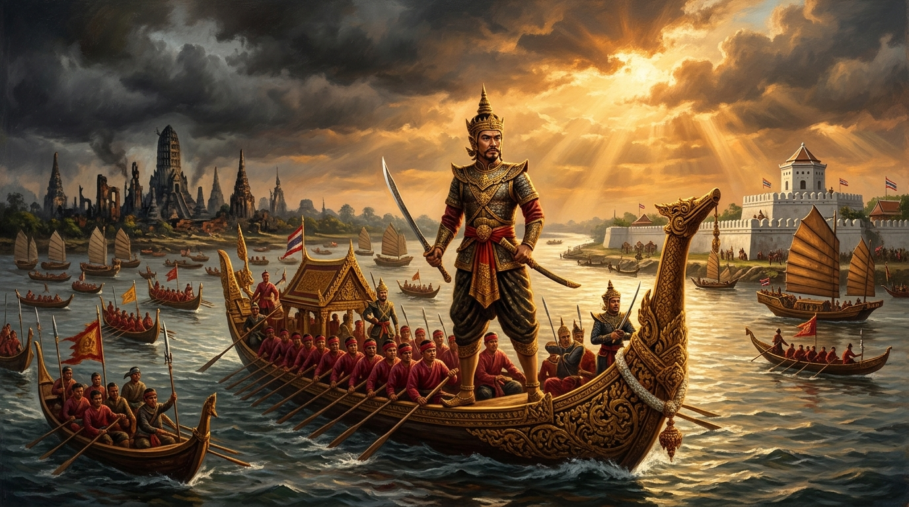
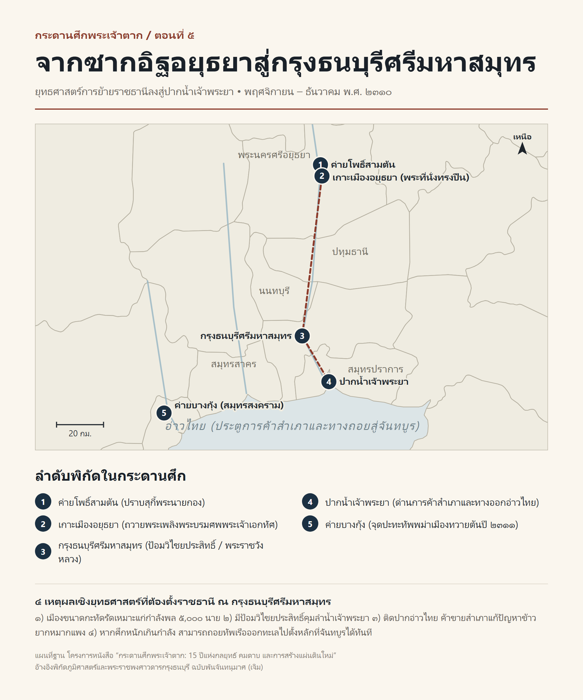

# ภาคที่ 1: ฝ่าไฟไปตั้งหลัก (พ.ศ. 2309 – 2310)
## ตอนที่ 5: ซากอิฐที่ไม่อาจซ่อม ทำไมต้องเป็น "ธนบุรีศรีมหาสมุทร"

---

### องก์ที่ 1: จุดชนวนและเดิมพัน (The Cold Open & The Stakes)

กลิ่นเถ้าถ่านและซากศพยังคงคละคลุ้งอยู่ในสายลมหนาวเดือนสิบสองเหนือเกาะเมืองกรุงศรีอยุธยา

ไม่กี่วันหลังจากค่ายโพธิ์สามต้นของสุกี้พระนายกองแตกพ่าย **เจ้าตาก** ทรงม้าพระที่นั่งเสด็จตรวจตราเข้าไปภายในเขตพระราชวังหลวงและย่านใจกลางพระนครที่เพิ่งถูกปลดปล่อย ทหารองครักษ์ที่ตามเสด็จต่างก้มหน้าเงียบงัน ไม่มีใครกล้าเอ่ยคำพูดใดออกมาทำลายความวังเวงอันน่าสะพรึงกลัวเบื้องหน้า

มหานครที่เคยมีประชากรเรือนแสนและปราสาทราชมณเฑียรหุ้มทองคำระยิบระยับ บัดนี้ดูไม่ต่างจากสุสานหินขนาดมหึมา

ตามบันทึกของ **คณะบาทหลวงฝรั่งเศส** และ **พระราชพงศาวดารกรุงธนบุรี ฉบับพันจันทนุมาศ (เจิม)** ภาพของอยุธยาในเดือนพฤศจิกายน พ.ศ. 2310 คือความพินาศที่เกินกว่าจินตนาการ พระที่นั่งสุริยาสน์อมรินทร์ พระที่นั่งสรรเพชญปราสาท และพระที่นั่งวิหารสมเด็จ ถูกไฟเผาผลาญจนหลังคาเครื่องบนพังทลายลงมาเหลือแต่เสาไม้ไหม้เกรียมและผนังอิฐที่แตกร้าว องค์พระศรีสรรเพชญดาญาณ—พระพุทธรูปยืนหุ้มทองคำสูงแปดวาอันเป็นหัวใจของแผ่นดิน—ถูกทหารพม่าเอาไฟสุมรอบองค์เพื่อลอกทองคำไปจนเหลือแต่แกนสำริดที่แตกร้าวเป็นชิ้นๆ

ตามถนนหนทางและซากวัดร้าง โครงกระดูกสีขาวของชาวเมืองที่ตายจากคมดาบและภาวะอดอยากนอนทับถมกันจนไม่มีที่ฝัง สุนัขจรจัดและฝูงแร้งบินวนเวียนอยู่เหนือซากปรักหักพัง

ค่ำคืนนั้น เจ้าตากเสด็จเข้าประทับแรม ณ **พระที่นั่งทรงปืน**—อาคารริมขอบพระราชวังหลวงด้านท้ายสระที่ยังพอมีหลังคาหลงเหลืออยู่ท่ามกลางทะเลซากอิฐ

บรรดาขุนนางเก่าอยุธยาและราษฎรที่เพิ่งได้รับการช่วยเหลือออกมาจากค่ายโพธิ์สามต้น ต่างเฝ้ารอด้วยความหวังว่า รุ่งเช้าวันพรุ่ง จอมทัพผู้กู้แผ่นดินจะมีรับสั่งให้เกณฑ์ไพร่พลซ่อมแซมกำแพงเมืองและบูรณะพระราชวังหลวง เพื่อฟื้นฟูกรุงศรีอยุธยากลับคืนสู่ความรุ่งเรืองดังเดิม

ทว่าเมื่อแสงเงินแสงทองของรุ่งอรุณจับขอบฟ้า เจ้าตากกลับเสด็จออกมายืนหน้าพระที่นั่งทรงปืน แล้วตรัสเล่า **"พระสุบินนิมิต"** ที่ทำให้ขุนนางเก่าทุกคนในที่ประชุมต้องตกตะลึง:

*“เมื่อคืนนี้ เราฝันเห็นพระมหากษัตริย์แต่ปางก่อนเสด็จมาขับไล่เรา ตรัสว่ามิให้เราอยู่ ณ กรุงศรีอยุธยานี้... เราเห็นว่าเมืองกรุงเก่าชำรุดทรุดโทรมนัก กำแพงและปราสาทราชมณเฑียรก็พังทลายสิ้น จะซ่อมแซมขึ้นใหม่ก็สุดกำลังไพร่พล ให้กวาดต้อนผู้คนอพยพลงไปตั้งมั่น ณ เมืองธนบุรีเถิด!”*

คำสั่งทิ้งราชธานีที่มีอายุยาวนานถึง 417 ปี ผ่าเปรี้ยงลงกลางที่ประชุม!

ทำไมจอมทัพผู้ยอมแลกชีวิตตีฝ่าวงล้อมออกไปเพื่อกอบกู้กรุงศรีอยุธยา จึงตัดสินใจหันหลังให้กรุงศรีอยุธยาทันทีที่ยึดกลับคืนมาได้?

---

### องก์ที่ 2: อ่านกระดานศึกและปมที่ซ่อนอยู่ (The Map & The Hidden Truth)

หากมองด้วยสายตาของคนทั่วไป เรื่อง "พระสุบินนิมิตว่าอดีตบูรพกษัตริย์มาขับไล่" อาจฟังดูเหมือนเรื่องเร้นลับตามความเชื่อโบราณ แต่หากเรากางแผนที่บนโต๊ะยุทธการและสวมแว่นของ **"นักสืบประวัติศาสตร์"** วิเคราะห์ควบคู่ไปกับงานศึกษาของ **สมเด็จฯ กรมพระยาดำรงราชานุภาพ** และ **ศาสตราจารย์ ดร.นิธิ เอียวศรีวงศ์** เราจะพบว่า พระสุบินนิมิตนั้นคือ **"กุศโลบายทางการเมือง"** อันแยบคายที่สุดของเจ้าตาก!

เพราะในสังคมสมัยอยุธยาตอนปลาย กรุงศรีอยุธยาไม่ได้เป็นแค่เมืองหลวง แต่เป็น "ศูนย์กลางจักรวาลอันศักดิ์สิทธิ์" ขุนนางเก่าและราษฎรยังยึดติดกับแผ่นดินกรุงเก่าอย่างเหนียวแน่น หากเจ้าตากอธิบายด้วยเหตุผลทางทหารเพียงอย่างเดียว ย่อมเกิดแรงต้านและความคลางแคลงใจว่าเหตุใดจึงทิ้งแผ่นดินบรรพบุรุษ การอ้างโองการในพระสุบินนิมิตของบูรพกษัตริย์อยุธยาจึงเป็นการปลดล็อกความรู้สึกผิดของคนกรุงเก่าได้อย่างชะงัด

และเมื่อเปิดดู **"ความจริงทางยุทธศาสตร์"** ที่ซ่อนอยู่เบื้องหลังการตัดสินใจครั้งนั้น เราจะเห็นเหตุผล 4 ประการที่ชัดเจนจนไม่อาจปฏิเสธได้:

#### 1. สมการกำลังพลกับความยาวกำแพงเมือง (เสื้อเกราะยักษ์ที่คนตัวเล็กใส่ไม่ได้)
เกาะเมืองกรุงศรีอยุธยามีแนวกำแพงเมืองรอบเกาะยาวถึง **12 กิโลเมตร** ในยุคที่อยุธยาเรืองอำนาจ การจะวางกำลังทหารและปืนใหญ่รักษาเชิงเทินรอบเกาะเมืองให้ปลอดภัย ต้องใช้กำลังพลประจำการไม่ต่ำกว่า **30,000 ถึง 50,000 นาย**
แต่ในเดือนพฤศจิกายน พ.ศ. 2310 กองทัพของเจ้าตากมีทหารหลักเพียง **5,000 นาย** (แม้จะมีเชลยและราษฎรมาสมทบเพิ่ม แต่ส่วนใหญ่เป็นคนชรา ผู้หญิง และคนที่อดอยากจนแทบไม่มีแรงถืออาวุธ)
หากเจ้าตากฝืนตั้งมั่นอยู่ในเกาะเมืองอยุธยาที่กำแพงพังทลายไปกว่าครึ่ง ทันทีที่พระเจ้ามังระส่งกองทัพพม่าเรือนหมื่นย้อนกลับมา ทหาร 5,000 นายของเจ้าตากจะถูกกระจายออกจนบางเฉียบราวกับกระดาษ และกรุงศรีอยุธยาก็จะกลายเป็น "หลุมศพ" ซ้ำสองทันที!

#### 2. ชัยภูมิของข้าศึกที่รู้จักทุกตารางนิ้ว
ตลอดเกือบสองปีที่พม่าล้อมกรุงศรีอยุธยา แม่ทัพนายกองพม่ารู้จักจุดอ่อนของลำน้ำ คูคลอง และแนวกำแพงเมืองอยุธยาทุกจุด ซ้ำร้าย ค่ายคูประตูหอรบและฐานปืนใหญ่ที่พม่าสร้างล้อมกรุงไว้ยังตั้งอยู่ครบถ้วน หากฝ่ายไทยมีคนน้อยแล้วเข้าไปอยู่ในเมือง ข้าศึกที่ยกมาใหม่สามารถเข้ายึดค่ายเดิมของตนเพื่อล้อมกรุงได้ทันทีโดยไม่ต้องเสียเวลาสร้างค่ายใหม่ด้วยซ้ำ!

#### 3. ทำไมต้องเป็น "ธนบุรีศรีมหาสมุทร"? (ป้อมปราการปากน้ำและทางถอยสู่ทะเล)
เมื่อเลื่อนสายตาลงมาตามลำน้ำเจ้าพระยาทางทิศใต้ราว 70 กิโลเมตร ห่างจากปากอ่าวไทยขึ้นมาเพียง 30 กิโลเมตร คือที่ตั้งของ **เมืองธนบุรี**
เมืองธนบุรีมีขนาดกะทัดรัด ตั้งคร่อมแม่น้ำเจ้าพระยาซึ่งเปรียบเสมือนคูเมืองขนาดใหญ่ผ่ากลาง และที่สำคัญที่สุด ที่ปากคลองบางกอกใหญ่มี **ป้อมวิไชยประสิทธิ์** (และแนวกำแพงเมืองเดิมที่วิศวกรฝรั่งเศส เดอ ลามาร์ ออกแบบสร้างไว้ตั้งแต่สมัยสมเด็จพระนารายณ์มหาราช) ซึ่งเป็นป้อมปืนก่ออิฐถือปูนที่แข็งแกร่งมาก
ด้วยขนาดเมืองที่พอเหมาะ กำลังพลเพียง 5,000 นายของเจ้าตากสามารถวางกำลังป้องกันเมืองธนบุรีได้อย่างหนาแน่นทุกจุด และยังมีข้อได้เปรียบทางยุทธวิธีอีก 2 ชั้น:
- **สกัดศึกทางน้ำ:** พม่าเป็นกองทัพบกที่ไม่ชำนาญการรบทางเรือทะเลลึก การตั้งเมืองหลวงติดแม่น้ำใหญ่ใกล้ทะเลทำให้กองเรือรบของเจ้าตากกุมความได้เปรียบสูงสุด
- **แผนสำรองกรณีฉุกเฉิน:** เจ้าตากทรงวางแผนเผื่อกรณีเลวร้ายที่สุดไว้แล้วว่า หากพม่ายกทัพใหญ่มาเกินกำลังที่จะต้านทานได้ กองทัพธนบุรีสามารถลงเรือรบแล่นออกปากน้ำเจ้าพระยา ถอยกลับไปตั้งหลักที่ **เมืองจันทบูร** ได้ภายในเวลาไม่กี่วัน โดยไม่ถูกปิดล้อมตายเหมือนตอนอยู่อยุธยา!

#### 4. เส้นเลือดเศรษฐกิจการค้าสำเภา (ทางรอดจากวิกฤตทุพภิกขภัย)
ในปี พ.ศ. 2310–2311 ท้องทุ่งอยุธยาไม่ได้มีการทำนามาตลอดสองปี ข้าวสารในยุ้งฉางถูกพม่าเผาทำลายจนเกิดภาวะอดอยากขั้นรุนแรงที่สุดในประวัติศาสตร์ไทย (ข้าวสารราคาเกวียนละหลายชั่ง คนต้องต้มเปลือกไม้และรากบัวกินประทังชีวิต)
การย้ายราชธานีลงมาอยู่ที่ **ธนบุรี** ซึ่งอยู่ปากประตูการค้าทางทะเล ทำให้เจ้าตากสามารถติดต่อกับเรือสำเภาค้าขายของชาวจีน มลายู และแขกมัวร์ได้โดยตรง สามารถเอาทรัพย์สินและของป่าแลกซื้อข้าวสาร อาวุธปืนคาบศิลา ดินประสิว และกำมะถัน เข้ามาหล่อเลี้ยงกองทัพและแจกจ่ายราษฎรได้ทันท่วงที!

---

### องก์ที่ 3: คมดาบและกลศึก (The Clash & Tactical Turning Point)

แม้เจ้าตากจะตัดสินใจทิ้งซากอิฐของอยุธยาในทางยุทธศาสตร์ แต่ในทางการเมือง พระองค์ไม่เคยทิ้ง **"จิตวิญญาณและความชอบธรรมของอยุธยา"**

ก่อนที่จะเคลื่อนทัพหลวงล่องลงมายังเมืองธนบุรี เจ้าตากได้ทรงกระทำภารกิจสำคัญที่เปลี่ยนสถานะของพระองค์จาก "แม่ทัพผู้ชนะศึก" ให้กลายเป็น **"องค์รัชทายาททางธรรมะและประเพณีของกรุงศรีอยุธยา"** อย่างสมบูรณ์แบบ:

1. **การถวายพระเพลิงพระบรมศพพระเจ้าเอกทัศ:**
   เมื่อเจ้าตากทรงทราบว่า สุกี้พระนายกองได้นำพระบรมศพของ **สมเด็จพระที่นั่งสุริยาสน์อมรินทร์ (พระเจ้าเอกทัศ)** ไปฝังไว้ที่บริเวณ **โคกพระเมรุ** นอกพระราชวังหลวง พระองค์จึงมีรับสั่งให้ขุดอัญเชิญพระบรมศพขึ้นมา โปรดให้สร้างพระเมรุมาศและเครื่องประกอบพระราชอิสริยยศตามกำลังที่จะหาได้ในยามศึก แล้วนิมนต์พระภิกษุสงฆ์มาสวดพระอภิธรรมและถวายพระเพลิงพระบรมศพด้วยพระองค์เองอย่างสมพระเกียรติ พร้อมทั้งบรรจุพระบรมอัฐิไว้ตามโบราณราชประเพณี
2. **การชุบเลี้ยงเชื้อพระวงศ์และขุนนางเก่า:**
   เมื่อค้นพบพระบรมวงศานุวงศ์ฝ่ายในของอยุธยาที่ถูกพม่าจับกุมไว้ที่ค่ายโพธิ์สามต้นและที่ซ่อนตัวอยู่ตามที่ต่างๆ (เช่น พระราชธิดาและพระสนมในพระเจ้าอยู่หัวบรมโกศและพระเจ้าเอกทัศ) เจ้าตากทรงรับอุปการะดูแลและพระราชทานเครื่องนุ่งห่มอาหารอย่างดี พร้อมทั้งแต่งตั้งขุนนางเก่าอยุธยาที่มีความสามารถให้กลับเข้ารับราชการ

การกระทำทั้งสองประการนี้ได้ซื้อหัวใจของขุนนางเก่าและชาวกรุงศรีอยุธยาไปจนหมดสิ้น เพราะในสายตาของคนทั้งแผ่นดิน ไม่มีชุมนุมใดในสยาม—ไม่ว่าจะเป็นเจ้าพิษณุโลก เจ้าพระฝาง หรือเจ้านครศรีธรรมราช—ที่ได้ขึ้นมาขับไล่พม่าและถวายพระเพลิงพระบรมศพกษัตริย์อยุธยาเหมือนดังที่เจ้าตากทรงกระทำ!

#### สถาปนากรุงธนบุรีศรีมหาสมุทร (ธันวาคม พ.ศ. 2310)

เมื่อจัดการกิจการที่กรุงเก่าและตั้งผู้รักษากรุงศรีอยุธยาไว้คอยดูแลพื้นที่แล้ว เจ้าตากจึงโปรดให้อพยพผู้คน ไพร่พล ช้างม้า และปืนใหญ่น้อย ล่องเรือตามลำน้ำเจ้าพระยาลงมายัง **เมืองธนบุรี**

พระองค์ทรงเลือกชัยภูมิริมฝั่งตะวันตกของแม่น้ำเจ้าพระยา บริเวณปากคลองบางกอกใหญ่ ติดกับ **ป้อมวิไชยประสิทธิ์** เป็นที่ตั้งของ **พระราชวังหลวง** (ขนาบด้วยวัดแจ้งหรือวัดอรุณราชวราราม และวัดท้ายตลาด) โปรดให้เกณฑ์ไพร่พลสร้างพระราชมณเฑียรด้วยไม้ ขุดคูเมือง และเสริมป้อมปราการทั้งสองฝั่งแม่น้ำให้แข็งแกร่ง

และแล้ว ใน **วันพุธ เดือนอ้าย แรม 4 ค่ำ ปีกุน จุลศักราช 1129 (ตรงกับวันที่ 28 ธันวาคม พ.ศ. 2310)**

ท่ามกลางที่ประชุมพระภิกษุสงฆ์ราชาคณะ ข้าราชการฝ่ายทหารและพลเรือน ทั้งขุนนางเก่ากรุงศรีอยุธยาและขุนพลคู่พระทัยที่ร่วมตายกันมาตั้งแต่วัดพิชัยสงคราม เจ้าตากทรงประกอบพระราชพิธีปราบดาภิเษกเสด็จเถลิงถวัลยราชสมบัติขึ้นเป็นพระมหากษัตริย์แห่งสยาม ขณะมีพระชนมายุได้ **33 พรรษา** ทรงพระนามตามจารึกในพงศาวดารว่า **สมเด็จพระบรมราชาที่ 4** หรือที่ประชาราษฎร์รู้จักกันในพระนาม **สมเด็จพระเจ้ากรุงธนบุรี (สมเด็จพระเจ้าตากสินมหาราช)**

พร้อมกันนั้น ได้พระราชทานนามราชธานีแห่งใหม่นี้ว่า **"กรุงธนบุรีศรีมหาสมุทร"**—มหานครแห่งคลังสมบัติและอำนาจที่เชื่อมต่อกับมหาสมุทร!

---

### องก์ที่ 4: ผลลัพธ์และเงาของศึกถัดไป (The Aftermath & Cliffhanger)

การปราบดาภิเษกของสมเด็จพระเจ้าตากสินมหาราชในปลายปี พ.ศ. 2310 คือการประกาศให้โลกได้รู้ว่า อาณาจักรสยามฟื้นคืนชีพขึ้นมาจากกองเถ้าถ่านแล้ว

ทว่าเมื่อพระเจ้าตากสินเสด็จขึ้นประทับในท้องพระโรงกรุงธนบุรี และกางแผนที่พระราชอาณาจักรสยามออกดูบนโต๊ะยุทธการ พระองค์ก็ทรงตระหนักดีว่า สงครามที่แท้จริงเพิ่งจะเริ่มต้นขึ้นเท่านั้น

เพราะในวินาทีนั้น อำนาจของกรุงธนบุรีครอบคลุมอยู่เพียงหัวเมืองภาคกลางตอนล่างและชายฝั่งตะวันออก (ตั้งแต่ลพบุรี อยุธยา ธนบุรี ไปจนถึงชลบุรี ระยอง จันทบูร และตราด) เท่านั้น ในขณะที่ผืนแผ่นดินสยามส่วนที่เหลือได้แตกออกเป็นเสี่ยงๆ โดยมี **"ชุมนุมอิสระ 4 ก๊กใหญ่"** ตั้งตัวเป็นพระเจ้าแผ่นดินและเจ้าผู้ครองแคว้นแข่งบารมีอยู่ทั่วทุกทิศ:
- **ทิศเหนือ (พิษณุโลก – สุโขทัย – นครสวรรค์):** ชุมนุมของ **เจ้าพิษณุโลก (เรือง)** ขุนนางเอกผู้ทรงอิทธิพลและมีกองทัพที่เข้มแข็งที่สุดในหัวเมืองเหนือ
- **ทิศเหนือตอนบน (เมืองสวางคบุรี – อุตรดิตถ์):** ชุมนุมของ **เจ้าพระฝาง (เรือน)** พระภิกษุผู้ทรงวิทยาคมที่นุ่งห่มผ้าเหลืองสีแดงและมีสานุศิษย์ติดอาวุธนับหมื่น
- **ทิศตะวันออกเฉียงเหนือ (นครราชสีมา – พิมาย):** ชุมนุมของ **เจ้าพิมาย (กรมหมื่นเทพพิพิธ)** พระราชบุตรในสมเด็จพระเจ้าอยู่หัวบรมโกศ เชื้อพระวงศ์อยุธยาพระองค์เดียวที่มีสายโลหิตกษัตริย์โดยตรง!
- **ทิศใต้ (นครศรีธรรมราช – หัวเมืองปักษ์ใต้ตลอดแหลมมลายู):** ชุมนุมของ **เจ้านครศรีธรรมราช (หนู)** ผู้กุมความมั่งคั่งของหัวเมืองใต้ทั้งหมด

แผ่นดินเดียว ไม่อาจมีพระเจ้าแผ่นดินหลายองค์ได้ หากปล่อยให้ชุมนุมเหล่านี้แข็งแกร่งขึ้น สยามจะแตกออกเป็นแคว้นเล็กแคว้นน้อยและตกเป็นเหยื่อของพม่าไปตลอดกาล

แต่ยังไม่ทันที่สมเด็จพระเจ้าตากสินจะทันได้จัดทัพขึ้นไปปราบชุมนุมใด...

ต้นปีชวด พ.ศ. 2311 ม้าเร็วจากชายแดนทิศตะวันตกก็ควบตะบึงฝ่าฝุ่นเข้ามายังประตูเมืองธนบุรี พร้อมข่าวศึกด่วนที่สุดที่ทำให้ทั้งราชสำนักต้องลุกขึ้นจับดาบอีกครั้ง:

**พระเจ้ามังระแห่งกรุงอังวะ ทรงทราบข่าวว่าสุกี้พระนายกองถูกตีแตกที่โพธิ์สามต้น จึงมีพระราชโองการให้ "แมงกี้มารหญ้า" เจ้าเมืองทวาย ยกกองทัพพม่าทั้งทัพบกและทัพเรือบุกข้ามด่านเข้ามาทางเมืองไทรโยค ผ่านเมืองราชบุรี และกำลังเข้าล้อม "ค่ายบางกุ้ง" ที่เมืองสมุทรสงคราม—ห่างจากกรุงธนบุรีไปทางตะวันตกเพียงชั่วเดินเรือไม่กี่ชั่วยาม!**

---
**จบตอนที่ 5 (จบภาคที่ 1: ฝ่าไฟไปตั้งหลัก)**
*(ติดตามต่อใน ภาคที่ 2: แผ่นดินเดียวต้องมีพระเจ้าแผ่นดินองค์เดียว — ตอนที่ 6: เลือดหยดแรกที่บางกุ้ง และการเข้ามาของสองพี่น้องตระกูลนักรบ)*
