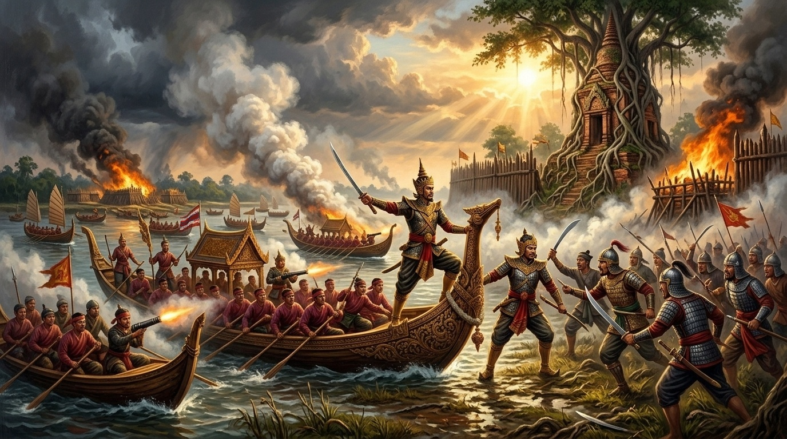
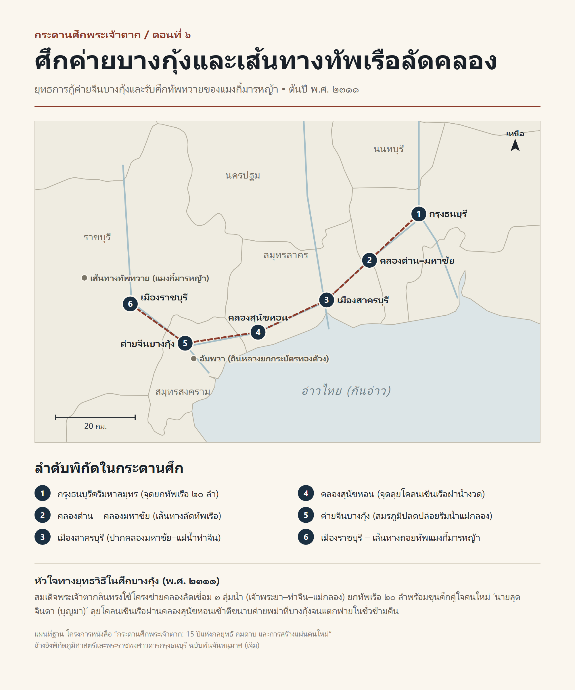

# ภาคที่ 2: แผ่นดินเดียวต้องมีพระเจ้าแผ่นดินองค์เดียว (พ.ศ. 2311 – 2313)
## ตอนที่ 6: เลือดหยดแรกที่บางกุ้ง และการเข้ามาของสองพี่น้องตระกูลนักรบ

---

### องก์ที่ 1: จุดชนวนและเดิมพัน (The Cold Open & The Stakes)

เสียงกลองศึกพม่าดังสะท้านคุ้งน้ำแม่กลองติดต่อกันเป็นวันที่สามแล้ว

ต้นฤดูแล้ง ปีชวด จุลศักราช 1130 (ต้นปี พ.ศ. 2311) เพียงไม่กี่สัปดาห์หลังจากพระราชพิธีปราบดาภิเษกสถาปนากรุงธนบุรีศรีมหาสมุทร ควันไฟสีดำทะมึนกลับพวยพุ่งขึ้นเหนือยอดตาลและดงไม้ชายเลนที่ **ตำบลบางกุ้ง** เมืองสมุทรสงคราม

ภายใน **ค่ายจีนบางกุ้ง**—ค่ายคูประตูหอรบที่ตั้งอยู่ริมฝั่งแม่น้ำแม่กลองล้อมรอบวัดบางกุ้ง—กองกำลังชาวจีนโพ้นทะเลและชาวบ้านลุ่มน้ำแม่กลองหลายร้อยคนกำลังยืนเบียดเสียดกันอยู่หลังแนวรั้วไม้ซุง เนื้อตัวของทุกคนชุ่มไปด้วยเหงื่อและเขม่าดินปืน ดวงตาที่แดงก่ำด้วยความอดนอนจ้องมองลอดช่องใบเสมาออกไปเบื้องหน้า

รอบค่ายบางกุ้งทั้งทางบกและทางน้ำ บัดนี้มืดฟ้ามัวดินไปด้วยธงรบของกองทัพพม่าและทวายกว่า **3,000 นาย** ภายใต้การบัญชาการของ **แมงกี้มารหญ้า** เจ้าเมืองทวาย!

เรือรบพม่าจอดเรียงรายปิดกั้นลำน้ำแม่กลองจนมิดคุ้งน้ำ ขณะที่บนบก ทหารพม่ากำลังขุดสนามเพลาะและเข็นปืนใหญ่เข้ามาตั้งประชิดแนวกำแพงค่ายในระยะเผาขน กระสุนปืนใหญ่พม่าพุ่งกระแทกเสาไม้ซุงของค่ายบางกุ้งจนสั่นสะเทือน เศษไม้และดินโคลนแตกกระจายใส่ใบหน้าของทหารรักษาค่ายระลอกแล้วระลอกเล่า

*"ดินดำใกล้หมดคลังแล้ว..."* นายกองชาวจีนในค่ายบางกุ้งกัดฟันกรอด มือกำด้ามดาบที่บิ่นเป็นฟันเลื่อย *"ถ้าทัพหลวงจากธนบุรีมาไม่ถึงภายในพรุ่งนี้ ค่ายบางกุ้งแตกแน่!"*

และหากค่ายบางกุ้งแตก นั่นไม่ได้หมายถึงความตายของคนในค่ายเพียงอย่างเดียว

แต่หมายความว่า ประตูหน้าด่านทางทิศตะวันตกของ **กรุงธนบุรีศรีมหาสมุทร** จะถูกพังทลายลง และกองทัพพม่าของแมงกี้มารหญ้าจะสามารถแล่นเรือทะลวงผ่านคลองมหาชัย–คลองด่าน เข้ามาจ่อคอหอยพระราชวังธนบุรีได้ภายในเวลาเพียงชั่วข้ามคืน!

---

### องก์ที่ 2: อ่านกระดานศึกและปมที่ซ่อนอยู่ (The Map & The Hidden Truth)

หากเรากางแผนที่ยุทธศาสตร์ลุ่มน้ำเจ้าพระยา–ท่าจีน–แม่กลอง ในต้นปี พ.ศ. 2311 ออกดูบนโต๊ะยุทธการ และเปิดอ่านหลักฐานชั้นต้นอย่าง **พระราชพงศาวดารกรุงธนบุรี ฉบับพันจันทนุมาศ (เจิม)** คู่กับงานวิเคราะห์ใน **ไทยรบพม่า** ของ **สมเด็จฯ กรมพระยาดำรงราชานุภาพ** เราจะเห็นว่า ศึกบางกุ้งไม่ได้เป็นเพียงการปะทะชายแดนขนาดย่อม แต่มันคือ **"บททดสอบความอยู่รอดครั้งแรก"** ของราชธานีใหม่ใน 2 มิติที่ซ้อนทับกันอยู่:

#### 1. หมากหยั่งเชิงของพระเจ้ามังระ และจุดอ่อนทางภูมิศาสตร์ของธนบุรี

เหตุใด **พระเจ้ามังระ** แห่งกรุงอังวะ จึงส่งแมงกี้มารหญ้า เจ้าเมืองทวาย คุมกำลังเพียงราว 3,000 นาย ยกเข้ามาทางด่านพระเจดีย์สามองค์–เมืองไทรโยค–ราชบุรี แทนที่จะส่งกองทัพหลวงเรือนแสนลงมา?

คำตอบซ่อนอยู่ในสมรภูมิระดับทวีปที่เราเห็นในตอนก่อนหน้า—ในต้นปี พ.ศ. 2311 กองทัพหลักของพม่าภายใต้การนำของเนเมียวสีหบดีและมหาสีหสุระ กำลังติดพันศึกเป็นตายอยู่กับ **กองทัพธงแปดกองของแม่ทัพหมิงรุ่ยแห่งราชวงศ์ชิง** ที่บุกประชิดชานกรุงอังวะ พระเจ้ามังระจึงยังไม่สามารถแบ่งทัพใหญ่ลงมาสยามได้

ทว่าเมื่อข่าวการสิ้นชีพของสุกี้พระนายกองที่โพธิ์สามต้นไปถึงอังวะ พระเจ้ามังระจึงมีพระราชโองการให้เจ้าเมืองทวายซึ่งอยู่ใกล้ชายแดนสยามที่สุด ยกทัพเข้ามา **"ลาดตระเวนเชิงรุก"** (Reconnaissance in Force) โดยมีเป้าหมาย 2 ประการ:
- หากผู้ตั้งตัวเป็นใหญ่คนใหม่ในสยามยังมีกำลังอ่อนแอ ให้บดขยี้เสียตั้งแต่ยังตั้งตัวไม่ติด
- หากตีไม่แตก ก็ให้กวาดต้อนผู้คนและเสบียงอาหารแถบลุ่มน้ำแม่กลอง–ราชบุรี เพื่อตัดกำลังฝ่ายไทยไว้ก่อนที่ทัพใหญ่พม่าจะเสร็จศึกจีน

ในมุมมองของโต๊ะยุทธการกรุงธนบุรี ชัยภูมิของ **เมืองธนบุรี** แม้จะปลอดภัยจากทางทะเล แต่มี **"จุดเปราะบางทางภูมิศาสตร์"** อยู่ทางทิศตะวันตก เพราะแม่น้ำแม่กลอง (สมุทรสงคราม–ราชบุรี) แม่น้ำท่าจีน (สมุทรสาคร) และแม่น้ำเจ้าพระยา (ธนบุรี) เชื่อมต่อถึงกันด้วยโครงข่ายคลองลัดธรรมชาติและคลองขุดโบราณ ได้แก่ **คลองด่าน – คลองมหาชัย – คลองสุนัขหอน**

หากปล่อยให้แมงกี้มารหญ้ายึดค่ายบางกุ้งและตั้งฐานทัพเรือที่ปากน้ำแม่กลองได้ พม่าจะสามารถส่งกองเรือลัดคลองเข้ามาตีกรุงธนบุรีทางด้านหลังได้ทุกเมื่อ!

#### 2. สงครามจิตวิทยาต่อสายตา "4 ชุมนุมใหญ่" และการเข้ามาของสองพี่น้องตระกูลนักรบ

สิ่งที่อันตรายยิ่งกว่ากองทัพของแมงกี้มารหญ้า คือ **"สายตาของคนไทยด้วยกันเอง"**

ในต้นปี พ.ศ. 2311 แม้สมเด็จพระเจ้าตากสินจะทรงปราบดาภิเษกขึ้นเป็นกษัตริย์แล้ว แต่บรรดาขุนนางเก่าอยุธยาที่ยังซ่อนตัวอยู่ตามหัวเมือง รวมถึงผู้นำชุมนุมอิสระทั้ง 4 ก๊ก (เจ้าพิษณุโลก, เจ้าพระฝาง, เจ้าพิมาย และเจ้านครศรีธรรมราช) ต่างยังมองกรุงธนบุรีด้วยความกังขา

หลายคนมองว่า ชัยชนะของพระเจ้าตากสินที่ค่ายโพธิ์สามต้นเป็นเพียงการเอาชนะกองกำลังรักษาการณ์ของสุกี้พระนายกองที่ถูกทิ้งไว้หลังศึกเท่านั้น แต่หากต้องเผชิญหน้ากับ **"กองทัพพม่าชุดใหม่ที่บุกข้ามด่านเข้ามาโดยตรง"** กองทัพธนบุรีที่มีคนเพียงไม่กี่พันนายจะต้านทานไหวหรือ?

ทว่าท่ามกลางความคลางแคลงใจของคนทั้งแผ่นดิน กลับมีชายหนุ่มตระกูลขุนนางเก่าอยุธยาคู่หนึ่งที่มองเห็น **"อนาคตของแผ่นดิน"** ในตัวกษัตริย์นักรบพระองค์นี้อย่างทะลุปรุโปร่ง!

ย้อนกลับไปก่อนหน้าศึกบางกุ้งเพียงไม่กี่วัน ณ ท้องพระโรงพระราชวังกรุงธนบุรี

ชายหนุ่มวัยยี่สิบสี่ปี รูปร่างสูงใหญ่ แววตาดุดันคมกริบ เดินทางจากแถบอัมพวา–ราชบุรี เข้ามากราบถวายบังคมแทบพระยุคลบาทของสมเด็จพระเจ้าตากสิน ชายหนุ่มผู้นั้นคือ **นายสุดจินดา (บุญมา)** อดีตมหาดเล็กหุ้มแพรในรัชกาลพระเจ้าเอกทัศ บุตรชายของพระอักษรสุนทรศาสตร์ (ทองดี) และเป็นน้องชายร่วมอุทรของ **หลวงยกกระบัตรเมืองราชบุรี (ทองด้วง)**

ในสมัยที่ยังรับราชการอยู่ในกรุงศรีอยุธยาก่อนเสียกรุง พระยาตาก (สิน) เคยรู้จักคุ้นเคยกับตระกูลของหลวงยกกระบัตร (ทองด้วง) และนายสุดจินดา (บุญมา) เป็นอย่างดี ทันทีที่ทอดพระเนตรเห็นนายสุดจินดาเดินทางฝ่าภัยสงครามเข้ามาถวายตัวรับราชการในยามที่กรุงธนบุรีเพิ่งก่อร่างสร้างตัวและยังขาดแคลนแม่ทัพนายกองผู้มีความรู้ความสามารถ สมเด็จพระเจ้าตากสินก็ทรงพระโสมนัสอย่างยิ่ง

พระองค์จึงมีพระบรมราชโองการโปรดเกล้าฯ แต่งตั้งนายสุดจินดา (บุญมา) ขึ้นเป็น **"พระมหามนตรี"** เจ้ากรมพระตำรวจในขวา คุมกำลังหน่วยรบทะลวงฟันใกล้ชิดพระองค์ทันที!

และศึกค่ายบางกุ้งที่กำลังจะระเบิดขึ้นนี้เอง คือสมรภูมิแรกที่จะพิสูจน์คมดาบของ **พระมหามนตรี (บุญมา)** เคียงบ่าเคียงไหล่กับองค์จอมทัพแห่งกรุงธนบุรี!

---

### องก์ที่ 3: คมดาบและกลศึก (The Clash & Tactical Turning Point)

ทันทีที่ม้าเร็วและเรือใบบอกจากเมืองสมุทรสงครามมาถึงกรุงธนบุรี รายงานว่ากองทัพของแมงกี้มารหญ้ากำลังล้อมค่ายจีนบางกุ้งอย่างหนัก สมเด็จพระเจ้าตากสินไม่ทรงเปิดโอกาสให้พม่าได้ตั้งตัวแม้แต่วันเดียว

บนโต๊ะยุทธการ พระองค์ทรงอ่านเกมขาดว่า **แมงกี้มารหญ้ากำลังประมาท**

แม่ทัพพม่าจากทวายเชื่อว่าฝ่ายไทยเพิ่งบอบช้ำจากศึกอยุธยา กว่าจะรวบรวมไพร่พลและจัดขบวนทัพยกมาช่วยค่ายบางกุ้งได้ คงต้องใช้เวลาอย่างน้อยครึ่งเดือน ซึ่งถึงเวลานั้นค่ายบางกุ้งก็คงแตกพ่ายไปแล้ว

สมเด็จพระเจ้าตากสินจึงทรงงัดกลยุทธ์ที่พระองค์ถนัดที่สุดออกมาใช้อีกครั้ง—**"การจู่โจมสายฟ้าแลบด้วยทัพเรือเคลื่อนที่เร็ว" (Lightning Amphibious Strike)!**

#### ลุยโคลนเข็นเรือฝ่าคลองสุนัขหอน

พระองค์มีพระราชโองการให้จัดกองทัพเรือรบขนาดเบาจำนวน **20 ลำ** บรรทุกทหารไทยและจีนที่คัดสรรแล้วว่าฝีมือจัดจ้านที่สุด โปรดให้ **พระมหามนตรี (บุญมา)** ขุนพลหนุ่มที่เพิ่งถวายตัวเข้ารับราชการ เป็นแม่ทัพหน้า และสมเด็จพระเจ้าตากสินเสด็จพระราชดำเนินทรงคุมทัพหลวงด้วยพระองค์เอง!

ขบวนเรือรบทั้ง 20 ลำเคลื่อนออกจากหน้าพระราชวังธนบุรี เลี้ยวเข้าสู่ **คลองด่าน** มุ่งหน้าผ่าน **คลองมหาชัย** ออกสู่แม่น้ำท่าจีน แล้วตัดเข้าคลองลัด **คลองสุนัขหอน** เพื่อทะลุออกสู่แม่น้ำแม่กลอง

แต่โจทย์ทางธรรมชาติที่โหดหินที่สุดของเส้นทางคลองสุนัขหอนในฤดูแล้งก็คือ **"เวลาน้ำงวด (น้ำลง)"!**

เมื่อขบวนเรือรบแล่นเข้าไปถึงช่วงกลางคลองสุนัขหอน ระดับน้ำในคลองลดต่ำลงจนท้องเรือรบครูดติดกับเลนตมสีดำ หากเป็นแม่ทัพทั่วไป ตามตำราเดินทัพจะต้องสั่งหยุดเรือทอดสมอรอให้น้ำขึ้นในอีกหลายชั่วยาม

แต่สำหรับสมเด็จพระเจ้าตากสินและพระมหามนตรี (บุญมา) การรอให้น้ำขึ้นเพียงไม่กี่ชั่วยาม อาจหมายถึงชีวิตของคนในค่ายบางกุ้งทั้งหมด!

*"ลงเข็นเรือ! อย่าให้หยุดแม้แต่ลำเดียว!"*

สิ้นพระราชโองการ ทหารไทยและจีนนับพันนายต่างกระโดดลงไปในโคลนตมลึกครึ่งเอว สองมือจับกราบเรือและหัวเรือ ออกแรงลากและเข็นเรือรบทั้ง 20 ลำฝ่าเลนตมในคลองสุนัขหอนไปข้างหน้าอย่างบ้าคลั่ง เสียงโห่ร้องเอาแรงดังกึกก้องไปตลอดลำคลองแคบ จนกระทั่งขบวนเรือทั้งหมดหลุดพ้นคลองสุนัขหอน ทะลวงออกสู่ผืนน้ำกว้างของ **แม่น้ำแม่กลอง** ได้ทันเวลาอย่างปาฏิหาริย์!

#### คมดาบแรกของพระมหามนตรี และการตีขนาบที่หน้าค่ายบางกุ้ง

ที่หน้าค่ายบางกุ้ง ทหารพม่าและทวายของแมงกี้มารหญ้ากำลังโห่ร้องระดมยิงปืนไฟและเตรียมบันไดพาดกำแพงเพื่อบุกหักเอาค่ายจีนบางกุ้งเป็นระลอกสุดท้าย

ทันใดนั้นเอง ที่คุ้งน้ำด้านใต้ เสียงกลองรบและเสียงแตรสังข์ของกองทัพหลวงกรุงธนบุรีก็แผดก้องสะท้านลำน้ำแม่กลอง!

เรือรบทั้ง 20 ลำที่มีธงชัยของสมเด็จพระเจ้าตากสินโบกสะบัดอยู่เหนือหัวเรือ พุ่งแหวกผืนน้ำแม่กลองเข้ามาด้วยความเร็วสูงสุด!

**พระมหามนตรี (บุญมา)** ยืนตระหง่านอยู่บนหัวเรือทัพหน้า ดวงตาคมกริบจ้องเขม็งไปยังแนวเรือรบพม่าและค่ายพม่าที่ตั้งเรียงรายอยู่ริมตลิ่ง ทันทีที่เรือรบแล่นเข้าสู่ระยะหวังผล ปืนใหญ่หน้าเรือของทัพหน้าก็คำรามลั่นส่งกระสุนพุ่งถล่มใส่เรือรบพม่าจนแตกกระจาย!

*"บุกขึ้นตลิ่ง! ทะลวงค่ายพม่า!"*

พระมหามนตรีชักดาบกระโจนนำทหารกองหน้าขึ้นบกริมฝั่งแม่น้ำแม่กลอง พุ่งเข้าชาร์จแนวค่ายพม่าที่กำลังล้อมค่ายบางกุ้งอยู่โดยไม่เปิดโอกาสให้ทหารพม่าได้ทันหันปากกระบอกปืนกลับมา!

ในเวลาเดียวกัน สมเด็จพระเจ้าตากสินทรงนำทัพหลวงเข้าตีกระหนาบซ้ำเติมอย่างดุดัน ส่วนกองกำลังชาวจีนภายใน **ค่ายบางกุ้ง** เมื่อมองเห็นธงหลวงและเห็นองค์พระมหากษัตริย์เสด็จนำทัพมาช่วยด้วยพระองค์เอง ขวัญกำลังใจที่เกือบมอดดับก็ลุกโชนขึ้นทันที พากันเปิดประตูค่ายถือดาบและหอกวิ่งกรูออกมาตีขนาบหลังทัพพม่า!

สมรภูมิริมฝั่งน้ำแม่กลองและรอบโบสถ์วัดบางกุ้งกลายเป็นทะเลเลือดในพริบตา!

ทหารพม่าและทวายของแมงกี้มารหญ้าที่ถูกตีขนาบทั้งจากทางแม่น้ำ ทางตลิ่ง และจากหน้าประตูค่ายบางกุ้ง ต่างตกตะลึงขวัญหนีดีฝ่อ ไม่มีใครคาดคิดว่ากองทัพของพระเจ้ากรุงธนบุรีจะสามารถเคลื่อนทัพผ่านคลองลัดมาโผล่ที่แม่กลองได้รวดเร็วราวกับเหาะมา!

การรบตะลุมบอนด้วยอาวุธสั้นดำเนินไปอย่างดุเดือดเพียงไม่กี่ชั่วยาม แนวค่ายของพม่าก็พังทลายลงอย่างสิ้นเชิง ทหารพม่าล้มตายเกลื่อนริมฝั่งน้ำแม่กลอง **แมงกี้มารหญ้า** เห็นท่าไม่สามารถต้านทานความดุดันของทัพธนบุรีได้ จึงต้องสั่งถอนทัพแตกพ่าย ทิ้งเรือรบทั้งหมด ศาสตราวุธ ปืนใหญ่น้อย และเสบียงอาหารไว้เกลื่อนกลาด แล้วรีบพาทหารที่เหลือรอดวิ่งหนีตายขึ้นบก ย้อนกลับไปทางเมืองราชบุรี มุ่งหน้าออกด่านเจ้าขว้าว–เมืองไทรโยค กลับไปเมืองทวายอย่างไม่คิดชีวิต!

---

### องก์ที่ 4: ผลลัพธ์และเงาของศึกถัดไป (The Aftermath & Cliffhanger)

ควันดินปืนเหนือคุ้งน้ำแม่กลองจางหายไปแล้ว ทิ้งไว้เพียงเสียงโห่ร้องแห่งชัยชนะของทหารไทยและจีนที่ดังกึกก้องไปทั่วค่ายบางกุ้ง

ชัยชนะที่บางกุ้งในต้นปี พ.ศ. 2311 อาจใช้เวลาในการรบไม่นาน แต่ผลสะเทือนทางการเมืองและจิตวิทยาของศึกครั้งนี้ยิ่งใหญ่มหาศาล:

1. **การประกาศศักดาของราชธานีใหม่:** นี่คือครั้งแรกนับตั้งแต่กรุงศรีอยุธยาแตกพ่าย ที่กองทัพไทยสามารถบดขยี้กองทัพพม่าที่ยกข้ามชายแดนเข้ามาใหม่ให้แตกพ่ายกลับออกไปได้อย่างเด็ดขาด ข่าวชัยชนะที่บางกุ้งแพร่สะพัดไปทั่วลุ่มน้ำเจ้าพระยาและแม่กลอง ปลุกศรัทธาของราษฎรและขุนนางเก่าให้หลั่งไหลเข้ามาพึ่งพระบรมโพธิสมภารที่กรุงธนบุรีเพิ่มขึ้นทุกวัน
2. **การก้าวเข้ามาของ "หลวงยกกระบัตร (ทองด้วง)":** หลังจบศึกบางกุ้ง ด้วยความดีความชอบและความกล้าหาญอันโดดเด่นของ **พระมหามนตรี (บุญมา)** ท่านจึงได้กราบบังคมทูลแนะนำพี่ชายร่วมสายเลือดผู้มีความรู้ความสามารถทั้งการศึกและการปกครอง คือ **หลวงยกกระบัตรเมืองราชบุรี (ทองด้วง)** (ขณะนั้นมีอายุได้ 32 ปี อ่อนกว่าสมเด็จพระเจ้าตากสินเพียง 2 ปี) ให้เข้ามาถวายตัวรับราชการ
   สมเด็จพระเจ้าตากสินทรงพระโสมนัสยิ่งนัก โปรดเกล้าฯ แต่งตั้งหลวงยกกระบัตร (ทองด้วง) ขึ้นเป็น **"พระราชวรินทร์"** เจ้ากรมพระตำรวจนอกขวา!
   นับตั้งแต่วินาทีนั้น **"สองพี่น้องตระกูลนักรบ"**—พระราชวรินทร์ (ทองด้วง) และพระมหามนตรี (บุญมา)—ก็ได้ก้าวเข้ามายืนเคียงข้างขุนพลคู่พระทัยเดิมอย่างพระเชียงเงิน หลวงพิชัยอาสา (จ้อย) และพระยาพิชัยราชา กลายเป็นเสาหลักทางทหารที่แข็งแกร่งที่สุดของกรุงธนบุรี!

ทว่าเมื่อศึกพม่าทางชายแดนตะวันตกสงบลง สมเด็จพระเจ้าตากสินเสด็จกลับคืนสู่ท้องพระโรงกรุงธนบุรี พระองค์ไม่ทรงปล่อยให้กองทัพได้พักหายใจแม้แต่เดือนเดียว

พระหัตถ์ของจอมทัพหนุ่มวางลงบนแผนที่ทาง **ทิศเหนือ**—ลุ่มน้ำเจ้าพระยาตอนบนและปากน้ำโพ

เพราะที่เมืองพิษณุโลก **เจ้าพิษณุโลก (เรือง)** ยอดขุนนางผู้กุมกองทัพที่เข้มแข็งที่สุดในหัวเมืองเหนือ ยังคงไม่ยอมรับอำนาจของกรุงธนบุรี และได้ส่งกองทัพหน้าลงมาตั้งค่ายปืนใหญ่ดักรออยู่ที่ **ตำบลเกยไชย** (เขตอำเภอชุมแสง จังหวัดนครสวรรค์ในปัจจุบัน)

เมื่อพยัคฆ์สองตัวไม่อาจอยู่ร่วมถ้ำ และแผ่นดินเดียวไม่อาจมีพระเจ้าแผ่นดินสององค์ สมเด็จพระเจ้าตากสินจึงมีพระราชโองการเคลื่อนทัพหลวงมุ่งหน้าขึ้นเหนือทันที โดยที่ไม่มีใครคาดคิดเลยว่า ที่ริมตลิ่งแม่น้ำน่าน ณ ตำบลเกยไชยแห่งนั้น... กระสุนปืนนัดหนึ่งของศัตรูกำลังรอคอยที่จะสร้าง **"บาดแผลและความพ่ายแพ้ครั้งแรก"** ให้แก่องค์จอมทัพแห่งกรุงธนบุรี!

---
**จบตอนที่ 6**
*(ติดตามต่อใน ตอนที่ 7: น้ำขึ้นที่เกยไชย และเงาพยัคฆ์แห่งพิษณุโลก)*
