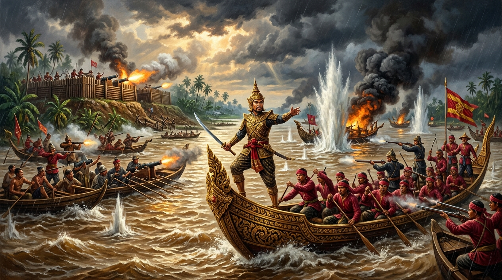
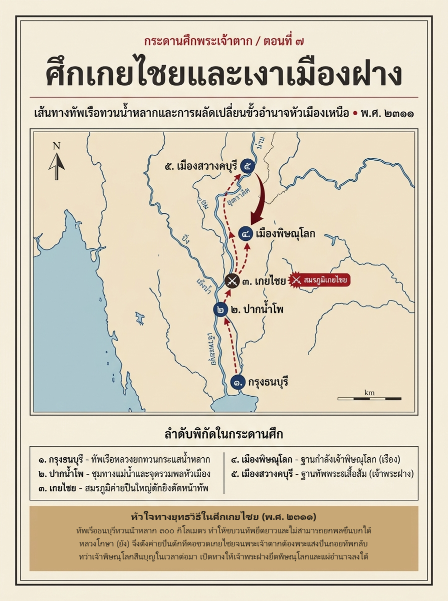

# ภาคที่ 2: แผ่นดินเดียวต้องมีพระเจ้าแผ่นดินองค์เดียว (พ.ศ. 2311 – 2313)
## ตอนที่ 7: น้ำขึ้นที่เกยไชย และเงาพยัคฆ์แห่งพิษณุโลก

---

### องก์ที่ 1: จุดชนวนและเดิมพัน (The Cold Open & The Stakes)

น้ำขึ้นอีกคืบหนึ่งแล้วตั้งแต่เมื่อคืน

**หลวงโกษา (ยัง)** ยืนอยู่บนเชิงเทินไม้ซุงของค่ายริมตลิ่ง ก้มมองหลักไม้ที่เขาสั่งให้ปักไว้วัดระดับน้ำตั้งแต่วันแรกที่ยกทัพลงมาถึง รอยบากเมื่อวานจมหายไปใต้ผิวน้ำสีชาแก่แล้ว

กลางฤดูน้ำ ปีชวด จุลศักราช 1130 (พ.ศ. 2311) ณ **ตำบลเกยไชย** จุดที่ลำน้ำยมไหลมาสบกับลำน้ำน่าน ท้องทุ่งสองฟากฝั่งกลายเป็นทะเลสาบสีน้ำตาลกว้างสุดสายตา ยอดข้าวและกอพงโผล่พ้นน้ำเป็นหย่อมๆ ที่ดอนเหลืออยู่เพียงสันตลิ่งแคบๆ กับโคกวัด—และบนที่ดอนเหล่านั้นทุกแห่ง บัดนี้มีค่ายของทัพพิษณุโลกตั้งอยู่ครบแล้ว

ปืนใหญ่ถูกลากขึ้นวางบนร้านไม้ยกพื้น ปากกระบอกทุกกระบอกหันลงใต้ ชี้ไปที่คุ้งน้ำเดียวกัน

หลวงโกษาไม่ได้เลือกที่นี่เพราะบังเอิญ เจ้านายของเขา **เจ้าพระยาพิษณุโลก (เรือง)** กำชับมาตั้งแต่ก่อนออกจากเมืองว่า อย่าลงไปรับศึกถึงปากน้ำโพ ให้รออยู่ที่เกยไชย ที่ซึ่งแม่น้ำบีบให้เรือทุกลำต้องแล่นผ่านหน้าปากกระบอกปืน

*"ขุนหลวงตากเป็นคนใจเร็ว"* ท่านว่าไว้อย่างนั้น *"คนใจเร็วย่อมมาทางน้ำ และมาเร็วกว่าที่ทัพของตัวเองจะตามทัน"*

เช้าวันนั้น เรือเร็วสอดแนมพายทวนน้ำกลับมาถึงค่ายด้วยฝีพายที่หอบจนพูดแทบไม่เป็นคำ

*"มาแล้วขอรับ... ธงหลวง... เรือรบเต็มคุ้ง!"*

หลวงโกษาหันไปมองทางทิศใต้ เหนือแนวไม้ริมน้ำที่จมอยู่ครึ่งลำต้น ปลายเสาธงสีแดงค่อยๆ เลื่อนพ้นโค้งน้ำออกมาทีละผืน ทีละผืน

ผู้ที่มากับธงเหล่านั้นคือชายวัยสามสิบสี่ผู้ไม่เคยแพ้ใครเลยตลอดสองปี—ตีฝ่าวงล้อมพม่าออกจากอยุธยา พังประตูเมืองจันทบูร บดค่ายโพธิ์สามต้น และเพิ่งไล่ทัพทวายแตกกระเจิงที่บางกุ้งเมื่อต้นปี

แต่วันนี้ ปืนกระบอกหนึ่งในค่ายเกยไชยกำลังจะทำในสิ่งที่กองทัพพม่าทั้งกองทัพทำไม่สำเร็จ

---

### องก์ที่ 2: อ่านกระดานศึกและปมที่ซ่อนอยู่ (The Map & The Hidden Truth)

ก่อนจะกางแผนที่ ต้องบอกผู้อ่านตรงๆ เสียก่อนว่า ศึกเกยไชยเป็นศึกที่หลักฐาน **"พูดน้อยที่สุด"** ศึกหนึ่งในรัชกาล

**พระราชพงศาวดารกรุงธนบุรี ฉบับพันจันทนุมาศ (เจิม)** บันทึกเหตุการณ์ทั้งศึกไว้เพียงไม่กี่บรรทัด ใจความว่า ในปีชวดนั้นเสด็จยกทัพขึ้นไปตีเมืองพิษณุโลก ถึงตำบลเกยไชย เจ้าพิษณุโลกทราบข่าวจึงแต่งให้หลวงโกษา (ยัง) ยกทัพลงมาตั้งรับ ได้รบกันเป็นสามารถ ข้าศึกยิงปืนมาต้องพระชงฆ์เบื้องซ้าย จึงให้ล่าทัพกลับกรุงธนบุรี

เท่านั้นเอง ไม่มีจำนวนไพร่พล ไม่มีชื่อแม่ทัพหน้า ไม่มีรายละเอียดการรบ

เมื่อพยานเอกสารเงียบ นักสืบประวัติศาสตร์ต้องหันไปซักพยานอีกปากหนึ่งที่ไม่เคยโกหก นั่นคือ **ภูมิประเทศ**

#### 1. ทำไมต้องเป็นพิษณุโลกก่อน

ในบรรดา 4 ชุมนุมที่เราเห็นท้ายตอนที่ 5 ชุมนุมพิษณุโลกคือชุมนุมที่ **ใกล้ที่สุดและน่ากลัวที่สุด** สำหรับกรุงธนบุรี

เจ้าพระยาพิษณุโลก (เรือง) ไม่ใช่หัวหน้าซ่องโจรที่ฉวยโอกาสยามบ้านเมืองแตก ท่านเป็นเจ้าเมืองเอกชั้นเจ้าพระยามาตั้งแต่ครั้งกรุงเก่า มีกรมการเมือง มีคลังอาวุธ มีระบบเกณฑ์ไพร่ที่ยังทำงานอยู่ครบ และมีอาณาเขตตั้งแต่เมืองพิชัยลงมาจรดปากน้ำโพ กำแพงเมืองพิษณุโลกเองก็เพิ่งพิสูจน์ความแข็งแกร่งมาหมาดๆ เมื่อ **เจ้าพระฝาง** ยกทัพจากสวางคบุรีลงมาล้อมอยู่ราวครึ่งปีแล้วต้องถอยกลับไปมือเปล่า

มองจากท้องพระโรงกรุงธนบุรี ปัญหามีสองชั้น

ชั้นแรกคือ **ยุทธศาสตร์** ปากน้ำโพเป็นจุดที่ปิง วัง ยม น่าน ไหลมารวมเป็นเจ้าพระยา ใครถือปากน้ำโพ คนนั้นถือประตูน้ำของภาคกลางทั้งภาค ตราบใดที่ชุมนุมพิษณุโลกยังยืนอยู่ กรุงธนบุรีก็มีศัตรูที่ล่องเรือตามน้ำลงมาถึงหน้าเมืองได้ในไม่กี่วัน

ชั้นที่สองคือ **ความชอบธรรม** เจ้าพระยาพิษณุโลกมียศศักดิ์ครั้งกรุงเก่าสูงกว่าพระยาตากอยู่หลายขั้น ขุนนางเก่าที่ยังลังเลว่าจะฝากตัวกับใครย่อมชั่งน้ำหนักข้อนี้อยู่ในใจ ชัยชนะที่บางกุ้งทำให้ตาชั่งเอียงมาทางธนบุรีแล้ว สมเด็จพระเจ้าตากสินจึงทรงต้องการรีบกดให้มันเอียงจนสุด ก่อนที่ข่าวจะจาง

#### 2. โจทย์ที่ซ่อนอยู่ในฤดูน้ำ

การยกทัพในฤดูน้ำไม่ใช่ความผิดพลาดในตัวมันเอง ตรงกันข้าม มันคือสูตรสำเร็จที่พระองค์ใช้ชนะมาแล้วสองครั้ง ทัพเรือร้อยลำที่ย้อนกลับเข้าเจ้าพระยาเมื่อปลายปี 2310 ก็มาในหน้าน้ำ ทัพเรือที่บางกุ้งก็ชนะด้วยความเร็วของเรือ น้ำมากหมายถึงเรือใหญ่ขึ้นได้ถึงหัวเมืองเหนือ ขนปืน ขนเสบียง ขนคนได้โดยไม่ต้องเดินเท้าสักก้าว

แต่ลองวางนิ้วลงบนแผนที่ แล้วไล่จากกรุงธนบุรีขึ้นไปถึงเกยไชย

**หนึ่ง — ขาขึ้นคือขาทวนน้ำ** ที่บางกุ้ง กองเรือแล่นไปตามคลองลัดระยะสั้น แต่ทางไปเกยไชยคือการพายทวนกระแสน้ำหลากเป็นระยะทางราวสามร้อยกิโลเมตร ฝีพายต้องออกแรงทุกคืบ ขบวนเรือที่ออกจากเมืองหลวงพร้อมกันย่อมยืดออกเป็นสายยาว เรือเร็วไปก่อน เรือหนักตามหลัง

**สอง — น้ำท่วมทุ่งทำให้ทัพเรือ "ขึ้นบกไม่ได้"** ในหน้าแล้ง ทหารเรือกระโดดขึ้นตลิ่งแล้วแปรขบวนตีโอบได้ทุกทิศ อย่างที่พระมหามนตรีทำที่บางกุ้ง แต่ในหน้าน้ำ ตลิ่งหายไปใต้น้ำ ทุ่งทั้งทุ่งเป็นเลนลึก ที่ดอนเหลืออยู่ไม่กี่แห่ง ใครมาถึงก่อนก็ได้ที่ดอนไป

**สาม — ฝ่ายตั้งรับอยู่เหนือน้ำ** ทัพพิษณุโลกล่องตามน้ำลงมา มาถึงก่อน เลือกที่ได้ก่อน และถ้าจำเป็นก็ปล่อยแพไฟหรือถอยกลับได้ง่ายกว่า

เมื่อรวมสามข้อนี้เข้าด้วยกัน เกยไชยจึงเป็นจุดที่ฝ่ายตั้งรับได้เปรียบแทบทุกทาง ลำน้ำสองสายมาสบกัน ร่องน้ำลึกบังคับทิศเรือ ที่ดอนริมตลิ่งมีพอให้ตั้งค่ายปืนได้ แต่ไม่มีเหลือให้ผู้มาทีหลังยกพลขึ้นบก

พงศาวดารไม่ได้บอกว่าเจ้าพิษณุโลกคิดอย่างนี้ แต่ตำแหน่งที่หลวงโกษาเลือกตั้งรับบอกแทนไว้ชัดเจนพอแล้ว ท่านไม่ได้ลงไปรับศึกที่ปากน้ำโพซึ่งเป็นประตูอาณาเขต หากถอยขึ้นมารอที่คอขวดเหนือขึ้นไป ปล่อยให้แม่น้ำกับระยะทางทำงานแทนทหาร

อาวุธที่ทำให้สมเด็จพระเจ้าตากสินชนะมาตลอด—ความเร็ว—กำลังจะถูกใช้เป็นเหยื่อล่อพระองค์เอง

---

### องก์ที่ 3: คมดาบและกลศึก (The Clash & Tactical Turning Point)

> **หมายเหตุผู้เขียน:** ฉากการรบข้างล่างนี้เป็นการประกอบภาพขึ้นใหม่จากข้อความสั้นๆ ในพงศาวดารและสภาพภูมิประเทศหน้าน้ำ ข้อเท็จจริงที่หลักฐานยืนยันมีเพียงสี่ข้อ คือ รบกันที่เกยไชย หลวงโกษา (ยัง) เป็นแม่ทัพฝ่ายพิษณุโลก การรบดุเดือด และสมเด็จพระเจ้าตากสินต้องกระสุนที่พระชงฆ์เบื้องซ้ายจนต้องถอนทัพ

#### คุ้งน้ำหน้าปากกระบอกปืน

กองเรือหลวงพ้นปากน้ำโพขึ้นมาโดยไม่มีใครขวาง

ไม่มีค่าย ไม่มีเรือลาดตระเวน ไม่มีแม้แต่ควันไฟ หมู่บ้านริมน้ำร้างผู้คน สำหรับกองทัพที่เพิ่งชนะศึกมาหมาดๆ ความเงียบแบบนี้อ่านได้สองทาง ข้าศึกอาจกำลังหนี หรือข้าศึกอาจกำลังรอ

สมเด็จพระเจ้าตากสินทรงเลือกอ่านแบบแรก และมีพระราชโองการให้เร่งฝีพาย

เมื่อเรือลำหน้าเลี้ยวพ้นคุ้งสุดท้ายเข้าสู่ปากน้ำเกยไชย ฝีพายก็ได้เห็นสิ่งที่ซ่อนอยู่หลังแนวไม้ ค่ายไม้ซุงตั้งเรียงอยู่บนสันตลิ่งทั้งสองฟาก ธงเมืองพิษณุโลกปักอยู่เหนือเชิงเทิน และร้านปืนยกพื้นที่หันปากกระบอกลงมาหาพวกเขาพอดี

หลวงโกษารอจนเรือลำที่สามพ้นคุ้งจึงให้สัญญาณ

ปืนใหญ่บนตลิ่งคำรามขึ้นพร้อมกัน น้ำแตกเป็นเสาสูงรอบลำเรือ กราบเรือลำหน้าฉีกออกเป็นเสี่ยง ฝีพายกระเด็นลงน้ำ เสียงไม้สักลั่นเปรี๊ยะผสมเสียงโห่ร้องดังก้องคุ้งน้ำ เรือที่ตามมาข้างหลังหักหัวหลบกันจนขวางลำ และกระแสน้ำหลากอันเชี่ยวกรากก็ผลักเรือที่เสียจังหวะให้ลอยเข้าหาปากกระบอกปืนแทนที่จะออกห่าง

#### รบกันเป็นสามารถ

กองทัพธนบุรีไม่ได้แตกตั้งแต่ชุดแรก พงศาวดารใช้คำว่า **"ได้รบกันเป็นสามารถ"** ซึ่งเป็นสำนวนที่อาลักษณ์สงวนไว้ใช้กับการรบที่สู้กันถึงเลือดถึงเนื้อทั้งสองฝ่าย

เรือรบธนบุรีตอบโต้ด้วยปืนจินดาหน้าเรือ กลุ่มควันดินปืนสีเทาหนาทึบคลุ้งไปทั่วผิวน้ำ ทหารอาสาพยายามปักถ่อเทียบเรือเข้าหาตลิ่งเพื่อยกพลขึ้นตีค่ายอย่างที่เคยทำสำเร็จที่บางกุ้ง แต่ที่นี่ไม่มีตลิ่งให้ขึ้น คนที่กระโดดลงจากเรือจมเลนถึงอก ยกดาบแทบไม่พ้นน้ำ กระแสน้ำเชี่ยวจนยืนทรงตัวไม่ได้ ขณะที่พลปืนในค่ายยิงลงมาจากที่สูงได้ถนัดมือ

จุดที่ต่างจากบางกุ้งอยู่ตรงนี้ ที่บางกุ้งมีกองกำลังในค่ายจีนคอยตีกระหนาบจากด้านใน ข้าศึกจึงถูกบีบสามทาง ที่เกยไชยไม่มีใครอยู่ข้างหลังข้าศึกเลย กองเรือต้องตีจากหน้าตรงทิศทางเดียว เข้าหากำแพงไม้ซุงที่มีปืนรออยู่ และเรือหนุนที่ควรจะตามมาก็ยังทวนน้ำอยู่ไกลออกไปข้างหลัง

#### กระสุนนัดนั้น

กลางควันดินปืน เรือพระที่นั่งยังคงอยู่แนวหน้า

นี่เป็นวิธีรบของพระองค์มาตั้งแต่ต้น จอมทัพที่ทรงช้างพังประตูเมืองจันทบูรด้วยพระองค์เองย่อมไม่บัญชาการจากท้ายขบวน และวิธีนี้เองที่ทำให้ทหารของพระองค์ยอมตายแทนได้ แต่จอมทัพที่อยู่แนวหน้าก็อยู่ในระยะปืนของข้าศึกเหมือนทหารทุกคน

พงศาวดารฉบับพันจันทนุมาศ (เจิม) บันทึกว่า **"ข้าศึกยิงปืนมาต้องพระชงฆ์ข้างซ้าย"** ขณะที่พระราชพงศาวดารฉบับที่ชำระในชั้นหลังเล่าเพิ่มว่ากระสุนเฉียดถูกผ้าทรงเสียก่อนแล้วจึงเลยไปต้องพระชงฆ์ ไม่มีฉบับใดบอกว่าเป็นปืนใหญ่หรือปืนคาบศิลา และไม่มีฉบับใดบอกว่าผู้ยิงรู้หรือไม่ว่ายิงถูกใคร

แรงกระแทกทำให้พระวรกายเซไปพิงกราบเรือ โลหิตไหลซึมอาบพระชงฆ์ลงบนพื้นไม้สัก เสียงทหารใกล้ชิดร้องอุทานด้วยความตกใจ หลายคนละมือจากพายหมายจะเข้ามาประคอง

แผลที่หน้าแข้งไม่ใช่แผลถึงชีวิต แต่ผลของมันในสนามรบหนักกว่าขนาดของแผลหลายเท่า

กองทัพนี้ไม่ได้ผูกกันด้วยระบบราชการแบบกรุงเก่า หากผูกกันด้วยตัวบุคคลเพียงคนเดียว ทหารจีนจากจันทบูร ไพร่จากหัวเมืองตะวันออก ขุนนางเก่าที่เพิ่งมาฝากตัว—รวมถึงพี่น้องตระกูลนักรบอย่างพระราชวรินทร์ (ทองด้วง) และพระมหามนตรี (บุญมา) ที่เพิ่งก้าวเข้ามาร่วมเสาหลักแห่งธนบุรี—ทุกคนมาอยู่ที่นี่เพราะเชื่อว่าคนผู้นี้ไม่มีวันแพ้ ถ้าพระองค์สิ้นพระชนม์ที่เกยไชย กรุงธนบุรีที่เพิ่งตั้งได้ไม่ถึงปีก็จะสิ้นไปด้วยในบ่ายวันเดียวกัน

พระองค์ทรงกัดพระทนต์ข่มความเจ็บปวด กุมด้ามดาบยันพระองค์ขึ้นให้ทหารทั้งลำเห็นว่าจอมทัพยังยืนอยู่ แล้วทรงทำในสิ่งที่ยากกว่าการสั่งบุก

*"ล่าทัพ"*

เรือพระที่นั่งกลับลำ กระแสน้ำที่เป็นศัตรูมาตลอดขาขึ้นกลับเป็นฝ่ายช่วยในขาลง กองเรือที่เหลือปล่อยตัวไหลตามน้ำพ้นระยะปืนไปในไม่กี่อึดใจ

บนเชิงเทิน หลวงโกษามองตามท้ายเรือที่เล็กลงทุกที แล้วสั่งห้ามไม่ให้ใครออกเรือไล่ ท่านมีคำสั่งให้เฝ้าคอขวด ไม่ได้มีคำสั่งให้ลงไปตีกรุงธนบุรี และแม่ทัพที่รอบคอบพอจะเลือกเกยไชยเป็นที่ตั้งรับ ก็รอบคอบพอจะไม่ทิ้งที่มั่นลงไปรบในถิ่นของอีกฝ่าย

ความรอบคอบนั้นเองที่ช่วยกองทัพธนบุรีไว้ทั้งกองทัพ

---

### องก์ที่ 4: ผลลัพธ์และเงาของศึกถัดไป (The Aftermath & Cliffhanger)

ข่าวจากเกยไชยเดินทางไปสองทิศ และให้ผลตรงข้ามกันในสองเมือง

#### ที่พิษณุโลก: พระเจ้าแผ่นดินเจ็ดวัน

ที่เมืองพิษณุโลก ชัยชนะครั้งนี้ถูกอ่านเป็นลางบอกเหตุ ผู้ที่ทำให้ขุนหลวงตากต้องหลั่งเลือดและถอยทัพได้เป็นคนแรกย่อมเป็นผู้มีบุญกว่า เจ้าพระยาพิษณุโลก (เรือง) จึงให้ตั้งพิธีราชาภิเษก ประกาศตนขึ้นเป็นพระเจ้าแผ่นดิน รับพระราชโองการอย่างกษัตริย์กรุงเก่าทุกประการ

แล้วเรื่องที่ไม่มีใครวางแผนไว้ก็เกิดขึ้น

**พระราชพงศาวดาร ฉบับพระราชหัตถเลขา** เล่าว่า หลังราชาภิเษกได้เพียง **7 วัน** เจ้าพิษณุโลกก็ประชวรเป็นฝีขึ้นในลำคอ และถึงแก่พิราลัย

นักสืบประวัติศาสตร์ควรจดข้อสังเกตไว้ตรงนี้สองข้อ ข้อแรก ตัวเลข "7 วัน" มาจากพงศาวดารที่ชำระในสมัยรัตนโกสินทร์ ซึ่งมีธรรมเนียมอธิบายการสิ้นบุญของผู้ตั้งตนเป็นกษัตริย์ว่าเป็นเพราะ "บุญไม่ถึง" ตัวเลขจึงอาจมีน้ำหนักเชิงคติมากกว่าเชิงปฏิทิน ข้อที่สอง ไม่ว่าจะเป็นเจ็ดวันหรือนานกว่านั้น หลักฐานทุกฉบับตรงกันในสาระสำคัญ คือท่านสิ้นในปีเดียวกับที่ชนะศึก โดยไม่ทันได้ใช้ชัยชนะนั้นทำอะไรเลย

ชุมนุมพิษณุโลกไม่ได้แพ้ในสนามรบ ชุมนุมนี้เสียผู้นำไปในเวลาที่ต้องการผู้นำมากที่สุด

**พระอินทร์อากร** น้องชายของเจ้าพิษณุโลก ขึ้นว่าราชการเมืองแทน ท่านไม่กล้าตั้งตนเป็นกษัตริย์ต่อจากพี่ชาย และบารมีของท่านก็ไม่พอจะยึดกรมการเมืองไว้ด้วยกัน

ทางเหนือขึ้นไปที่เมืองสวางคบุรี มีผู้หนึ่งรอจังหวะนี้มานานแล้ว

**เจ้าพระฝาง (เรือน)** ผู้เคยล้อมพิษณุโลกอยู่ครึ่งปีแล้วต้องถอย ยกกองทัพลงมาอีกครั้งทันทีที่รู้ข่าว คราวนี้ล้อมอยู่ราวสองถึงสามเดือน เสบียงในเมืองร่อยหรอ ชาวเมืองที่หมดศรัทธาในผู้นำคนใหม่ลอบเปิดประตูรับข้าศึกในเวลากลางคืน พระอินทร์อากรถูกจับประหาร เจ้าพระฝางให้ขนปืนใหญ่น้อย ทรัพย์สิน และกวาดต้อนครอบครัวชาวพิษณุโลกขึ้นไปไว้ที่สวางคบุรี

เมืองเอกของหัวเมืองเหนือซึ่งรับศึกพม่าและศึกเมืองฝางมาได้ทุกครั้ง พังลงจากข้างในภายในเวลาไม่ถึงปีหลังจากชนะศึกครั้งใหญ่ที่สุดของตัวเอง

#### ที่ธนบุรี: บทเรียนจากแผลที่หน้าแข้ง

ที่กรุงธนบุรี สมเด็จพระเจ้าตากสินประทับรักษาพระองค์อยู่ในพระราชวังที่ยังสร้างไม่เสร็จ

ความพ่ายแพ้ที่เกยไชยไม่ได้ทำให้พระองค์เสียแผ่นดินแม้แต่เมืองเดียว แต่ทำให้ทรงเสียสิ่งที่มีค่ากว่านั้นในทางการเมือง คือภาพของผู้ที่ไม่มีวันแพ้ ขุนนางเก่าที่ยังเหยียบเรือสองแคมมีเหตุผลให้รอดูต่อไปอีกหน่อย

แต่แล้วครอบครัวชาวพิษณุโลกและพิจิตรที่หนีพ้นเงื้อมมือเจ้าพระฝางก็เริ่มล่องเรือลงมาถึงกรุงธนบุรี ทีละครัว ทีละหมู่บ้าน พร้อมข่าวที่เปลี่ยนกระดานทั้งกระดาน ชุมนุมพิษณุโลกไม่มีแล้ว ผู้ชนะที่เกยไชยสิ้นไปแล้ว และคนของท่านกำลังเดินทางมาขอพึ่งผู้แพ้

ในแง่ยุทธศาสตร์ นี่ไม่ใช่ข่าวดีทั้งหมด ศัตรูทางเหนือไม่ได้หายไป เพียงแต่เปลี่ยนจากขุนนางเก่าที่รบตามตำรา กลายเป็นชุมนุมนักบวชติดอาวุธที่บัดนี้ถือครองทั้งสวางคบุรีและพิษณุโลก มีปืนของสองเมืองรวมกัน และแผ่อำนาจลงมาได้ถึงปากน้ำโพ **เงาของเมืองฝาง** ทอดยาวลงมาทับที่ที่เงาของเจ้าพิษณุโลกเคยอยู่ และเป็นเงาที่ใหญ่กว่าเดิม

สมเด็จพระเจ้าตากสินทรงได้บทเรียนสามข้อจากเกยไชย และทั้งสามข้อจะปรากฏซ้ำในทุกศึกหลังจากนี้

1. **ความเร็วต้องมีทัพหนุนตามทัน:** การจู่โจมสายฟ้าแลบได้ผลกับข้าศึกที่ประมาท แต่ใช้ไม่ได้กับข้าศึกที่ตั้งใจรออยู่แล้ว
2. **ฤดูกาลเป็นอาวุธของทั้งสองฝ่าย:** น้ำที่พาเรือของพระองค์ขึ้นเหนือ เป็นน้ำเดียวกับที่กันไม่ให้ทหารของพระองค์ขึ้นบก
3. **ศัตรูที่แข็งที่สุดไม่จำเป็นต้องตีก่อน:** กระดานนี้มีสี่ชุมนุม และไม่มีกฎข้อใดบังคับว่าต้องเริ่มจากชุมนุมที่ใกล้ที่สุด

ข้อที่สามคือข้อที่ทรงลงมือทำทันที

เมื่อพระชงฆ์หายพอทรงม้าได้ และน้ำเหนือเริ่มลดเปิดทางบกให้เดินทัพ พระหัตถ์ของจอมทัพก็เลื่อนออกจากลำน้ำน่าน ข้ามแผนที่ไปทาง **ทิศตะวันออกเฉียงเหนือ** ผ่านแนวเขาทึบที่คนเดินทางเรียกกันด้วยความหวาดกลัวว่า **ดงพญาไฟ** ไปหยุดที่เมืองนครราชสีมาและเมืองพิมาย

ที่นั่น **กรมหมื่นเทพพิพิธ** พระราชโอรสในสมเด็จพระเจ้าอยู่หัวบรมโกศ ทรงตั้งราชสำนักย่อมๆ ขึ้นกลางที่ราบสูง ท่านไม่มีกองทัพเข้มแข็งเท่าพิษณุโลก และไม่มีศิษย์นับหมื่นอย่างเมืองฝาง แต่ท่านมีสิ่งเดียวที่สมเด็จพระเจ้าตากสินไม่มีและไม่มีวันหาได้ด้วยคมดาบ

**สายเลือดกษัตริย์อยุธยา**

ศึกครั้งต่อไปจึงไม่ใช่การรบกับขุนนางที่ตั้งตัวเป็นใหญ่ แต่เป็นการยกทัพไปจับเจ้านายของแผ่นดินเก่า และคำถามที่รออยู่ปลายทางก็หนักกว่ากระสุนที่เกยไชยหลายเท่า เมื่อจับได้แล้ว จะทำอย่างไรกับพระองค์ท่าน

---
**จบตอนที่ 7**
*(ติดตามต่อใน ตอนที่ 8: ดงพญาไฟและศึกสายเลือดที่พิมาย)*
