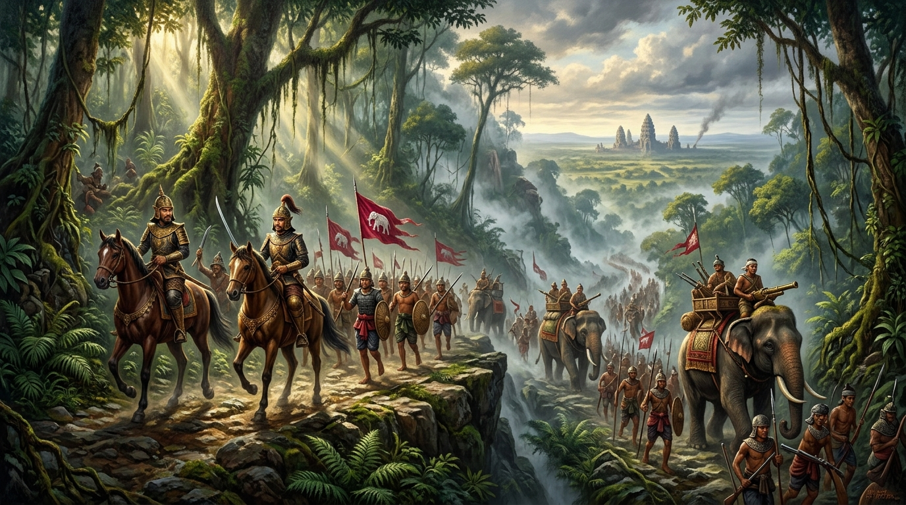
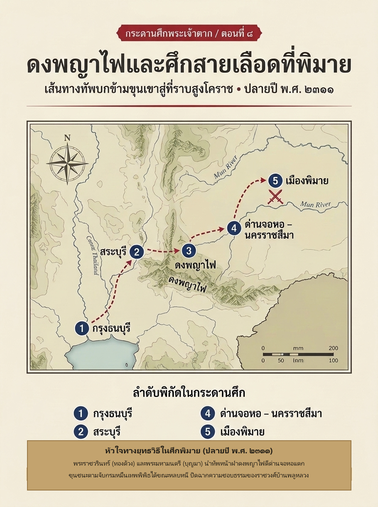

# ภาคที่ 2: แผ่นดินเดียวต้องมีพระเจ้าแผ่นดินองค์เดียว (พ.ศ. 2311 – 2313)
## ตอนที่ 8: ดงพญาไฟและศึกสายเลือดที่พิมาย

---

### องก์ที่ 1: จุดชนวนและเดิมพัน (The Cold Open & The Stakes)

อากาศใต้เรือนยอดไม้ใน **ดงพญาไฟ** เย็นชื้นและอับทึบแม้ในยามกลางวัน

ปลายฤดูฝนต่อต้นฤดูหนาว ปีชวด จุลศักราช 1130 (ปลายปี พ.ศ. 2311) เสียงฝีเท้าคนและม้าศึกนับพันเหยียบย่ำลงบนดินโคลนปนหินลูกรังตามแนวทางเกวียนแคบๆ ที่ไต่เลาะขึ้นสู่สันเขาดงพญาไฟ—แนวป่าดงดิบหนาทึบที่กั้นระหว่างลุ่มน้ำป่าสักในภาคกลางกับที่ราบสูงนครราชสีมา

**พระมหามนตรี (บุญมา)** ขี่ม้านำหน้ากองลาดตระเวน มือข้างหนึ่งกุมบังเหียน อีกข้างหนึ่งแตะด้ามดาบที่เอว ดวงตาคมกริบกวาดมองแนวผาหินและพุ่มไม้ไผ่สองข้างทางไม่กะพริบ ถัดไปเบื้องหลังไม่กี่ช่วงม้า **พระราชวรินทร์ (ทองด้วง)** พี่ชายร่วมสายเลือดของเขากำลังตรวจตราขบวนช้างต่างเสบียงและไพร่พลที่เดินเรียงแถวเดี่ยวฝ่าสายหมอกชื้นขึ้นมาอย่างยากลำบาก

*"ทางแคบเพียงนี้ หากข้าศึกซุ่มตีจากยอดผา เราจะแปรขบวนไม่ทัน"* พระราชวรินทร์เอ่ยเสียงเรียบ แต่สายตามองไกลขึ้นไปถึงช่องเขาเบื้องหน้า

*"และถ้าเราช้าไปอีกแม้แต่สองวัน ข่าวจากเกยไชยก็จะทำให้คนทั้งเมืองโคราชเชื่อว่าทัพธนบุรีหมดเขี้ยวเล็บแล้ว"* พระมหามนตรีตอบ

ไม่มีใครในกองทัพไม่รู้จักชื่อเสียงอันน่าสะพรึงกลัวของดงพญาไฟ คนเดินทางเรียกป่าผืนนี้ว่าดินแดนแห่งไข้ป่าและวิญญาณร้าย ทหารที่ป่วยด้วยไข้จับสั่นล้มลงข้างทางวันแล้ววันเล่า แต่สิ่งที่รออยู่ปลายทางอีกฟากหนึ่งของขุนเขานั้นน่ากลัวยิ่งกว่าไข้ป่า

ที่ **เมืองพิมาย** กลางทุ่งราบอีสาน ชายชราผู้หนึ่งกำลังประทับอยู่บนบัลลังก์จำลอง รายล้อมด้วยขุนนางเก่าอยุธยาที่หนีภัยพม่ามาพึ่งใบบุญ

พระนามของท่านคือ **กรมหมื่นเทพพิพิธ**—พระราชโอรสในสมเด็จพระเจ้าอยู่หัวบรมโกศ และเป็นพระเจ้าลูกยาเธอองค์สุดท้ายของราชวงศ์บ้านพลูหลวงที่ยังมีพระชนม์ชีพและตั้งราชสำนักอยู่บนแผ่นดินสยาม

เพียงไม่กี่เดือนก่อน สมเด็จพระเจ้าตากสินเพิ่งทรงพ่ายศึกครั้งแรกที่เกยไชยและต้องกระสุนที่พระชงฆ์เบื้องซ้าย บัดนี้พระองค์ยังไม่ทันหายสนิทดีก็ทรงสั่งเคลื่อนทัพข้ามดงพญาไฟเข้าหาศัตรูที่อันตรายในแบบที่ไม่เหมือนใคร

เพราะศึกนี้ไม่ได้ตัดสินกันเพียงว่าใครมีปืนมากกว่ากัน แต่กำลังจะตัดสินคำถามที่หนักหน่วงที่สุดของแผ่นดินใหม่:

**ระหว่าง "กษัตริย์สามัญชนผู้กอบกู้แผ่นดินด้วยคมดาบ" กับ "เจ้าฟ้าสายเลือดกษัตริย์กรุงเก่า" — ใครกันแน่ที่มีสิทธิครองบัลลังก์สยาม?**

---

### องก์ที่ 2: อ่านกระดานศึกและปมที่ซ่อนอยู่ (The Map & The Hidden Truth)

หากมองผ่านสายตาของนักประวัติศาสตร์ที่อ่าน **พระราชพงศาวดารกรุงธนบุรี ฉบับพันจันทนุมาศ (เจิม)** คู่กับงานวิเคราะห์ของ **นิธิ เอียวศรีวงศ์** ใน *การเมืองไทยสมัยพระเจ้ากรุงธนบุรี* ศึกพิมายในปลายปี พ.ศ. 2311 คือการขยับหมากที่เฉียบขาดที่สุดครั้งหนึ่งหลังความผิดพลาดที่เกยไชย

#### 1. ทำไมต้องเลี้ยวเข้าอีสาน ทั้งที่แผลเกยไชยยังไม่ทันจาง

หลังถอนทัพจากเกยไชย ความมั่นคงทางจิตวิทยาของกรุงธนบุรีสั่นคลอนอย่างหนัก ขุนนางเก่าอยุธยาที่ยังลังเลต่างเฝ้ามองว่าพระเจ้าตากสินจะทรงฟื้นพระองค์ได้เร็วเพียงใด หากพระองค์รอจนถึงปีหน้าเพื่อขึ้นเหนือซ้ำสอง ชุมนุมต่างๆ ก็จะมีเวลาสะสมกำลังและอาจจับมือกันปิดล้อมธนบุรี

แต่การขึ้นเหนือในปลายปี 2311 ยังติดข้อจำกัดของน้ำหลากและฐานที่มั่นของเจ้าพิษณุโลก (และต่อมาคือเจ้าพระฝาง) สมเด็จพระเจ้าตากสินจึงทรงหันเข็มทิศมาทาง **ทิศตะวันออกเฉียงเหนือ** ด้วยเหตุผลยุทธศาสตร์ 3 ประการ:

1. **ตัดจุดอ่อนที่สุดก่อน:** ชุมนุมพิมายมีกำลังทหารน้อยกว่าพิษณุโลกและนครศรีธรรมราช หากพิชิตได้ก่อน ขวัญกำลังใจของทัพธนบุรีที่เสียไปจากเกยไชยจะกลับมาทันที
2. **กุมจุดยุทธศาสตร์ปากประตูอีสาน:** เมืองนครราชสีมาเป็นเมืองหน้าด่านที่เชื่อมภาคกลางกับที่ราบสูงอีสานและล้านช้าง หากปล่อยให้กรมหมื่นเทพพิพิธตรึงเมืองโคราชและพิมายไว้ได้ พันธมิตรจากเวียงจันทน์หรือจำปาศักดิ์อาจไหลลงมาสมทบได้ทุกเมื่อ
3. **ทำลาย "ศูนย์รวมใจของพวกราชวงศ์เก่า":** ตราบใดที่พระราชโอรสในสมเด็จพระเจ้าอยู่หัวบรมโกศยังทรงประทับเป็นศูนย์กลางอำนาจอยู่ กลุ่มขุนนางเก่าอยุธยาที่ยังจงรักภักดีต่อราชวงศ์บ้านพลูหลวงย่อมมี "ตัวเลือก" ที่จะไม่ยอมสวามิภักดิ์ต่อกรุงธนบุรี

#### 2. เส้นทางชีวิตอันโลดโผนของ "เจ้าฟ้าผู้ไม่ยอมก้มหัว"

กรมหมื่นเทพพิพิธ (พระนามเดิมว่าพระองค์เจ้าแขก) ไม่ใช่เจ้านายที่นั่งรอโชคชะตาอยู่ในวัง ทรงเป็นตัวละครทางการเมืองที่มีประวัติศาสตร์ซับซ้อนที่สุดคนหนึ่งในปลายยุคอยุธยา

ในรัชกาลพระเจ้าเอกทัศ พระองค์ทรงพัวพันกับความขัดแย้งในราชสำนักจนถูกเนรเทศไปอยู่ที่เกาะลังกา แต่เมื่อทราบข่าวศึกพม่าบุกกรุงศรีอยุธยา ทรงลักลอบเดินทางกลับเข้ามาทางเมืองมะริด–ตะนาวศรี–เพชรบุรี และพยายามรวบรวมไพร่พลอาสาเข้าสู้รบกับพม่าถึงขั้นตั้งค่ายที่เมืองปราจีนบุรี (ปากน้ำโจ้โล้) ก่อนจะพ่ายแพ้แก่ทัพพม่าแล้วถอยลึกเข้าไปทางเมืองนครราชสีมาและเมืองพิมาย

ในสายตาของกรมหมื่นเทพพิพิธ พระองค์คือ **"ผู้สืบสันตติวงศ์โดยชอบธรรม"** ที่รอดชีวิตมาได้จากกลียุค ทรงมีขุนนางเก่าผู้ภักดีอย่าง **พระยาศรีสุริยวงศ์** และกองกำลังหัวเมืองอีสานคอยหนุนหลัง ทั้งยังทรงกวาดต้อนกำลังคนจากแถบนครราชสีมามาเสริมกำลังที่พิมาย

ทว่าจุดอ่อนร้ายแรงของชุมนุมพิมายซ่อนอยู่ตรง **"ความแตกแยกภายในเมืองนครราชสีมา"** นั่นเอง เพราะการตั้งตัวของกรมหมื่นเทพพิพิธทำให้เจ้าเมืองและกรมการเมืองโคราชเดิมแตกออกเป็นสองฝักสองฝ่าย บางส่วนยอมสวามิภักดิ์ บางส่วนถูกกำจัด และอีกจำนวนไม่น้อยแอบรอจังหวะที่จะหันมาเข้าข้างผู้แข็งแกร่งกว่า

#### 3. เดิมพันในการส่ง "สองพี่น้องตระกูลนักรบ" เป็นทัพหน้า

ที่น่าจับตาบนกระดานศึกครั้งนี้คือการจัดทัพของสมเด็จพระเจ้าตากสิน

พระองค์ไม่ได้ทรงนำทัพหน้าด้วยพระองค์เองเช่นที่เกยไชย เพราะพระชงฆ์เพิ่งทุเลาจากบาดแผล และทรงได้บทเรียนแล้วว่าหากจอมทัพอยู่หน้าสุดโดยไม่มีทัพหนุนคอยประคอง ความเสี่ยงจะสูงเกินไป

คราวนี้พระองค์ทรงมอบความไว้วางใจสูงสุดให้ **พระราชวรินทร์ (ทองด้วง)** และ **พระมหามนตรี (บุญมา)** สองพี่น้องขุนนางเก่าอยุธยาที่เพิ่งเข้าถวายตัวในตอนที่ 6 คุมทัพหน้าเดินเท้าข้ามดงพญาไฟล่วงหน้าไปก่อน แล้วพระองค์จึงเสด็จพระราชดำเนินคุมทัพหลวงตามขึ้นไปหนุน!

นี่คือบททดสอบความภักดีครั้งใหญ่ที่สุดของตระกูลนักรบคู่นี้—พวกเขากำลังจะนำทัพของ "กษัตริย์ใหม่" ไปรบกับ "เจ้าฟ้าแห่งราชวงศ์เก่า" ที่พวกเขาเคยรับราชการมาแต่ครั้งกรุงศรีอยุธยา

---

### องก์ที่ 3: คมดาบและกลศึก (The Clash & Tactical Turning Point)

#### ฝ่าประตูนรกดงพญาไฟ สู่ด่านจอหอ

การเดินทัพข้ามดงพญาไฟในปลายฤดูฝนคือสงครามกับธรรมชาติก่อนจะได้เจอตัวข้าศึก

ทางเดินแคบเลียบหน้าผาชันและลำห้วยเชี่ยวกรากทำให้ปืนใหญ่ขนาดหนักและเกวียนเสบียงเคลื่อนที่ได้ช้ามาก ทหารหลายสิบนายล้มป่วยด้วยไข้ป่า ทว่าความเร่งด่วนของสถานการณ์บีบให้ทัพหน้าของพระราชวรินทร์และพระมหามนตรีไม่อาจหยุดตั้งค่ายพักแรมนานได้ พวกเขาเร่งฝ่าแนวป่าทึบข้ามสันเขาลงสู่ที่ราบฝั่งนครราชสีมาได้สำเร็จ ก่อนที่ฝ่ายพิมายจะคาดคิดว่าจะมียกทัพใหญ่ฝ่าดงพญาไฟมาได้ในฤดูนี้

ที่หน้าเมืองนครราชสีมา กรมหมื่นเทพพิพิธทรงส่ง **พระยาศรีสุริยวงศ์** แม่ทัพคู่พระทัย คุมกองกำลังมาตั้งค่ายสกัดอยู่ที่ **ด่านจอหอ** เพื่อขวางทางทัพธนบุรีไม่ให้เข้าถึงตัวเมืองโคราชและพิมาย

เมื่อทัพหน้าของกรุงธนบุรีมาถึงด่านจอหอ เสียงกลองศึกและปืนไฟก็ปะทะกันสนั่นทุ่งราบ

ฝ่ายพิมายอาศัยแนวค่ายไม้และชัยภูมิที่คุ้นเคยกว่ายิงสกัดอย่างหนัก แต่ครั้งนี้ไม่ใช่ศึกทางน้ำที่เกยไชยซึ่งทหารเรือต้องจมเลนอยู่กลางแม่น้ำ—บนพื้นดินแห้งของที่ราบสูง **พระราชวรินทร์ (ทองด้วง)** และ **พระมหามนตรี (บุญมา)** แปรขบวนทหารราบรุกเข้าตีโอบปีกค่ายด่านจอหอได้อย่างเต็มรูปแบบ

ในเวลาเดียวกับที่ทัพหลวงของสมเด็จพระเจ้าตากสินเคลื่อนพ้นดงพญาไฟเข้ามาสมทบ แนวรับของฝ่ายพิมายก็สั่นคลอน ทหารธนบุรีโห่ร้องทะลวงเข้าประชิดเชิงเทินค่ายด่านจอหอ ฟันแนวขวากหนามและพังประตูค่ายแตกยับเยิน!

ทัพของพระยาศรีสุริยวงศ์แตกพ่ายกระเจิดกระเจิง กองทัพธนบุรีรุกไล่ยึดเมืองนครราชสีมาได้โดยแทบไม่มีการต่อต้านจากชาวเมืองที่เบื่อหน่ายความขัดแย้งภายในอยู่ก่อนแล้ว

#### พิมายแตก และจุดจบของการหลบหนี

ข่าวการแตกพ่ายที่ด่านจอหอและนครราชสีมาเดินทางไปถึง **เมืองพิมาย** เร็วกว่าที่ราชสำนักจำลองจะตั้งตัวติด

เมื่อ **พระยาศรีสุริยวงศ์** ขุนพลคนสำคัญสิ้นท่าและถูกจับตัวได้ (และถูกประหารชีวิตในเวลาต่อมา) แนวป้องกันสุดท้ายของเมืองพิมายก็พังทลายลงอย่างสิ้นเชิง ชาวเมืองและไพร่พลที่ถูกเกณฑ์มาต่างแตกฮือหนีเอาตัวรอดเมื่อเห็นธงชัยของทัพหลวงกรุงธนบุรีเคลื่อนใกล้เข้ามา

กรมหมื่นเทพพิพิธทรงตระหนักว่าเมืองพิมายไม่อาจรักษาไว้ได้อีกต่อไป จึงทรงรวบรวมพระโอรสธิดาและข้าราชบริพารใกล้ชิด เสด็จหลบหนีออกจากเมืองพิมายในยามวิกาล มุ่งหน้าไปทางทิศตะวันออกเฉียงเหนือ หวังจะเสด็จข้ามโขงไปพึ่งพระบรมโพธิสมภาร ณ **กรุงศรีสัตนาคนหุต (เวียงจันทน์)**

แต่เส้นทางหลบหนีถูกตัดขาดเร็วกว่าที่ทรงคิด

**ขุนชนะ** กรมการเมืองนครราชสีมาผู้ตัดสินใจสวามิภักดิ์ต่อสมเด็จพระเจ้าตากสิน นำกำลังทหารท้องถิ่นที่รู้เส้นทางป่าและทางเกวียนในอีสานดีกว่าใคร ออกติดตามไล่ล่าขบวนเสด็จของกรมหมื่นเทพพิพิธอย่างกระชั้นชิด จนกระทั่งสามารถดักจับพระองค์ พร้อมด้วยพระโอรสธิดาและผู้ติดตามทั้งหมดไว้ได้กลางทาง ก่อนจะนำตัวมัดคุมส่งกลับมายังค่ายหลวงของสมเด็จพระเจ้าตากสิน!

---

### องก์ที่ 4: ผลลัพธ์และเงาของศึกถัดไป (The Aftermath & Cliffhanger)

#### การเผชิญหน้าของสองแผ่นดิน

ภายในพลับพลาที่ประทับกลางเมืองนครราชสีมา บรรยากาศเงียบสงัดจนได้ยินเสียงลมหนาวพัดผ่านยอดไม้

เบื้องหน้าพระที่นั่งของสมเด็จพระเจ้าตากสิน คือ **กรมหมื่นเทพพิพิธ** พระราชโอรสในสมเด็จพระเจ้าอยู่หัวบรมโกศ ผู้ซึ่งประทับยืนนิ่งไม่ยอมถวายบังคม

นี่คือฉากการเมืองที่ทรงพลังที่สุดฉากหนึ่งในประวัติศาสตร์ธนบุรี—การเผชิญหน้ากันตัวต่อตัวระหว่าง **"อดีตเจ้าฟ้าแห่งกรุงศรีอยุธยา"** กับ **"อดีตขุนนางเชื้อสายจีนที่สถาปนาตนเป็นกษัตริย์องค์ใหม่"**

**พระราชพงศาวดารกรุงธนบุรี** บันทึกการโต้ตอบอันดุเดือดในวันนั้นไว้อย่างชัดเจน สมเด็จพระเจ้าตากสินตรัสถามกรมหมื่นเทพพิพิธด้วยความขุ่นเคืองพระทัยว่า ในยามที่กรุงศรีอยุธยาถูกพม่าล้อม เหตุใดจึงไม่ทรงร่วมแรงร่วมใจรักษาราชธานี กลับปล่อยให้บ้านเมืองล่มจม แล้วจึงมาตั้งตัวเป็นใหญ่แข่งบุญบารมีในภายหลัง ทั้งเมื่อถูกจับได้แล้วยังไม่ยอมอ่อนน้อม

กรมหมื่นเทพพิพิธมิได้ทรงขอชีวิต พระองค์ตรัสตอบด้วยน้ำเสียงหยิ่งทระนงในขัตติยมานะแห่งราชวงศ์บ้านพลูหลวง ทำนองว่าทรงเป็นลูกพระมหากษัตริย์ผู้สูงศักดิ์ แม้สิ้นไร้ไม้ตอกก็จะไม่ยอมก้มกราบสามัญชนคนใด หากจะทำประการใดก็จงฆ่าเสียเถิด

คำตอบนั้นปิดประตูทางรอดทุกบานลงในทันที

สมเด็จพระเจ้าตากสินทรงเห็นประจักษ์แล้วว่า ตราบใดที่กรมหมื่นเทพพิพิธยังมีพระชนม์ชีพอยู่ เชื้อไฟแห่งการกบฏและข้ออ้างเรื่อง "ความชอบธรรมของราชวงศ์เก่า" จะไม่มีวันดับลงได้ เพราะผู้ที่ไม่ยอมกราบพระองค์ในวันนี้ ย่อมพร้อมจะปลุกระดมขุนนางเก่าให้แข็งข้อต่อกรุงธนบุรีได้ทุกเมื่อในวันหน้า

พระองค์จึงมีพระราชโองการให้นำกรมหมื่นเทพพิพิธไปสำเร็จโทษด้วย **ท่อนจันทน์** ตามโบราณราชประเพณีของการประหารเจ้านายชั้นสูงในสมัยกรุงศรีอยุธยา!

การประหารด้วยท่อนจันทน์ในวันนั้นมีความหมายทางการเมืองลึกซึ้งสองชั้น:
- **ชั้นแรก:** เป็นการให้เกียรติยศครั้งสุดท้ายในฐานะพระราชวงศ์อยุธยา ไม่ให้เลือดเจ้าตกถึงแผ่นดิน
- **ชั้นที่สอง:** เป็นการประกาศให้คนทั้งแผ่นดินรับรู้ว่า **ราชวงศ์กรุงเก่าได้ปิดฉากลงอย่างสมบูรณ์แล้ว** บัดนี้เหลือเพียงอำนาจเดียวที่ชอบธรรมบนแผ่นดิน คือราชอาณาจักรกรุงธนบุรี

#### ปูนบำเหน็จสองขุนพล และสายตาที่หันลงใต้

ชัยชนะที่ด่านจอหอและพิมายลบล้างความผิดพลาดจากเกยไชยได้อย่างหมดจด เมื่อเสด็จกลับถึงกรุงธนบุรี สมเด็จพระเจ้าตากสินทรงปูนบำเหน็จความชอบให้สองพี่น้องผู้เป็นหัวหอกในศึกนี้อย่างสมเกียรติ:
- **พระราชวรินทร์ (ทองด้วง)** ได้รับการเลื่อนบรรดาศักดิ์ขึ้นเป็น **พระยาอภัยรณฤทธิ์** จางวางกรมพระตำรวจนอกขวา
- **พระมหามนตรี (บุญมา)** ได้รับการเลื่อนบรรดาศักดิ์ขึ้นเป็น **พระยาอนุชิตราชา** จางวางกรมพระตำรวจในขวา

จากสี่ชุมนุมใหญ่หลังเสียกรุง บัดนี้ชุมนุมพิษณุโลกสิ้นสลายไปแล้วด้วยฝีมือเจ้าพระฝาง และชุมนุมพิมายก็ถูกบดขยี้ราบคาบด้วยคมดาบของกรุงธนบุรี เหลือเพียงสองคู่ปรับขนาดมหึมาที่ยังยืนตระหง่านอยู่คนละขั้วของแผนที่

ทางเหนือคือ **เจ้าพระฝาง** ที่กำลังกลืนกินหัวเมืองเหนือทั้งหมด

แต่ก่อนจะขึ้นเหนือไปสะสางบัญชีแค้นกับเมืองฝาง สายพระเนตรของสมเด็จพระเจ้าตากสินกลับมองลงไปทาง **ทิศใต้**—สู่คาบสมุทรอันมั่งคั่งไปด้วยดีบุก พริกไทย ข้าวสาร และท่าเรือค้าสำเภาที่เชื่อมสู่มหาสมุทรอินเดีย

ที่นั่น **เจ้านครศรีธรรมราช (หนู)** อดีตปลัดเมืองนครฯ ได้สถาปนาตนขึ้นเป็นใหญ่ ครอบครองหัวเมืองปักษ์ใต้ตั้งแต่ชุมพรลงไปจนถึงหัวเมืองมลายู และกำลังสะสมกองกำลังไว้รอรับมือทัพจากราชธานีใหม่

หากปล่อยให้เจ้านครศรีธรรมราชตั้งมั่นเป็นรัฐอิสระได้ กรุงธนบุรีก็จะสูญเสียรายได้จากการค้าทางทะเลและคลังเสบียงทางใต้ไปตลอดกาล—แต่การส่งกองทัพเรือหลวงลงใต้ในครั้งนี้ กลับกำลังจะเปิดเผยรอยร้าวและความขัดแย้งระหว่างแม่ทัพหน้า จนองค์จอมทัพต้องเสด็จฯ ลงไปบัญชาการรบด้วยพระองค์เอง!

---
**จบตอนที่ 8**
*(ติดตามต่อใน ตอนที่ 9: มังกรใต้และศึกชิงเมืองละคร (นครศรีธรรมราช))*
