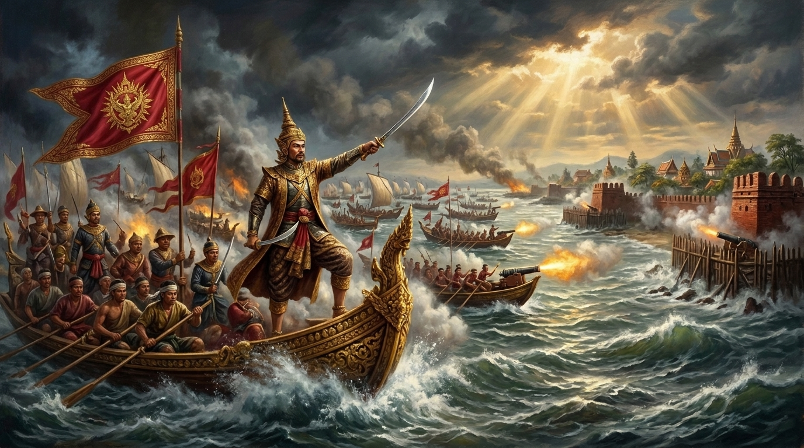
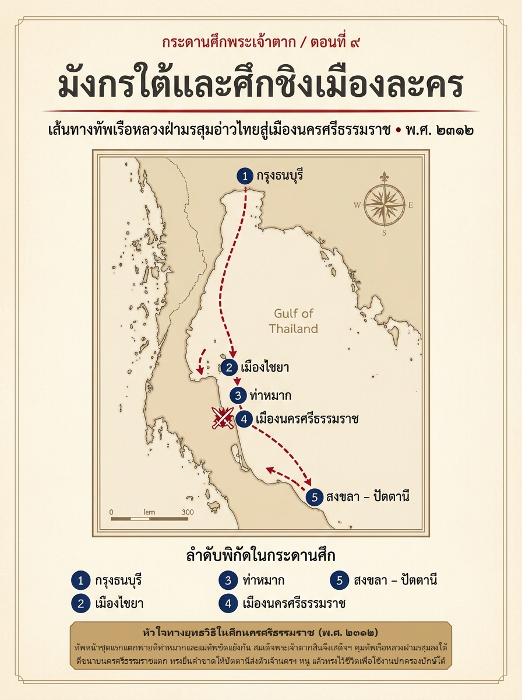

# ภาคที่ 2: แผ่นดินเดียวต้องมีพระเจ้าแผ่นดินองค์เดียว (พ.ศ. 2311 – 2313)
## ตอนที่ 9: มังกรใต้และศึกชิงเมืองละคร (นครศรีธรรมราช)

---

### องก์ที่ 1: จุดชนวนและเดิมพัน (The Cold Open & The Stakes)

ใบบอกราชการจากเมืองไชยาวางอยู่บนโต๊ะไม้สักในท้องพระโรงกรุงธนบุรี—และตราประทับขี้ผึ้งของมันยังอุ่นอยู่

กลางปีฉลู จุลศักราช 1131 (พ.ศ. 2312) เสียงลมมรสุมตะวันตกเฉียงใต้พัดกระหน่ำหลังคาพระตำหนักไม้ริมแม่น้ำเจ้าพระยา แต่ความเงียบภายในท้องพระโรงกลับหนักอึ้งยิ่งกว่าพายุภายนอก

**สมเด็จพระเจ้าตากสิน** ทรงคลี่ใบบอกฉบับนั้นออกอ่านซ้ำเป็นรอบที่สอง พระพักตร์เคร่งขรึมลงทุกบรรทัด

ทัพหน้าขนาดใหญ่กว่าห้าพันนายที่พระองค์ทรงส่งล่วงหน้าลงไปปราบเมืองนครศรีธรรมราช ภายใต้การนำของ **พระยาจักรี (แขก)** และ **พระยายมราช** ไม่ได้เดินหน้าไปถึงกำแพงเมืองละครอย่างที่ทรงคาดไว้

ตรงกันข้าม—ที่ **ท่าหมาก** ริมฝั่งแม่น้ำพุมดวง กองหน้าของ **พระยาเพชรบุรี** และ **พระยาศรีพิพัฒน์** ถูกกองทัพนครศรีธรรมราชตีแตกพ่ายจนแม่ทัพทั้งสองสิ้นชีพในที่รบ ส่วนตัวแม่ทัพใหญ่อย่างพระยาจักรีกับพระยายมราชกลับเกิดความบาดหมาง แก่งแย่งชิงดีและไม่ยอมประสานกำลังกัน จนกองทัพทั้งกองทัพติดหล่มนิ่งงันอยู่ที่เมืองไชยา!

ในท้องพระโรง เหล่าขุนนางต่างก้มหน้านิ่ง ไม่มีใครกล้าสบพระเนตรจอมทัพ

เพราะทุกคนรู้ดีว่าความพ่ายแพ้ที่ท่าหมากไม่ได้เสียหายเพียงไพร่พล—แต่มันกำลังเปิดแผลใหญ่ที่อันตรายยิ่งกว่าศึกเกยไชย

หาก **เจ้านครศรีธรรมราช (หนู)** สามารถยันทัพธนบุรีให้อยู่แค่ไชยาได้สำเร็จ ชื่อเสียงของกรุงธนบุรีที่เพิ่งฟื้นขึ้นจากชัยชนะที่พิมายก็จะพังทลายลงทันที และที่เลวร้ายกว่านั้นคือ ทางเหนือยังมี **เจ้าพระฝาง** คอยจ้องมองอยู่ หากทัพหลวงต้องติดพันศึกยืดเยื้อทางใต้ เมืองเหนืออาจฉวยโอกาสบุกลงมาตีท้ายครัวถึงกรุงธนบุรี!

สมเด็จพระเจ้าตากสินทรงวางใบบอกลงบนโต๊ะ เสียงกระดาษกระทบไม้ดังก้องไปทั้งห้อง

*"แม่ทัพไม่เป็นใจกันเอง เช่นนี้จะเอาชัยชนะมาจากที่ใด"*

พระองค์ทรงลุกขึ้นจากพระที่นั่ง มองออกไปยังแม่น้ำเจ้าพระยาที่กำลังคลั่งด้วยลมฝน

เมื่อลูกน้องไม่ยอมเดินหน้า องค์จอมทัพก็ต้องลงไปปิดเกมด้วยพระองค์เอง—ต่อให้ต้องแล่นเรือหลวงฝ่าคลื่นมรสุมอ่าวไทยลงไปนับร้อยลี้ก็ตาม!

---

### องก์ที่ 2: อ่านกระดานศึกและปมที่ซ่อนอยู่ (The Map & The Hidden Truth)

หากกางแผนที่คาบสมุทรภาคใต้ใน พ.ศ. 2312 ออกดู แล้วอ่านประกอบกับ **พระราชพงศาวดารกรุงธนบุรี ฉบับพันจันทนุมาศ (เจิม)** และงานวิเคราะห์ของ **นิธิ เอียวศรีวงศ์** ใน *การเมืองไทยสมัยพระเจ้ากรุงธนบุรี* เราจะเห็นเหตุผลชัดเจนว่า ทำไมเมืองนครศรีธรรมราช (หรือที่คนยุคเก่าเรียกว่า **"เมืองละคร"**) จึงเป็นหมากตัวที่สำคัญที่สุดทางเศรษฐกิจของแผ่นดินใหม่

#### 1. ทำไม "มังกรใต้" จึงอันตรายไม่แพ้ "พยัคฆ์เหนือ"

ก่อนเสียกรุงศรีอยุธยา เมืองนครศรีธรรมราชคือเมืองเอกชั้นพระยามหานครที่คุมหัวเมืองปักษ์ใต้ทั้งหมด ตั้งแต่ชุมพร ไชยา พัทลุง สงขลา ไปจนถึงหัวเมืองมลายูอย่างปัตตานี ไทรบุรี กลันตัน และตรังกานู

หลังกรุงแตก **พระปลัดเมืองนครศรีธรรมราช (หนู)** ขุนนางผู้ช่ำชองการปกครองท้องถิ่น ได้รวบรวมกรมการเมืองและไพร่พลตั้งตนขึ้นเป็นเจ้า ประกาศเอกราชในนาม **เจ้านครศรีธรรมราช**

ในมุมมองของโต๊ะยุทธการกรุงธนบุรี ชุมนุมนครศรีธรรมราชมีจุดแข็ง 3 ประการที่ไม่มีชุมนุมใดเทียบได้:
- **ความมั่งคั่งจากการค้าทางทะเล:** เมืองนครฯ คุมเหมืองดีบุก สวนพริกไทย ป่าไม้ และท่าเรือที่พ่อค้าจีน–มลายู–อินเดีย–ยุโรป แวะเวียนมาค้าขายตลอดปี
- **ภูมิศาสตร์แบบคอขวด:** การเดินทัพลงใต้จากภาคกลางต้องผ่านแนวเขาตะนาวศรี–ชุมพร–ไชยา ที่มีเส้นทางแคบและป่าทึบ หรือไม่ก็ต้องเสี่ยงแล่นเรือฝ่ามรสุมในอ่าวไทย
- **กองทัพที่มีระเบียบ:** เจ้านครฯ (หนู) มีแม่ทัพฝีมือดีอย่าง **อุปราชจันทร์** (หลานเขย) และเครือข่ายเจ้าเมืองปักษ์ใต้อย่างสงขลา–พัทลุงคอยหนุนหลัง

หากกรุงธนบุรีปราบพิมายได้แต่ปล่อยให้ปักษ์ใต้หลุดมือ แผ่นดินสยามจะถูกแบ่งครึ่งตลอดกาล—กรุงธนบุรีจะได้เพียงลุ่มน้ำเจ้าพระยากับอีสาน แต่เสียประตูการค้าทางทะเลและรายได้หลักของราชอาณาจักรไปให้เมืองละคร!

#### 2. ปมร้าวภายในทัพหน้าชุดแรก

เหตุใดกองทัพ 5,000 นายของ **พระยาจักรี (แขก)** จึงตีเมืองนครฯ ไม่แตก?

*(หมายเหตุ: พระยาจักรีผู้นี้คือแม่ทัพมุสลิมในต้นรัชกาลกรุงธนบุรี ไม่ใช่เจ้าพระยาจักรี (ทองด้วง) ซึ่งในเวลานี้ยังดำรงตำแหน่งพระยาอภัยรณฤทธิ์)*

พงศาวดารระบุสาเหตุไว้สองชั้น ชั้นแรกคือ **ความประมาทของกองหน้า** ที่แยกกำลังข้ามไปตั้งค่ายที่ **ท่าหมาก** โดยไม่รอประสานงานกัน ทำให้ทัพของอุปราชจันทร์แห่งนครฯ ชิงจังหวะเข้าตีค่ายพระยาเพชรบุรีและพระยาศรีพิพัฒน์แตกยับเยินจนแม่ทัพทั้งสองสิ้นชีพ

ชั้นที่สองที่ร้ายแรงกว่าคือ **รอยร้าวระหว่างแม่ทัพใหญ่** เมื่อพระยาจักรีกับพระยายมราชเกิดความระแวงและแก่งแย่งอำนาจบัญชาการ ต่างฝ่ายต่างคุมเชิงไม่ยอมส่งกำลังไปช่วยกัน และส่งใบบอกกล่าวโทษกันเองกลับมายังกรุงธนบุรี

นี่คือโรคเรื้อรังของกองทัพผสมที่รวมตัวกันจากขุนนางหลายสายหลังเสียกรุง—และมีเพียงวิธีเดียวที่จะรักษาโรคนี้ได้ทันท่วงที คือพระมหากษัตริย์ต้องเสด็จฯ ลงไปบัญชาการด้วยพระองค์เอง

---

### องก์ที่ 3: คมดาบและกลศึก (The Clash & Tactical Turning Point)

#### ฝ่ามรสุมอ่าวไทย: เดิมพันกลางคลื่นลม

เดือน 9 ปีฉลู พ.ศ. 2312 กลางฤดูมรสุมตะวันตกเฉียงใต้ สมเด็จพระเจ้าตากสินทรงจัด **กองทัพเรือหลวง** กว่า **100 ลำ** บรรทุกไพร่พลนับหมื่นนาย พร้อมปืนใหญ่และเสบียงอาหารครบครัน เสด็จพระราชดำเนินออกจากปากน้ำเจ้าพระยามุ่งหน้าลงใต้ด้วยพระองค์เอง!

การเดินทัพเรือในเดือน 9 คือการท้าทายธรรมชาติอย่างแท้จริง

เมื่อกองเรือหลวงแล่นพ้นชะอำเข้าสู่อ่าวประจวบคีรีขันธ์–บางสะพาน–ชุมพร คลื่นลมในอ่าวไทยก็โหมกระหน่ำ เรือรบหลายลำถูกคลื่นซัดโคลงเคลงจนฝีพายแทบประคองหางเสือไม่อยู่ บางลำต้องหลบเข้าบังเกาะตามชายฝั่ง

แต่ในเรือพระที่นั่ง จอมทัพผู้เคยนำเรือรบร้อยลำฝ่ามรสุมปลายปี 2310 กลับไม่ทรงสั่งถอย พระองค์ทรงเร่งรัดให้กองเรือเกาะกลุ่มแล่นฝ่าคลื่นลมลงไปจนถึง **เมืองไชยา** ได้สำเร็จ!

ทันทีที่เสด็จขึ้นฝั่งเมืองไชยา บรรยากาศในค่ายทัพหน้าที่เคยเอื่อยเฉื่อยก็เปลี่ยนเป็นตึงเครียดในพริบตา

สมเด็จพระเจ้าตากสินทรงเรียกตัว **พระยาจักรี** และ **พระยายมราช** มาสอบสวนความผิดฐานปล่อยให้ทัพหน้าพ่ายแพ้และทะเลาะเบาะแว้งกันเองจนเสียการใหญ่ ทรงตำหนิอย่างรุนแรง และทรงยึดอำนาจการบัญชาการรบทั้งหมดกลับมาไว้ในพระหัตถ์!

#### ตีแตกท่าหมาก ทะลวงปากน้ำเมืองละคร

คราวนี้ไม่มีการรอคอยและไม่มีการเกี่ยงงอนกันอีกต่อไป

สมเด็จพระเจ้าตากสินทรงวางแผน **ตีขนาบสองทาง** เช่นเดียวกับที่ทรงใช้ได้ผลมาแล้วที่จันทบูรและบางกุ้ง:
- **ทางบก:** โปรดให้กองทัพหัวเมืองและทัพหน้าที่ปรับขบวนใหม่เร่งรุกข้ามจากไชยา–ท่าข้าม เข้าตีค่ายของอุปราชจันทร์ที่ **ท่าหมาก** และกวาดล้างแนวป้องกันชั้นนอกของนครศรีธรรมราช
- **ทางทะเล:** พระองค์ทรงนำ **กองทัพเรือหลวง** แล่นอ้อมแหลมตะลุมพุก พุ่งตรงเข้าโจมตี **ปากน้ำนครศรีธรรมราช** จากด้านทะเลโดยตรง!

ที่สมรภูมิท่าหมากและลานสกา ทัพของอุปราชจันทร์ที่เคยเอาชนะพระยาเพชรบุรีได้เมื่อไม่กี่เดือนก่อน กลับต้องเผชิญหน้ากับแรงกดดันมหาศาลจากกองทัพธนบุรีที่บัดนี้มีองค์พระมหากษัตริย์คุมเชิงอยู่เบื้องหลัง การรบดำเนินไปอย่างดุเดือด แต่แนวรับของฝ่ายนครฯ ไม่อาจต้านทานการรุกไล่ที่ต่อเนื่องทั้งวันทั้งคืนได้ ค่ายท่าหมากแตกพ่าย อุปราชจันทร์ต้องถอยร่นกลับเข้าเมือง

ในเวลาไล่เลี่ยกัน เสียงปืนใหญ่จากกองทัพเรือหลวงก็คำรามกึกก้องที่ปากน้ำนครศรีธรรมราช!

เมื่อกองกำลังป้องกันเมืองนครฯ ถูกบีบทั้งจากด้านบกและด้านปากอ่าว กำแพงอิฐเก่าแก่ของเมืองละครก็ไม่อาจต้านทานไว้ได้ ทหารธนบุรีบุกทะลวงเข้ายึดตัวเมืองนครศรีธรรมราชได้สำเร็จ

**เจ้านครศรีธรรมราช (หนู)** เห็นว่าเมืองแตกแน่แล้ว จึงตัดสินใจพาครอบครัว ญาติมิตร และขุนนางคนสนิทตีฝ่าวงล้อมออกจากเมืองในความมืด มุ่งหน้าหลบหนีลงใต้ หวังจะไปตั้งหลักในดินแดนหัวเมืองมลายู!

#### ไล่ล่าถึงสงขลา และคำขาดต่อพระยาตานี

ชัยชนะที่เมืองนครฯ ยังไม่ถือว่าจบ ตราบใดที่ "มังกรใต้" ยังมีชีวิตและหนีรอดไปได้

สมเด็จพระเจ้าตากสินไม่ทรงเปิดโอกาสให้เจ้านครฯ หนีไปตั้งตัวใหม่ในปัตตานีเหมือนที่พระยาจันทบูรเคยหนีไปพุทไธมาศ พระองค์ทรงนำกองทัพเรือติดตามไล่ล่าลงไปถึง **เมืองสงขลา** ทันที

เมื่อทรงสืบทราบว่าเจ้านครฯ (หนู) หนีไปพึ่งพิงอยู่กับ **พระยาตานี** เจ้าเมืองปัตตานี พระองค์ก็ทรงยื่นคำขาดทางการทูตที่สั้นและเฉียบขาดที่สุดไปยังเมืองตานี:

**ให้ส่งตัวเจ้านครศรีธรรมราช (หนู) พร้อมครอบครัวกลับมาถวายโดยดี มิฉะนั้นทัพหลวงกรุงธนบุรีจะยกเข้าไปเหยียบเมืองปัตตานีให้ราบคาบ!**

ต่อหน้ากองทัพเรือหลวงที่เพิ่งบดขยี้เมืองนครศรีธรรมราชมาหมาดๆ พระยาตานีไม่มีทางเลือกอื่น นอกจากการจับกุมเจ้านครฯ (หนู) พร้อมครอบครัวและข้าราชบริพารส่งมอบคืนมาให้ทัพหลวงกรุงธนบุรีแต่โดยดี!

---

### องก์ที่ 4: ผลลัพธ์และเงาของศึกถัดไป (The Aftermath & Cliffhanger)

#### ทำไมจึงทรง "ไว้ชีวิต" มังกรใต้?

เมื่อเจ้านครศรีธรรมราช (หนู) ถูกคุมตัวมาถึงหน้าพลับพลา หลายคนในกองทัพคาดว่าชะตากรรมของท่านคงไม่ต่างจากกรมหมื่นเทพพิพิธที่เมืองพิมาย

ขุนนางนายทหารฝ่ายธนบุรีหลายคนกราบบังคมทูลเสนอให้ประหารชีวิตเจ้านครฯ หนูเสีย เพื่อตัดเสี้ยนหนามให้สิ้นซาก

แต่สมเด็จพระเจ้าตากสินทรงนิ่งคิด—แล้วทรงตัดสินพระทัยในสิ่งที่ทำให้ทั้งกองทัพต้องประหลาดใจ

**พระองค์ทรงไว้ชีวิตเจ้านครศรีธรรมราช (หนู)!**

หากเปรียบเทียบการตัดสินใจในตอนที่ 8 กับตอนที่ 9 เราจะเห็น **"อัจฉริยภาพทางการเมือง"** ของสมเด็จพระเจ้าตากสินได้อย่างชัดเจนที่สุด:
1. **กรมหมื่นเทพพิพิธ (ตอนที่ 8)** ทรงถือสายเลือดกษัตริย์อยุธยา ทรงปฏิเสธความชอบธรรมของพระเจ้าตากสินอย่างเปิดเผย และไม่ยอมก้มหัวให้สามัญชน—การไว้ชีวิตท่านจึงเท่ากับเก็บระเบิดเวลาไว้กลางราชอาณาจักร
2. **เจ้านครศรีธรรมราช (หนู) (ตอนที่ 9)** เป็นขุนนางนักปกครองผู้ช่ำชอง ไม่ได้อ้างสิทธิราชบัลลังก์อยุธยา และที่สำคัญที่สุด—ในเวลานั้นกรุงธนบุรียังขาดแคลนคนที่มีบารมีและเข้าใจระบบการปกครองหัวเมืองปักษ์ใต้รวมถึงรัฐมลายูได้ลึกซึ้งเท่าท่าน!

สมเด็จพระเจ้าตากสินจึงทรงเลือก **"เก็บคนเก่งไว้ใช้งาน"** แทนการประหาร ทรงนำตัวเจ้านครฯ (หนู) กลับไปรับราชการที่กรุงธนบุรี (และในเวลาต่อมา เมื่อทรงเห็นความจงรักภักดี ก็โปรดเกล้าฯ แต่งตั้งให้ท่านกลับลงไปครองเมืองนครศรีธรรมราชดังเดิมในฐานะเจ้าเมืองประเทศราชคู่พระบารมี!) ส่วนในระยะแรกหลังเสร็จศึก ทรงแต่งตั้ง **เจ้านราสุริยวงศ์** พระเจ้าหลานเธอให้อยู่รั้งเมืองนครศรีธรรมราชเพื่อวางรากฐานอำนาจของราชธานีใหม่

#### เหลือเพียงหนึ่งเดียวบนกระดาน

เมื่อเสด็จกรีธาทัพเรือกลับคืนสู่กรุงธนบุรีในปลายปี พ.ศ. 2312 แผนที่แผ่นดินสยามก็เปลี่ยนโฉมหน้าไปอย่างสิ้นเชิง

จาก 4 ชุมนุมใหญ่ที่เคยท้าทายอำนาจกรุงธนบุรี:
- **พิษณุโลก** — สลายตัวไปแล้ว
- **พิมาย** — ถูกปราบราบคาบแล้ว
- **นครศรีธรรมราช** — สวามิภักดิ์แล้ว

บัดนี้ทั้งแผ่นดินเหลือคู่ปรับเพียง **"ชุมนุมเดียว"** ที่ยังยืนหยัดท้าทายกรุงธนบุรีอยู่ทางทิศเหนือ—แต่เป็นชุมนุมที่แปลกประหลาด น่าสะพรึงกลัว และปลุกศรัทธาผู้คนได้รุนแรงกว่าทุกชุมนุมที่ผ่านมา

ที่เมืองสวางคบุรีและเมืองพิษณุโลก **เจ้าพระฝาง (เรือน)** อดีตพระสงฆ์ผู้สถาปนาตนเองเป็นจอมทัพ ได้นำคณะสงฆ์นุ่งห่ม **ผ้าเหลืองย้อมสีแดง** จับดาบและปืนขึ้นบัญชาการรบ ยึดครองหัวเมืองเหนือไว้เกือบทั้งหมด และกำลังแผ่อำนาจลงมาจ่อคอหอยปากน้ำโพ

ศึกครั้งสุดท้ายของสงครามรวมแผ่นดินกำลังจะเริ่มต้น—ศึกที่กองทัพกรุงธนบุรีไม่ได้รบเพียงกับทหาร แต่ต้องรบกับกองทัพนักบวชติดอาวุธที่เชื่อว่าตนเองมีอาคมและบุญญาธิการคุ้มครอง!

---
**จบตอนที่ 9**
*(ติดตามต่อใน ตอนที่ 10: ผ้าเหลืองสีแดง การล่มสลายของชุมนุมพระฝาง)*
