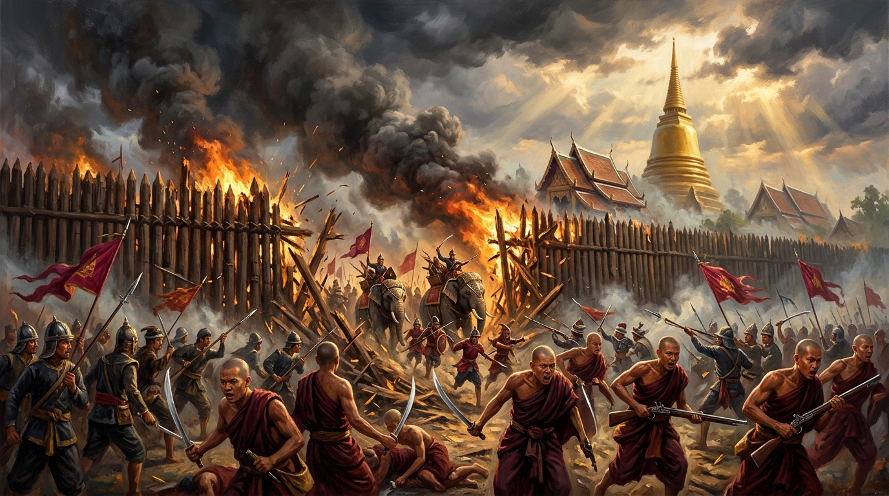
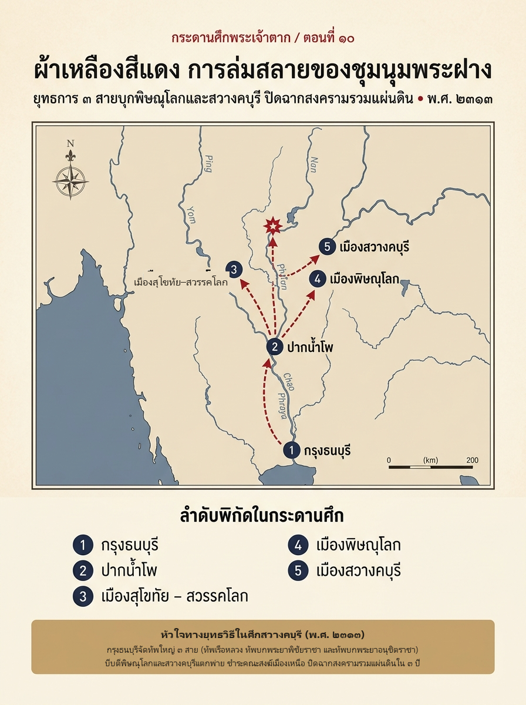

# ภาคที่ 2: แผ่นดินเดียวต้องมีพระเจ้าแผ่นดินองค์เดียว (พ.ศ. 2311 – 2313)
## ตอนที่ 10: ผ้าเหลืองสีแดง การล่มสลายของชุมนุมพระฝาง

---

### องก์ที่ 1: จุดชนวนและเดิมพัน (The Cold Open & The Stakes)

กลางฤดูฝน ปีขาล จุลศักราช 1132 (พ.ศ. 2313) ชาวบ้านริมแม่น้ำน่านแถบเมืองอุทัยธานีและชัยนาทต่างพากันขนข้าวเปลือกและต้อนวัวควายหนีเข้าป่าทันทีที่เห็นธงรบสีแดงปลิวไสวมาตามลำน้ำ

ไม่ใช่ธงของกองทัพพม่า และไม่ใช่ธงของกรุงธนบุรี

ผู้ที่เดินขบวนลงมานั้นแต่งกายด้วย **จีวรย้อมสีแดงเข้ม** โกนศีรษะโล้นเช่นพระสงฆ์—แต่ในมือกลับถือดาบ ง้าว และปืนคาบศิลา!

กองกำลังลาดตระเวนของ **เจ้าพระฝาง (เรือน)** แห่งเมืองสวางคบุรี กำลังรุกลงมากวาดต้อนเสบียงอาหารและผู้คนถึงเขตเมืองอุทัยธานีและชัยนาท ระยะทางห่างจากกรุงธนบุรีลงมาไม่ถึงสิบวันล่องเรือ

สำหรับชาวบ้านธรรมดา กองทัพพระสงฆ์สีแดงนี้ดูน่าสะพรึงกลัวยิ่งกว่าทัพพม่า เพราะพวกเขามิได้สู้รบด้วยเหล็กและดินปืนเพียงอย่างเดียว แต่สู้รบด้วยความเชื่อเรื่อง **บุญญาธิการและเวทมนตร์คาถา** ที่ดึงดูดผู้คนในหัวเมืองเหนือให้ศรัทธาอย่างมืดบอด

แต่ที่ท้องพระโรงกรุงธนบุรี **สมเด็จพระเจ้าตากสิน** มิได้ทอดพระเนตรรายงานการปล้นชิงที่ชัยนาทด้วยความหวาดหวั่น

ตรงกันข้าม พระองค์กำลังทอดพระเนตร **"จุดจบ"** ของสงครามรวมแผ่นดินที่รอคอยมานานถึงสามปี

บัดนี้พิษณุโลก พิมาย และนครศรีธรรมราชล้วนสยบอยู่ใต้ธงกรุงธนบุรีหมดแล้ว เหลือเพียงชุมนุมสุดท้ายทางทิศเหนือ—ชุมนุมที่กลืนกินทั้งสวางคบุรี พิษณุโลก สุโขทัย และกำแพงเพชรไว้ในกำมือ

หากปราบเจ้าพระฝางลงได้ แผ่นดินสยามที่แตกสลายเป็นเสี่ยงๆ นับแต่วันกรุงศรีอยุธยาแตกก็จะกลับมารวมเป็นหนึ่งเดียวอย่างสมบูรณ์—แต่หากพลาดท่าซ้ำรอยเกยไชยเมื่อสองปีก่อน กรุงธนบุรีก็อาจต้องเสียหัวเมืองเหนือทั้งหมดไปตลอดกาล!

---

### องก์ที่ 2: อ่านกระดานศึกและปมที่ซ่อนอยู่ (The Map & The Hidden Truth)

หากกางแผนที่ยุทธศาสตร์ลุ่มน้ำเจ้าพระยาตอนบน–ยม–น่าน ในปี พ.ศ. 2313 แล้วเปิดอ่าน **พระราชพงศาวดารกรุงธนบุรี ฉบับพันจันทนุมาศ (เจิม)** คู่กับ **ฉบับพระราชหัตถเลขา** และงานวิเคราะห์ของ **นิธิ เอียวศรีวงศ์** เราจะเห็นความแตกต่างอย่างชัดเจนระหว่าง "พระเจ้าตากสินในศึกเกยไชย (พ.ศ. 2311)" กับ "พระเจ้าตากสินในศึกเมืองฝาง (พ.ศ. 2313)"

#### 1. เจ้าพระฝาง: ผู้นำกึ่งนักบวชกึ่งจอมทัพ

**เจ้าพระฝาง** มีนามเดิมว่า **เรือน** เป็นชาวเมืองเหนือที่เคยลงมาเล่าเรียนพระปริยัติธรรมในกรุงศรีอยุธยาจนได้เป็นพระราชาคณะที่ **พระพากุลเถระ** แล้วกลับขึ้นไปเป็นเจ้าคณะอยู่ ณ **วัดสวางคบุรี (เมืองฝาง)** เขตจังหวัดอุตรดิตถ์ในปัจจุบัน

หลังเสียกรุงศรีอยุธยา พระพากุลเถระ (เรือน) ไม่ได้ลาสิกขาบทเช่นขุนนางหรือสามัญชนทั่วไป หากแต่ตั้งตนเป็นใหญ่ในสมณเพศ เปลี่ยนสีจีวรจากเหลืองหม่นเป็น **สีแดง** (เพื่อแยกตัวออกจากพระสงฆ์ทั่วไปและใช้เป็นสัญลักษณ์ของผู้นำทางจิตวิญญาณ–การทหาร) แล้วตั้งบรรดาพระสงฆ์สานุศิษย์ที่เป็นคนสนิทขึ้นเป็นแม่ทัพนายกอง

จุดแข็งของชุมนุมพระฝางคือ **ศรัทธาของราษฎรหัวเมืองเหนือ** ที่หวาดกลัวภัยสงครามและต้องการที่พึ่งทางใจ ประกอบกับเมื่อเจ้าพระฝางยึดเมืองพิษณุโลกได้หลังการสิ้นบุญของเจ้าพิษณุโลก (เรือง) ท่านก็ได้ปืนใหญ่ เสบียง และกำลังคนของพิษณุโลกมาเสริมเขี้ยวเล็บจนกลายเป็นชุมนุมที่ใหญ่ที่สุดในภาคเหนือ

ทว่าจุดอ่อนร้ายแรงของชุมนุมพระฝางก็ซ่อนอยู่ในโครงสร้างเดียวกันนั้น:
- **กองทัพขาดวินัยทางทหารแบบมืออาชีพ:** แม่ทัพนายกองที่เป็นพระสงฆ์ติดอาวุธอาจปลุกระดมความฮึกเหิมได้ดีในการรุกปล้นชิงหรือการล้อมเมืองที่อ่อนแอ แต่ไม่อาจเทียบชั้นกับกองทัพกรุงธนบุรีที่ผ่านศึกหนักมาแล้วทั้งบางกุ้ง พิมาย และนครศรีธรรมราช
- **ความเสื่อมศรัทธาจากภายใน:** การที่พระสงฆ์จับอาวุธ ฆ่าฟัน และปล้นชิงราษฎร สร้างความระส่ำระสายทางศีลธรรมในหมู่ชาวเมืองเหนือเอง ทำให้ขุนนางและชาวพิษณุโลกเดิมจำนวนมากแอบส่งข่าวและเอาใจออกห่างมาพึ่งกรุงธนบุรี

#### 2. บทเรียนจากเกยไชย: แผน "คีมหนีบ 3 สาย" สู่สวางคบุรี

ครั้งนี้ สมเด็จพระเจ้าตากสินไม่ทรงทำผิดซ้ำรอยเดิมอีกต่อไป

เมื่อสองปีก่อนที่เกยไชย พระองค์ทรงรีบเร่งพายเรือทวนน้ำขึ้นไปก่อนทัพหนุน ทำให้ถูกค่ายปืนพิษณุโลกดักยิงจนต้องถอนทัพกลับ

แต่ในเดือน 8 ปีขาล พ.ศ. 2313 พระองค์ทรงระดมกำลังพลครั้งใหญ่ที่สุดนับตั้งแต่ตั้งกรุงธนบุรี กว่า **10,000–12,000 นาย** แบ่งการเคลื่อนทัพออกเป็น **3 สาย** เพื่อบีบหัวเมืองเหนือจากทุกทิศทาง:
1. **ทัพหลวงทางน้ำ:** สมเด็จพระเจ้าตากสินเสด็จพระราชดำเนินคุมทัพเรือขนาดใหญ่ขึ้นไปตามลำน้ำเจ้าพระยา–แม่น้ำน่าน มุ่งตรงเข้าตี **เมืองพิษณุโลก**
2. **ทัพบกฝั่งตะวันตก:** โปรดให้ **พระยาพิชัยราชา** คุมกำลังเดินบกขึ้นไปทางเมืองสุโขทัย–สวรรคโลก เพื่อตัดกำลังปีกตะวันตกของเจ้าพระฝางไม่ให้ส่งกำลังมาช่วยพิษณุโลกได้
3. **ทัพบกฝั่งตะวันออก:** โปรดให้ **พระยาอนุชิตราชา (บุญมา)** ขุนพลคู่พระทัยคุมทัพบกเดินเลียบฝั่งตะวันออกของแม่น้ำน่าน มุ่งหน้าขึ้นไปตีโอบ **เมืองพิชัย** และ **เมืองสวางคบุรี** จากด้านข้างและด้านหลัง!

นี่คือกลยุทธ์ที่ปิดประตูหนีของเจ้าพระฝางทุกด้าน—ทัพหลวงดึงความสนใจตรงกลาง ขณะที่ทัพบกสองปีกโอบตัดเส้นทางถอย!

---

### องก์ที่ 3: คมดาบและกลศึก (The Clash & Tactical Turning Point)

#### พิษณุโลกแตกในพริบตา

เดือน 9 พ.ศ. 2313 กองทัพเรือหลวงของกรุงธนบุรีแล่นทวนน้ำผ่านปากน้ำโพและคุ้งน้ำเกยไชย—สมรภูมิเก่าที่พระองค์เคยหลั่งเลือดเมื่อสองปีก่อน

คราวนี้ไม่มีค่ายปืนของหลวงโกษา (ยัง) รอต้อนรับอยู่ที่ตลิ่งเกยไชยอีกแล้ว กองกำลังรักษาด่านของเจ้าพระฝางไม่อาจต้านทานแสนยานุภาพของทัพเรือหลวงที่เคลื่อนขึ้นมาอย่างเป็นระบบได้ จึงถอยร่นขึ้นไปรวมกำลังที่ **เมืองพิษณุโลก**

เมื่อทัพหลวงของสมเด็จพระเจ้าตากสินเสด็จถึงหน้ากำแพงเมืองพิษณุโลก พระองค์ทรงสั่งระดมพลเข้าโจมตีอย่างสายฟ้าแลบ การรบดำเนินไปไม่นาน แนวป้องกันของฝ่ายเจ้าพระฝางที่พิษณุโลกก็พังทลายลง ทหารพระฝางแตกหนีกระเจิงขึ้นเหนือกลับไปยังเมืองสวางคบุรี สมเด็จพระเจ้าตากสินทรงยึดเมืองพิษณุโลก—ป้อมปราการที่เคยต้านทัพเจ้าพระฝางได้ถึงครึ่งปี—กลับคืนมาได้แทบจะในทันที!

พระองค์มิได้ทรงประมาทหยุดพักเพียงแค่นั้น หากทรงสั่งให้เร่งส่งกำลังสนับสนุนขึ้นไปสมทบกับทัพบกของ **พระยาพิชัยราชา** และ **พระยาอนุชิตราชา (บุญมา)** เพื่อปิดล้อม **เมืองสวางคบุรี** รังสุดท้ายของเจ้าพระฝาง

#### ศึกชี้ชะตาหน้าค่ายไม้ซุงสวางคบุรี

ต่างจากพิษณุโลกที่มีกำแพงอิฐแข็งแรง **เมืองสวางคบุรี** มีเพียงระเนียดไม้ซุงและคูเมืองตื้นๆ ป้องกันอยู่รอบนอก

เมื่อกองทัพธนบุรีทั้งทัพหลวงและทัพบกของพระยาอนุชิตราชา (บุญมา) เคลื่อนมาบรรจบกันรอบเมืองสวางคบุรี ชุมนุมผ้าเหลืองสีแดงก็ตกอยู่ในวงล้อมเหล็กอย่างสมบูรณ์

**เจ้าพระฝาง** สั่งให้พระสงฆ์แม่ทัพและไพร่พลระดมยิงปืนไฟจากหลังระเนียดไม้ต้านทานอย่างสิ้นหวัง แต่เมื่อต้องเผชิญหน้ากับทหารกรุงธนบุรีที่กรำศึกมาตลอดสามปี แนวระเนียดไม้ก็ไม่อาจทานแรงบุกทะลวงได้

เสียงโห่ร้องของทหารธนบุรีดังสนั่นพร้อมการพังระเนียดไม้เข้าสู่ตัวเมือง กองกำลังผ้าเหลืองสีแดงแตกกระเจิงไม่เป็นขบวน ท่ามกลางความโกลาหลนั้น เอกสารพงศาวดารยังบันทึกเหตุการณ์สำคัญที่เป็นสัญลักษณ์ทางจิตวิทยาของยุคสมัยไว้ด้วยว่า ภายในเมืองสวางคบุรีมี **ช้างพังเผือก** (ซึ่งตกลูกเป็นช้างพลายเผือกในเวลาไล่เลี่ยกัน) ตกอยู่ในมือทัพหลวงกรุงธนบุรี—ในสายตาคนโบราณ การได้ช้างเผือกคู่บารมีจากรังของศัตรูคือคำประกาศิตจากสวรรค์ว่า **"ผู้มีบุญแท้จริง"** ได้ปรากฏขึ้นแล้ว!

เมื่อเมืองแตกยับเยิน **เจ้าพระฝาง (เรือน)** ไม่ยอมจำนน ท่านพาพรรคพวกคนสนิทจำนวนหนึ่งตีฝ่าวงล้อมหลบหนีหายเข้าไปในป่าลึกทางทิศเหนือ และหายสาบสูญไปจากหน้าประวัติศาสตร์นับแต่วันนั้นเป็นต้นมา

---

### องก์ที่ 4: ผลลัพธ์และเงาของศึกถัดไป (The Aftermath & Cliffhanger)

#### ชำระสังฆมณฑล: สงครามที่จบด้วยพระธรรมวินัย

ชัยชนะที่สวางคบุรีทิ้งโจทย์ที่ละเอียดอ่อนที่สุดโจทย์หนึ่งไว้ให้สมเด็จพระเจ้าตากสิน—**จะทำอย่างไรกับพระสงฆ์เมืองเหนือนับพันรูปที่ถูกเกณฑ์หรือสมัครใจเข้าร่วมรบกับเจ้าพระฝาง?**

หากสั่งประหารพระสงฆ์ทั้งหมดโดยไม่แยกแยะ จะเกิดแรงกระเพื่อมทางศรัทธาในหัวเมืองเหนืออย่างรุนแรง แต่หากปล่อยไว้โดยไม่ชำระ พระพุทธศาสนาในภาคเหนือก็จะมัวหมองไปด้วยอลัชชีที่ถืออาวุธ

สมเด็จพระเจ้าตากสินจึงทรงมีพระราชโองการนิมนต์พระราชาคณะผู้ทรงศีลจากกรุงธนบุรีขึ้นไปตั้งคณะสงฆ์ไต่สวนอธิกรณ์พระสงฆ์เมืองเหนือทั้งหมดตามพระธรรมวินัย

ในพงศาวดารเล่าถึงการใช้วิธี **"ดำน้ำพิสูจน์"** ร่วมกับการไต่สวนอย่างเข้มงวด พระสงฆ์รูปใดบริสุทธิ์พ้นมลทินก็ทรงโปรดให้คงสมณเพศและแต่งตั้งเป็นเจ้าอธิการดูแลวัดวาอารามสืบไป ส่วนรูปใดที่ต้องอาบัติปาราชิก ฆ่าคน หรือปล้นชิงทรัพย์สินชาวบ้าน ก็ทรงจับสึกออกจากสมณเพศและลงพระราชอาญาตามโทษานุโทษ เพื่อฟื้นฟูความบริสุทธิ์ของคณะสงฆ์หัวเมืองเหนือให้กลับคืนสู่ระเบียบแบบแผนดังเดิม

#### วางสองพี่น้องเฝ้าประตูแผ่นดิน และปิดฉากภาคที่ 2

ก่อนเสด็จยกทัพกลับกรุงธนบุรี สมเด็จพระเจ้าตากสินทรงวางหมากป้องกันชายแดนภาคเหนือไว้อย่างแน่นหนา โดยปูนบำเหน็จความชอบให้ขุนพลผู้พิชิตในศึกนี้อย่างสมเกียรติ:
- โปรดเกล้าฯ เลื่อน **พระยาอนุชิตราชา (บุญมา)** ขึ้นเป็น **เจ้าพระยาสุรสีห์พิษณวาธิราช** ให้ครอง **เมืองพิษณุโลก** ทำหน้าที่เป็นปราการด่านหน้าคอยรับมือพม่าที่จะยกมาจากล้านนา!
- โปรดเกล้าฯ เลื่อน **พระยาอภัยรณฤทธิ์ (ทองด้วง)** ขึ้นเป็น **พระยายมราช** (ก่อนจะก้าวขึ้นเป็นเจ้าพระยาจักรีในเวลาต่อมา)
- ทรงแต่งตั้ง **หลวงพิชัยอาสา (จ้อย)** ขุนพลคู่ใจที่ฝ่าฟันมาด้วยกันตั้งแต่ก่อนกรุงแตก ขึ้นเป็น **พระยาพิชัย** รั้งเมืองพิชัยไว้เป็นด่านหน้าเคียงข้างเมืองพิษณุโลก!

เพียง **3 ปี** หลังวันที่กรุงศรีอยุธยาจมอยู่ในกองเพลิง...
จากทหารม้าห้าร้อยนายที่ตีฝ่าวงล้อมออกจากวัดพิชัยในคืนเดือนมืด บัดนี้ **สมเด็จพระเจ้าตากสินมหาราช** ทรงรวบรวมแผ่นดินสยามที่แตกเป็นเสี่ยงๆ ให้กลับมารวมเป็นหนึ่งเดียวได้สำเร็จทั้งภาคกลาง ภาคตะวันออก อีสาน ภาคใต้ และภาคเหนือ

**สงครามรวมแผ่นดินจบลงแล้ว — แผ่นดินเดียวมีพระเจ้าแผ่นดินเพียงองค์เดียวแล้ว**

ทว่าบนกระดานภูมิรัฐศาสตร์แห่งเอเชียตะวันออกเฉียงใต้ ความสงบไม่เคยอยู่ได้นาน

ทาง **ทิศตะวันออก** สายข่าวจากชายแดนรายงานความเคลื่อนไหวผิดปกติใน **กรุงกัมพูชา** เมื่อความขัดแย้งชิงราชบัลลังก์เขมรกำลังดึงเอากองกำลังญวนและเจ้าเมืองท่าอย่าง **มạcเทียนตื้อ แห่งเมืองพุทไธมาศ (ฮาเตียน)**—ผู้เคยให้ที่พักพิงแก่ศัตรูของกรุงธนบุรีอย่างพระยาจันทบูร—เข้ามาแทรกแซงประชิดชายแดนสยาม

และทาง **ทิศเหนือ** ไกลออกไปที่กรุงอังวะ มหาอำนาจพม่าแห่งราชวงศ์คองบองที่กำลังจะเสร็จศึกกับจีน ก็เริ่มหันคมดาบกลับมามองยังราชธานีใหม่ริมแม่น้ำเจ้าพระยาอีกครั้ง

กระดานศึกบทใหม่กำลังจะเปิดขึ้น—ไม่ใช่สงครามกลางเมืองระหว่างคนไทยด้วยกันอีกต่อไป แต่เป็น **สงครามขยายขอบขัณฑสีมาและการปะทะกับมหาอำนาจต่างชาติ**!

---
**จบตอนที่ 10 (จบบริบูรณ์ ภาคที่ 2)**
*(ติดตามต่อใน ภาคที่ 3: ขยายขอบขัณฑสีมาและศึกพม่า 9 ทัพยุคธนบุรี — ตอนที่ 11: หมากรุกริมฝั่งโขง–ทะเลสาบเขมร (ศึกกัมพูชาและฮาเตียน))*
