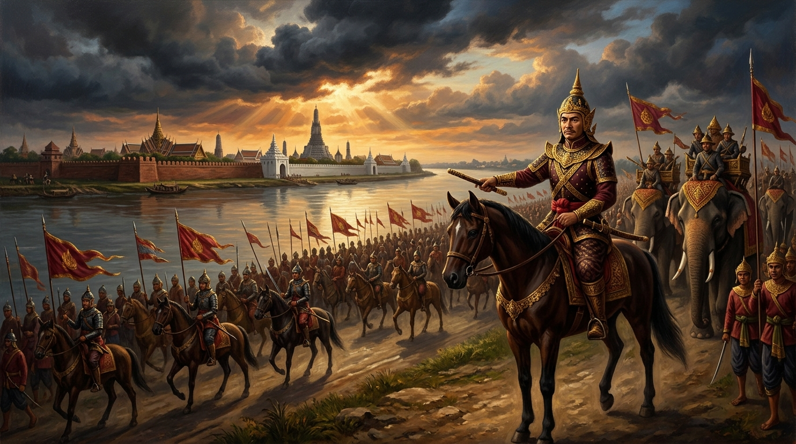
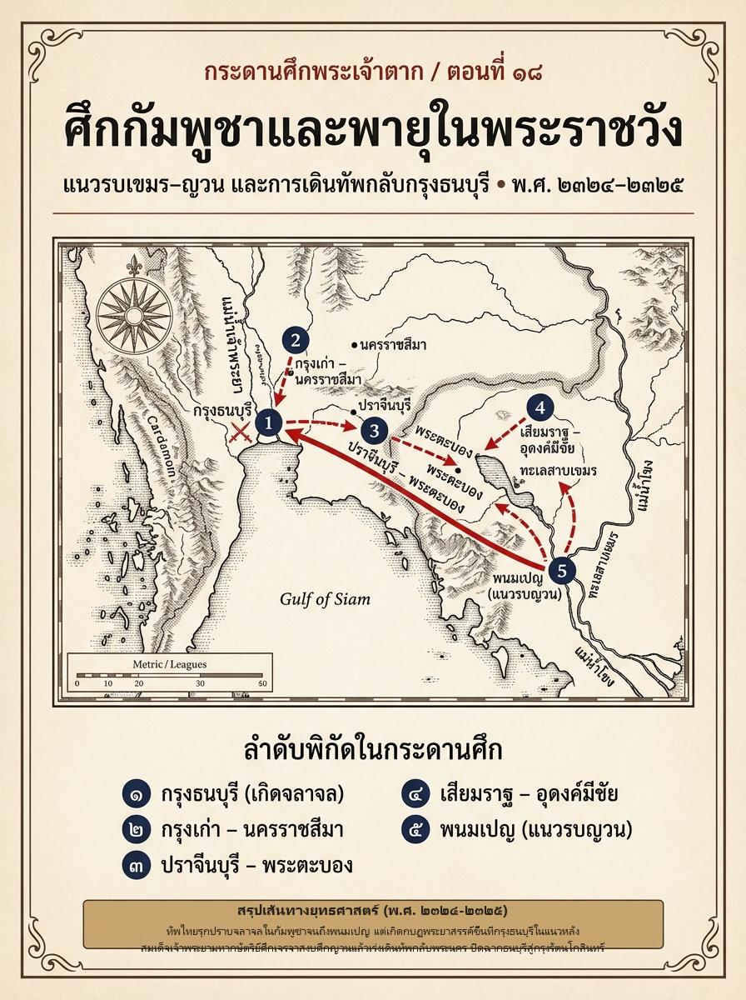

# ภาคที่ 4: เส้นทางสู่แม่น้ำโขง และฉากสุดท้ายแห่งกรุงธนบุรี (พ.ศ. 2319 – 2325)
## ตอนที่ 18 (ตอนจบ): ศึกกัมพูชาและพายุในพระราชวัง จุดเปลี่ยนสุดท้ายแห่งกรุงธนบุรี

---

### องก์ที่ 1: จุดชนวนและเดิมพัน (The Cold Open & The Stakes)

พ.ศ. 2324 — แผ่นดินกรุงธนบุรีที่ยืนหยัดผ่านเปลวเพลิงสงครามมานานถึงสิบสี่ปี กลับกำลังยืนอยู่บนปากเหวของวิกฤตการณ์ที่อันตรายยิ่งกว่ากองทัพพม่าครั้งใด!

ภายนอกราชอาณาจักร เปลวไฟจลาจลปะทุขึ้นที่ **กัมพูชา** เมื่อกลุ่มขุนนางเขมรนำโดย **เจ้าฟ้าทะละหะ (มู)** ก่อการยึดอำนาจและลอบปลงพระชนม์ **สมเด็จพระรามราชา (นักองค์โนน)** กษัตริย์กัมพูชาที่กรุงธนบุรีให้การสนับสนุน แล้วหันไปขอความช่วยเหลือจากฝ่าย **เหงียน (ญวน)**

สมเด็จพระเจ้าตากสินทรงไม่อาจปล่อยให้กัมพูชา—ซึ่งเป็นรัฐกันชนทางตะวันออกและเป็นแหล่งเสบียงสำคัญ—หลุดลอยไปอยู่ในมือของเวียดนามได้ พระองค์จึงมีพระราชโองการให้ **สมเด็จเจ้าพระยามหากษัตริย์ศึก** และ **เจ้าพระยาสุรสีห์** ยกทัพใหญ่กว่า 20,000 นาย (พร้อมด้วย **กรมขุนอินทรพิทักษ์** พระราชโอรส) เดินทัพออกไปปราบจลาจลในกัมพูชา

ทว่าสิ่งที่ไม่มีใครคาดคิดก็คือ ทันทีที่สองขุนพลคู่บัลลังก์และกำลังรบหลักของราชอาณาจักรเดินทัพห่างออกจากพระนครไปไกลถึงแดนเขมร **พายุลูกใหญ่ที่สุดกลับก่อตัวขึ้นข้างหลัง—ใจกลางกรุงธนบุรีเอง!**

---

### องก์ที่ 2: อ่านกระดานศึกและปมที่ซ่อนอยู่ (The Map & The Hidden Truth)

หากกางแผนที่ยุทธศาสตร์ใน พ.ศ. 2324–2325 ออกดูควบคู่กับ **พระราชพงศาวดารกรุงธนบุรี ฉบับพันจันทนุมาศ (เจิม)** และ **การเมืองไทยสมัยพระเจ้ากรุงธนบุรี** ของ **นิธิ เอียวศรีวงศ์** เราจะเห็น **"วิกฤตซ้อนวิกฤต"** ที่บีบรัดกรุงธนบุรีจากทั้งสองทิศทาง:

#### 1. แนวรบด้านตะวันออก: การประจันหน้าในกัมพูชา
- กองทัพไทยของสมเด็จเจ้าพระยามหากษัตริย์ศึกและเจ้าพระยาสุรสีห์รุกผ่าน **ปราจีนบุรี – พระตะบอง – เสียมราฐ** เข้าสู่ **อุดงค์มีชัย** และ **พนมเปญ**
- ฝ่ายเจ้าฟ้าทะละหะ (มู) ถอยร่นไปตั้งหลักและได้กำลังทัพ **ญวน (ตระกูลเหงียน)** เข้ามาหนุนหลัง ทำให้เกิดการประจันหน้ายืดเยื้อในดินแดนกัมพูชา ไม่สามารถถอนกำลังกลับได้โดยง่าย

#### 2. แนวหลังที่เปราะบาง: รอยร้าวในราชสำนักธนบุรี
- ขณะเดียวกัน ภายในกรุงธนบุรีเองกำลังเผชิญแรงกดดันสะสมมานานหลายปี ทั้งปัญหาข้าวยากหมากแพง เศรษฐกิจฝืดเคืองหลังสงครามต่อเนื่อง ความเคร่งเครียดในการบังคับใช้กฎหมายและลงโทษขุนนาง–ราษฎรอย่างรุนแรง รวมถึงความขัดแย้งทางความเชื่อในราชสำนัก
- เมื่อกองทัพหลัก 20,000 นายไม่อยู่ในพระนคร **สุญญากาศทางทหาร** ก็เปิดช่องให้กลุ่มขุนนางและราษฎรที่ไม่พอใจก่อความไม่สงบขึ้นที่กรุงเก่า (อยุธยา) ภายใต้การนำของ **พระยาสรรค์** ก่อนที่จะยกกำลังลงมาปิดล้อมและบุกยึดกรุงธนบุรีในเดือนมีนาคม พ.ศ. 2324 (นับอย่างปัจจุบันคือต้นปี พ.ศ. 2325)!

---

### องก์ที่ 3: คมดาบและกลศึก (The Clash & Tactical Turning Point)

#### ความเด็ดขาดกลางสนามรบเขมร และม้าเร็วจากพระนคร

กลางค่ายหลวงในดินแดนกัมพูชา ขณะที่กองทัพของ **สมเด็จเจ้าพระยามหากษัตริย์ศึก** และ **เจ้าพระยาสุรสีห์** กำลังเตรียมเปิดฉากแตกหักกับทัพเขมรและทัพญวน ข่าวด่วนจากกรุงธนบุรีก็ถูกส่งมาถึงมือแม่ทัพใหญ่—พระนครตกอยู่ในความจลาจล **พระยาสรรค์** ยึดอำนาจในกรุงธนบุรีได้แล้ว และ **เจ้าพระยาสุริยอภัย** (หลานของสมเด็จเจ้าพระยามหากษัตริย์ศึก ผู้ครองเมืองนครราชสีมา) กำลังนำทัพลงมาสู้รบเพื่อกอบกู้สถานการณ์ในพระนคร!

ในเสี้ยววินาทีวิกฤตนั้น สมเด็จเจ้าพระยามหากษัตริย์ศึกทรงเผชิญการตัดสินใจที่ยากที่สุดครั้งหนึ่งในชีวิต:
- หากทรงเดินหน้าตีทัพญวนต่อไป แผ่นดินเบื้องหลังอาจแตกสลายเป็นจลาจลซ้ำรอยกรุงแตก พ.ศ. 2310
- แต่หากทรงสั่งถอนทัพหนีกลับมาเฉยๆ ทัพญวนย่อมฉวยโอกาสไล่ตีกระหนาบหลังจนกองทัพไทยพินาศกลางทาง!

ท่านจึงทรงใช้ **กลยุทธ์การทูตเหนือคมดาบ**: ส่งทูตไปเจรจาทำความตกลงสงบศึกกับแม่ทัพญวนอย่างมีศักดิ์ศรี จนฝ่ายญวนยอมรับข้อตกลงและไม่เข้าโจมตีตลบหลัง จากนั้นจึงเร่งนำทัพใหญ่เดินทัพกลับสู่กรุงธนบุรีอย่างเป็นระเบียบและรวดเร็วที่สุด!

#### ยุติจลาจลที่กรุงธนบุรี (เมษายน พ.ศ. 2325)

ก่อนที่ทัพใหญ่จะเดินทางมาถึง **เจ้าพระยาสุริยอภัย** ได้นำกำลังจากนครราชสีมาเข้าปะทะกับฝ่ายพระยาสรรค์กลางกรุงธนบุรีและสามารถควบคุมสถานการณ์ในพระนครไว้ได้

ครั้นวันที่ **6 เมษายน พ.ศ. 2325** สมเด็จเจ้าพระยามหากษัตริย์ศึกนำทัพใหญ่เสด็จกลับเข้าสู่กรุงธนบุรีท่ามกลางเสียงแซ่ซ้องของราษฎรและขุนนางที่รอคอยการฟื้นฟูความสงบสุข ท่านทรงดำเนินการไต่สวนเหตุจลาจล ปราบปรามผู้ก่อความไม่สงบ และตัดสินพระทัยปิดฉากความขัดแย้งภายในราชสำนักอย่างเด็ดขาด—**รัชสมัยกรุงธนบุรีอันยาวนาน 15 ปี จึงปิดฉากลง ณ วันนั้น**

---

### องก์ที่ 4: ผลลัพธ์และบทสรุปแห่งกระดานศึก (The Aftermath & Epilogue)

#### จากกรุงธนบุรี สู่ กรุงรัตนโกสินทร์

ในวันเดียวกันนั้นเอง ขุนนางและอาณาประชาราษฎร์ได้อัญเชิญ **สมเด็จเจ้าพระยามหากษัตริย์ศึก** ขึ้นปราบดาภิเษกเป็นปฐมกษัตริย์แห่งราชวงศ์จักรี ทรงพระนามว่า **พระบาทสมเด็จพระพุทธยอดฟ้าจุฬาโลกมหาราช** และทรงตัดสินพระราชหฤทัยย้ายราชธานีจากฝั่งตะวันตก (กรุงธนบุรี) ข้ามแม่น้ำเจ้าพระยามาสู่ฝั่งตะวันออกที่มีชัยภูมิป้องกันข้าศึกดีกว่า—สถาปนา **"กรุงรัตนโกสินทร์"** ขึ้นเป็นราชธานีแห่งใหม่ของสยาม!

#### บทสรุปส่งท้าย: มรดกแห่ง "กระดานศึกพระเจ้าตาก"

เมื่อมองย้อนกลับไปตลอด 18 ตอนของ **"กระดานศึกพระเจ้าตาก"** นับจากค่ำคืนที่พระยาวชิรปราการนำทหารกล้าเพียง 500 คนตีฝ่าวงล้อมค่ายโพธิ์สามต้นใน พ.ศ. 2309 จนถึงวันที่แผ่นดินสยามตั้งมั่นเป็นปึกแผ่นใน พ.ศ. 2325:

1. **ผู้กอบกู้เอกราช:** สมเด็จพระเจ้าตากสินมหาราช คือผู้พลิกฟื้นแผ่นดินจากเถ้าถ่าน ใช้เวลาเพียง 7 เดือนเศษกอบกู้กรุงศรีอยุธยากลับคืน และรวม 5 ชุมนุมที่แตกแยกให้กลับมาเป็นอาณาจักรเดียวกันได้ในเวลาเพียง 3 ปี
2. **ผู้วางรากฐานยุทธศาสตร์ใหม่:** พระองค์ทรงกล้าคิดนอกกรอบจากชัยภูมิเดิมที่อยุธยา ย้ายศูนย์กลางอำนาจลงมาอยู่ริมทะเลที่ธนบุรี เชื่อมการค้าสำเภากับยุทธศาสตร์ทางเรืออย่างแยกไม่ออก
3. **ผู้หล่อหลอมขุนพลแห่งยุค:** ภายใต้กระดานศึกของพระองค์ ยอดขุนพลอย่าง **สมเด็จเจ้าพระยามหากษัตริย์ศึก**, **เจ้าพระยาสุรสีห์**, และ **พระยาพิชัยดาบหัก** ได้ผ่านการเคี่ยวกรำจากสงครามนับสิบครั้ง จนสามารถขยายขอบขัณฑสีมาไปถึงล้านนา กัมพูชา และล้านช้างทั้ง 3 อาณาจักร—ส่งต่ออาณาจักรอันเข้มแข็งให้สืบสานต่อไปยังยุคกรุงรัตนโกสินทร์อย่างสง่างาม!

**ประวัติศาสตร์มิได้บันทึกไว้เพียงชื่อของผู้ชนะ—แต่จารึกความกล้าหาญ ปัญญา และการเสียสละของคนรุ่นหนึ่ง เพื่อให้คนรุ่นหลังยังมีแผ่นดินให้ยืนหยัดมาจนถึงทุกวันนี้**

---
**จบบริบูรณ์**
*(ขอบคุณที่ร่วมเดินทางบน "กระดานศึกพระเจ้าตาก" ทั้ง 18 ตอนตลอด 4 ภาคครับ)*
